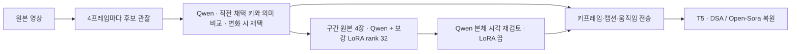

# BSU: LGVSC 기반 의미 영상 전송 모델

LGVSC를 기반으로 **영상의 키프레임·캡션·움직임 정보를 전송하고 생성 모델로 복원**하는 연구 구현입니다. 원본 대비 내용의 추가·누락·왜곡을 줄이는 방법과 그 평가를 연구합니다. 원본 LGVSC 구현과 이 저장소에서 수정한 부분을 구분합니다.

2026-10-09 사용자 지정으로 현재 개발 모델을 **BSU**라고 부릅니다. 과거 `FC-LGVSC` 실험명·코드·산출물 ID는 출처 보존을 위해 유지합니다. [BSU와 LGVSC 내부 블록다이어그램](docs/MODEL_ARCHITECTURE.md#bsu-lgvsc-blocks)

## 현재 기본 구조

2026-10-09부터 `run_qwen35_pairs_video.sh`와 `run_lgvsc_qwen_baseline.sh`의 Qwen 경로는 **의미 변화에 따라 키 개수가 달라지는 순차 선택**을 사용합니다. 과거 고정 키 예산·최대 1초 간격은 이 기본 경로에서 제거했습니다. 새 선택기의 복원 품질 개선은 별도 검증 대상입니다.



- Qwen3.5-9B NF4 본체에 캡션 전용 LoRA를 적용합니다. 후보·재검토에는 어댑터를 끕니다.
- 최종 키프레임 선택은 Qwen 본체의 의미 변화 판정입니다. 처음·끝을 유지하고 중간 키는 판정 결과로 추가합니다. 후보 간격은 관찰 빈도이며 키 간격을 강제하지 않습니다. 이전 InternVL 혼합 경로는 별도 코드·기록으로 보존합니다.
- 수신단은 마지막 17프레임 참조, T5 FP32 조건 캐시, 키프레임 조건 충돌·짧은 구간 시간표 수정을 포함합니다.
- 복원 후 선택형 [`bsu_refine`](docs/RUN_GUIDE.md#bsu-trajectory-cadence) 명령은 추가 전송 없이 움직임을 보정합니다. 기본 모드는 `cadence`이며, 기존 전체 복원 명령에 자동 연결한 상태는 아닙니다.
- GPT6-Astra는 일부 학습 정답·평가 작성에 사용했습니다. 온라인 추론 모델이나 사람 정답으로 표시하지 않습니다.

<a id="status"></a>
<a id="scope"></a>
## 검증 범위와 한계

현황 정리: **2026-10-12**. 희소 궤적·수신 키 합성·움직임 보정을 7원본·28조건에서 시험하고, 이중 윤곽 억제 후속 14조건을 추가 검증했습니다. 시간 보정만 사용하는 `cadence`를 선택형 보정 명령의 기본 모드로 채택했습니다. 영상별 평균 광류 오차 −2.19%·움직임 변화 오차 −8.58%의 이득에 대해 LPIPS +1.03%·DISTS +4.35%의 손실을 수용했습니다. 전체 BSU 명령의 자동 적용·구조 조건 학습·버벅임 완전 해결은 미완료입니다.

| 확인한 범위 | 현재 근거 |
|---|---|
| LoRA 기본 경로 연결 | 7.5초·180프레임, 9키·8캡션 추출과 복원 경로의 캡션 import 완료 |
| 보강 캡션 비교 | 미사용 ClipShots 12원본·24구간에서 기존 LoRA 대비 사실 51→54/83, 동작 17/25·오류 7/24 유지 |
| 기존 FC-LGVSC 복원 | assistant 캡션 조건 4편, 어댑터 없는 Qwen 조건 7.5초 표본의 송수신·복원 완료 |
| 별도 Qwen 사건 쌍 + 보강 캡션 | TVSum 60초 복원·원본 LGVSC 대조 완료; 평균 화질 개선·전송량 31.70% 감소, 독립 의미 검수는 미완료 |
| Zea 항구 전체 복원 | 494프레임·20.58초 완료; 구간 경계의 버벅임 확인, 시간 조건·공동 생성 후보는 비채택 |
| Zea 동일 16초 대조 | 기존 고정 22키 Qwen과 공개 LGVSC 정책의 복원·정량 비교 완료; Qwen의 움직임 오차 증가. 새 가변 개수 선택과 별도 결과 |
| Qwen 의미 변화 순차 선택 | 저동작 2키·보행 4키 선택 검증. 항구 16초 2키 복원·3종 비교 완료; 고정 22키 대비 전송량·큰 화면 변화 감소, 화질 악화. [상세 결과](docs/RESULTS.md#bsu-zea-three-way) |
| 압축 움직임·수신부 학습 후보 | 17조건 복원·평가 완료. 항구 전송량 91,495 유지·PSNR 개선, 질감·움직임 및 저동작 회귀로 비채택. 캡션 효과와 학습 기여도도 분리. [상세 결과](docs/RESULTS.md#bsu-motion-pilot) |
| 키 예산 재배분·구조 앵커 | 6조건 복원·평가 완료. 총전송량 92,472에서 PSNR 15.930→20.128dB, LPIPS 0.35002→0.44075로 악화. 고정 22키 품질 목표 미달·비채택. [상세 결과](docs/RESULTS.md#bsu-structure-anchors) |
| 저주파 구조 주입 후속 | 같은 패킷으로 5조건 완료. 저주파 3조건 PSNR 16.384~17.337·LPIPS 0.38755~0.41522, 강한 보정에서 밝기 번쩍임 확인. 세부·구도 동시 보존 실패로 비채택. [상세 결과](docs/RESULTS.md#bsu-frequency-anchors) |
| 시간축 보정 원인 대조 | 4조건 완료. 연속 0.29009는 희소 0.7 대비 PSNR +0.276dB·광류 오차 −21.9%, LPIPS +0.11%·DISTS +1.49%. 이 손익을 수용해 저주파 보정 개발 기준안으로 선택. 기본 BSU 대비 우수성·최종 목표 달성은 별도. [상세 결과](docs/RESULTS.md#bsu-temporal-support) |
| 7원본 궤적·시간 보정 | 시간 보정은 7편 모두 광류·움직임 변화 오차 감소, 추가 전송 없음. 궤적 합성은 평균 PSNR +1.041dB지만 이중 윤곽으로 연구 옵션 유지. 항구 유료 궤적 후보는 LGVSC 대비 +1.43% 전송. [수치·실패·채택 범위](docs/RESULTS.md#bsu-trajectory-cadence) |
| 아직 입증하지 않은 것 | 새 LoRA 기본 경로의 최종 복원 품질 개선, 넓은 일반화, 독립적인 할루시네이션 완화 |

51→54는 **기존 Astra 정답 LoRA와 보강 LoRA의 고정 4키 비교**입니다. 무학습 Qwen 대비 개선 수치가 아니며 원본 단위 불확실성 구간은 개선 없음도 포함합니다. 선택 정확도·전송량·복원 품질 향상으로 확대하지 않습니다. 실패 사례와 실험별 조건은 [결과](docs/RESULTS.md)에 보존합니다.

과거 사건 쌍·InternVL 혼합 선택의 완료 결과를 새 가변 개수 Qwen 선택의 검증으로 합치지 않습니다. [선택·실행 방식](docs/RUN_GUIDE.md#qwen35-fc)과 [동일 16초 기준선 비교](docs/RUN_GUIDE.md#lgvsc-qwen-16s-baseline)의 입력 대응을 구분합니다. 2026-10-08 정리로 삭제한 비채택 산출물과 보존 자료는 [데이터 문서](docs/DATA.md#artifact-retention)에 구분합니다.

평가 목표는 동일 원본·채널에서 기준선과 제안 방식의 Added/Missing/Distorted, 시간 흐름, 전송량·처리 시간을 비교하는 것입니다. AWGN, 연속 60초 이상 및 저·중·고전환 확장이 연구 범위이며, 목표와 완료 결과를 구분합니다.

**남은 문제:** 희소 궤적과 수신 키 대응 검사를 구현했지만 새 외형·가림·잘못 생성된 자세를 함께 고치지는 못했습니다. 오류 위치의 이미지 앵커·패치 배치와 구조 조건 어댑터 학습이 남습니다. 시간 보정의 일부 정지 악화, 미사용 원본·긴 구간·여러 seed/SNR 검증도 필요합니다. 품질 이득이 있으면 LGVSC보다 소폭 많은 전송을 허용하며 이번 후보의 탐색 상한은 +5%로 정했습니다. 최종 전송량·품질 목표 달성은 미완료입니다. [후보 구조·논문·비용](docs/MODEL_ARCHITECTURE.md#bsu-next-design) · [단계별 상태](docs/RESULTS.md#bsu-progress)

## 시작하기

Linux/WSL2, NVIDIA GPU, Python 3.10, Conda, FFmpeg를 사용합니다. 개발 검증 GPU는 RTX 4080 16GB입니다. 기본 Qwen 로더는 여유 VRAM 12,000MiB 이상을 확인합니다. 입력 크기·프로세스별 할당량은 [실행 안내](docs/RUN_GUIDE.md)에 구분합니다.

```bash
# 독립 Qwen 캡션 환경·고정 revision 모델 준비 (uv 필요)
bash scripts/bootstrap_qwen35.sh
bash scripts/run_qwen35_caption.sh doctor

# 임의의 짧은 영상에서 기본 Qwen 단독 추론 확인
bash scripts/run_qwen35_caption.sh caption \
  --video /absolute/path/input.mp4 --start 0 --end 2 \
  --output outputs/my_caption.json
```

위 단독 점검은 LoRA·InternVL·수신단 전체 실행이 아닙니다. 통합 경로는 [설치·데이터·어댑터 준비 및 실행](docs/RUN_GUIDE.md#public-start)을 따릅니다.

**코드만 clone하면 기존 실험 전체를 바로 재현할 수 있는 상태는 아닙니다.** 데이터·고정 주석·가중치·prepared inventory는 Git에 포함하지 않습니다. 기본 LoRA의 해시·검증 명령과 전달 패키지 절차를 제공하지만 공개 다운로드 URL은 아직 없습니다. 새 장비에서는 경로를 설정하고 새 실행 폴더에서 준비해야 하며 기존 동결 기록의 경로·해시를 덮어쓰지 않습니다.

<a id="documents"></a>
## 공개 문서

| 문서 | 역할 |
|---|---|
| [모델 구조](docs/MODEL_ARCHITECTURE.md) | LGVSC와 변경점, 학습·추론 구조 |
| [실행 안내](docs/RUN_GUIDE.md) | 설치, 가중치, 추론·학습·평가·복구 |
| [데이터](docs/DATA.md) | 확보, 분할, 전처리, 주석, 전달 범위 |
| [평가 지표](docs/METRICS.md) | 계산식, 평가 절차, 집계·판정 한계 |
| [실험 결과](docs/RESULTS.md) | 기준선·ablation·실패 사례·재현 정보 |
| [BSU 전송량·품질 연구안](docs/research/BSU_RATE_QUALITY_IDEAS_2026-10-11.md) | 통합 아이디어, 검증 이력, 남은 연구 후보 |
| [외부 저작물](THIRD_PARTY_NOTICES.md) | LGVSC·외부 모델 출처와 기존 고지 |

## 코드와 인용

- `src/semantic_transmission/`: 추출·학습·송수신·평가 실행기
- `scripts/`, `configs/`, `tests/`, `environment/`: 실행 명령, 설정, 검사, 환경 명세
- `01_data_prep/`–`07_downstream/`: 원본 LGVSC 단계별 구현
- `data/`, `outputs/`, `.local/`: Git에서 제외한 로컬 자료

이 저장소는 [LGVSC 공개 구현](https://github.com/TT2TER/LGVSC)의 파생 연구입니다. [LICENSE](LICENSE)와 [기존 저작물·원본 인용](THIRD_PARTY_NOTICES.md)을 함께 확인합니다. 본 소프트웨어 인용은 [CITATION.cff](CITATION.cff)로 제공하며, 자체 논문의 출판 정보는 아직 등록하지 않았습니다.
