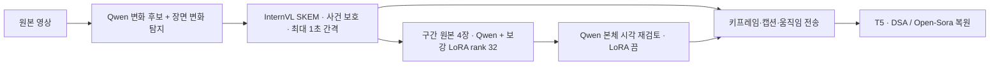

# FC-LGVSC: Faithful Caption-guided Video Semantic Communication

LGVSC를 기반으로 **영상의 키프레임·캡션·움직임 정보를 전송하고 생성 모델로 복원**하는 연구 구현입니다. 원본 대비 내용의 추가·누락·왜곡을 줄이는 방법과 그 평가를 연구합니다. 원본 LGVSC 구현과 이 저장소에서 수정한 부분을 구분합니다.

## 현재 기본 구조



- Qwen3.5-9B NF4 본체에 캡션 전용 LoRA를 적용합니다. 후보·재검토에는 어댑터를 끕니다.
- 최종 키프레임 선택은 InternVL입니다. 단일 Qwen 선택기·공동학습은 별도 실험이며 기본 경로가 아닙니다.
- 수신단은 마지막 17프레임 참조, T5 FP32 조건 캐시, 키프레임 조건 충돌·짧은 구간 시간표 수정을 포함합니다.
- GPT6-Astra는 일부 학습 정답·평가 작성에 사용했습니다. 온라인 추론 모델이나 사람 정답으로 표시하지 않습니다.

<a id="status"></a>
<a id="scope"></a>
## 검증 범위와 한계

| 확인한 범위 | 현재 근거 |
|---|---|
| LoRA 기본 경로 연결 | 7.5초·180프레임, 9키·8캡션 추출과 복원 경로의 캡션 import 완료 |
| 보강 캡션 비교 | 미사용 ClipShots 12원본·24구간에서 기존 LoRA 대비 사실 51→54/83, 동작 17/25·오류 7/24 유지 |
| 기존 FC-LGVSC 복원 | assistant 캡션 조건 4편, 어댑터 없는 Qwen 조건 7.5초 표본의 송수신·복원 완료 |
| 아직 입증하지 않은 것 | 새 LoRA 기본 경로의 최종 복원 품질 개선, 넓은 일반화, 독립적인 할루시네이션 완화 |

51→54는 **기존 Astra 정답 LoRA와 보강 LoRA의 고정 4키 비교**입니다. 무학습 Qwen 대비 개선 수치가 아니며 원본 단위 불확실성 구간은 개선 없음도 포함합니다. 선택 정확도·전송량·복원 품질 향상으로 확대하지 않습니다. 실패 사례와 실험별 조건은 [결과](docs/RESULTS.md)에 보존합니다.

평가 목표는 동일 원본·채널에서 기준선과 제안 방식의 Added/Missing/Distorted, 시간 흐름, 전송량·처리 시간을 비교하는 것입니다. AWGN, 연속 60초 이상 및 저·중·고전환 확장이 연구 범위이며, 목표와 완료 결과를 구분합니다.

## 시작하기

Linux/WSL2, NVIDIA GPU, Python 3.10, Conda, FFmpeg를 사용합니다. 개발 검증 GPU는 RTX 4080 16GB입니다. 기본 Qwen 로더는 여유 VRAM 12,000MiB 이상을 확인합니다. 입력 크기·프로세스별 할당량은 [실행 안내](docs/RUN_GUIDE.md)에 구분합니다.

```bash
# 독립 Qwen 캡션 환경·고정 revision 모델 준비 (uv 필요)
bash scripts/bootstrap_qwen35.sh
bash scripts/run_qwen35_caption.sh doctor

# 임의의 짧은 영상에서 기본 Qwen 단독 추론 확인
bash scripts/run_qwen35_caption.sh caption \
  --video /absolute/path/input.mp4 --start 0 --end 2 \
  --output outputs/my_caption.json
```

위 단독 점검은 LoRA·InternVL·수신단 전체 실행이 아닙니다. 통합 경로는 [설치·데이터·어댑터 준비 및 실행](docs/RUN_GUIDE.md#public-start)을 따릅니다.

**코드만 clone하면 기존 실험 전체를 바로 재현할 수 있는 상태는 아닙니다.** 데이터·고정 주석·가중치·prepared inventory는 Git에 포함하지 않습니다. 기본 LoRA의 해시·검증 명령과 전달 패키지 절차를 제공하지만 공개 다운로드 URL은 아직 없습니다. 새 장비에서는 경로를 설정하고 새 실행 폴더에서 준비해야 하며 기존 동결 기록의 경로·해시를 덮어쓰지 않습니다.

<a id="documents"></a>
## 공개 문서

| 문서 | 역할 |
|---|---|
| [모델 구조](docs/MODEL_ARCHITECTURE.md) | LGVSC와 변경점, 학습·추론 구조 |
| [실행 안내](docs/RUN_GUIDE.md) | 설치, 가중치, 추론·학습·평가·복구 |
| [데이터](docs/DATA.md) | 확보, 분할, 전처리, 주석, 전달 범위 |
| [평가 지표](docs/METRICS.md) | 계산식, 평가 절차, 집계·판정 한계 |
| [실험 결과](docs/RESULTS.md) | 기준선·ablation·실패 사례·재현 정보 |
| [외부 저작물](THIRD_PARTY_NOTICES.md) | LGVSC·외부 모델 출처와 기존 고지 |

## 코드와 인용

- `src/semantic_transmission/`: 추출·학습·송수신·평가 실행기
- `scripts/`, `configs/`, `tests/`, `environment/`: 실행 명령, 설정, 검사, 환경 명세
- `01_data_prep/`–`07_downstream/`: 원본 LGVSC 단계별 구현
- `data/`, `outputs/`, `.local/`: Git에서 제외한 로컬 자료

이 저장소는 [LGVSC 공개 구현](https://github.com/TT2TER/LGVSC)의 파생 연구입니다. [LICENSE](LICENSE)와 [기존 저작물·원본 인용](THIRD_PARTY_NOTICES.md)을 함께 확인합니다. 본 소프트웨어 인용은 [CITATION.cff](CITATION.cff)로 제공하며, 자체 논문의 출판 정보는 아직 등록하지 않았습니다.
