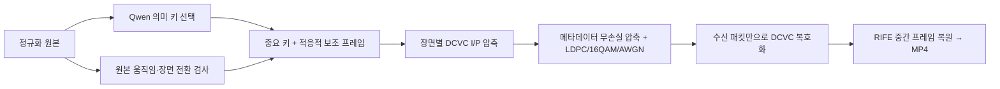

# SPARC: Semantic Predictive Adaptive Reference Codec

**SPARC**는 중요한 의미 키프레임과 복원에 필요한 보조 프레임을 선택하고, **DCVC-RT 예측 압축 → LDPC/16QAM/AWGN → RIFE4.25 복원**을 수행하는 영상 전송 모델입니다. 모델명과 브랜치명은 `SPARC`입니다. BSU-Gen의 Qwen 의미 변화 선택기를 재사용하며, 선택한 프레임 사이의 시간 중복은 DCVC로 압축합니다. 새 학습 없이 고정 사전 학습 가중치를 사용합니다.

## 현재 기본 구조



- Qwen은 4프레임 간격 후보에서 의미 변화를 판단하며, 선택한 키와 양끝은 모두 보존합니다.
- 보조 프레임은 최대 4프레임 간격과 저해상도 원본 움직임 지표로 추가합니다. 이 지표는 실제 RIFE 화질 점수가 아닙니다.
- 검출한 장면 전환의 양쪽 프레임을 보내며, 새 장면의 첫 프레임만 I 프레임으로 초기화합니다. 나머지는 이전 복원 특징을 참조하는 P 프레임입니다.
- 원본은 송신 선택·압축과 별도 평가에만 사용합니다. 수신기는 전달된 패킷과 고정 모델만 사용합니다.
- 기본값은 QP32·AWGN 10dB·seed42입니다. 헤더·CRC·LDPC 패딩/패리티를 포함한 실제 복소 채널 사용량을 기록합니다.
- **압축된 디지털 비트스트림을 보내는 구조입니다.** 예측 latent의 직접 JSCC 전송 모델은 아닙니다.

```bash
bash scripts/run_sparc.sh profile
bash scripts/run_sparc.sh check --video /absolute/path/input.mp4 --output outputs/sparc_video
bash scripts/run_sparc.sh run --video /absolute/path/input.mp4 --output outputs/sparc_video
bash scripts/run_sparc.sh status --output outputs/sparc_video
```

`run_bsu.sh`도 이 브랜치에서는 SPARC를 실행합니다. 기존 모델은 `run_bsu_gen.sh`, `run_bsu_predict.sh`, `run_bsu_hybrid.sh`로 유지합니다. [실행·재개·대조 실험](docs/RUN_GUIDE.md#sparc) · [구조](docs/MODEL_ARCHITECTURE.md#sparc)

<a id="status"></a>
<a id="scope"></a>
## 검증 범위와 한계

원격 RTX 4080에서 001 영상의 240프레임과 두 대조 조건 복원·평가를 완료했고, 로컬·원격 테스트 각각 138개가 통과했습니다. 현재 기본값은 간격2 대조보다 PSNR 25.73→26.78dB, 채널 사용량 566,784→730,368(+28.86%)였습니다. **전송량 절감 목표는 아직 달성하지 못했습니다.**

키 수 감소만으로 같은 화질이나 의미 보존을 보장하지 않습니다. 같은 원본·조건에서 **적응 선택, 동일 개수의 균등 선택, 기존 간격2 선택**을 비교합니다. 최종 MP4 화질과 실제 전송량을 함께 기록하고, 독립 행동·의미 검수는 별도로 구분합니다. [SPARC 검증 결과](docs/RESULTS.md#sparc)

**희소 궤적 후속 실험:** 같은 001 영상의 31키·30구간 궤적을 재사용해 보조 프레임을 궤적 정보로 대체했습니다. 키만 전송하면 214,272 uses·19.003dB, 궤적을 추가하면 232,704 uses·19.323dB였습니다. 정확히 같은 전송량에서 보조 프레임 4장 추가는 20.037dB로 더 좋았습니다. 기존 160장보다 전송은 줄지만 품질 손실이 커 기본값으로 채택하지 않았습니다. [실험 결과·한계](docs/RESULTS.md#sparc-motion) · [별도 실행](docs/RUN_GUIDE.md#sparc-motion)

**보조 프레임 선택 후속 실험:** 원래 160장 구성에서 제거·이동 후보를 실제 재압축·복원해 평가했습니다. 001의 의미 키 31장을 유지하며 보조 프레임 3장을 제거해 전송량 1.26%를 줄였고, PSNR은 26.783→26.693dB였습니다. 한 영상에서 사전 품질 허용 범위를 통과한 제한된 탐색 결과입니다. [결과](docs/RESULTS.md#sparc-auxiliary-search) · [실행](docs/RUN_GUIDE.md#sparc-auxiliary-search)

아래는 이전 BSU/LGVSC 연구 이력입니다. SPARC의 새 결과로 인용하지 않습니다.

10월 16일의 14편·3,333프레임 비교는 **예측 8편 + 생성 6편의 혼합 BSU** 결과입니다. 전송 2,470,155·PSNR 26.305dB·LPIPS 0.23462를 예측 전용 모델의 수치로 사용할 수 없습니다. 적응형 간격+QP의 추가 1.12% 절감도 당시 혼합 모델 기준입니다. [이전 모델의 결과와 증거](docs/RESULTS.md#bsu-predictive-default)

아래 표는 이전 구성 요소의 검증 이력입니다.

| 확인한 범위 | 현재 근거 |
|---|---|
| LoRA 기본 경로 연결 | 7.5초·180프레임, 9키·8캡션 추출과 복원 경로의 캡션 import 완료 |
| 보강 캡션 비교 | 미사용 ClipShots 12원본·24구간에서 기존 LoRA 대비 사실 51→54/83, 동작 17/25·오류 7/24 유지 |
| 기존 FC-LGVSC 복원 | assistant 캡션 조건 4편, 어댑터 없는 Qwen 조건 7.5초 표본의 송수신·복원 완료 |
| 별도 Qwen 사건 쌍 + 보강 캡션 | TVSum 60초 복원·원본 LGVSC 대조 완료; 평균 화질 개선·전송량 31.70% 감소, 독립 의미 검수는 미완료 |
| Zea 항구 전체 복원 | 494프레임·20.58초 완료; 구간 경계의 버벅임 확인, 시간 조건·공동 생성 후보는 비채택 |
| Zea 동일 16초 대조 | 기존 고정 22키 Qwen과 공개 LGVSC 정책의 복원·정량 비교 완료; Qwen의 움직임 오차 증가. 새 가변 개수 선택과 별도 결과 |
| Qwen 의미 변화 순차 선택 | 저동작 2키·보행 4키 선택 검증. 항구 16초 2키 복원·3종 비교 완료; 고정 22키 대비 전송량·큰 화면 변화 감소, 화질 악화. [상세 결과](docs/RESULTS.md#bsu-zea-three-way) |
| 압축 움직임·수신부 학습 후보 | 17조건 복원·평가 완료. 항구 전송량 91,495 유지·PSNR 개선, 질감·움직임 및 저동작 회귀로 비채택. 캡션 효과와 학습 기여도도 분리. [상세 결과](docs/RESULTS.md#bsu-motion-pilot) |
| 키 예산 재배분·구조 앵커 | 6조건 복원·평가 완료. 총전송량 92,472에서 PSNR 15.930→20.128dB, LPIPS 0.35002→0.44075로 악화. 고정 22키 품질 목표 미달·비채택. [상세 결과](docs/RESULTS.md#bsu-structure-anchors) |
| 저주파 구조 주입 후속 | 같은 패킷으로 5조건 완료. 저주파 3조건 PSNR 16.384~17.337·LPIPS 0.38755~0.41522, 강한 보정에서 밝기 번쩍임 확인. 세부·구도 동시 보존 실패로 비채택. [상세 결과](docs/RESULTS.md#bsu-frequency-anchors) |
| 시간축 보정 원인 대조 | 4조건 완료. 연속 0.29009는 희소 0.7 대비 PSNR +0.276dB·광류 오차 −21.9%, LPIPS +0.11%·DISTS +1.49%. 이 손익을 수용해 저주파 보정 개발 기준안으로 선택. 기본 BSU 대비 우수성·최종 목표 달성은 별도. [상세 결과](docs/RESULTS.md#bsu-temporal-support) |
| 7원본 궤적·시간 보정 | 시간 보정은 7편 모두 광류·움직임 변화 오차 감소, 추가 전송 없음. 궤적 합성은 평균 PSNR +1.041dB지만 이중 윤곽으로 연구 옵션 유지. 항구 유료 궤적 후보는 LGVSC 대비 +1.43% 전송. [수치·실패·채택 범위](docs/RESULTS.md#bsu-trajectory-cadence) |
| 아직 입증하지 않은 것 | 새 LoRA 기본 경로의 최종 복원 품질 개선, 넓은 일반화, 독립적인 할루시네이션 완화 |

51→54는 **기존 Astra 정답 LoRA와 보강 LoRA의 고정 4키 비교**입니다. 무학습 Qwen 대비 개선 수치가 아니며 원본 단위 불확실성 구간은 개선 없음도 포함합니다. 선택 정확도·전송량·복원 품질 향상으로 확대하지 않습니다. 실패 사례와 실험별 조건은 [결과](docs/RESULTS.md)에 보존합니다.

과거 사건 쌍·InternVL 혼합 선택의 완료 결과를 새 가변 개수 Qwen 선택의 검증으로 합치지 않습니다. [선택·실행 방식](docs/RUN_GUIDE.md#qwen35-fc)과 [동일 16초 기준선 비교](docs/RUN_GUIDE.md#lgvsc-qwen-16s-baseline)의 입력 대응을 구분합니다. 2026-10-08 정리로 삭제한 비채택 산출물과 보존 자료는 [데이터 문서](docs/DATA.md#artifact-retention)에 구분합니다.

평가 목표는 동일 원본·채널에서 기준선과 제안 방식의 Added/Missing/Distorted, 시간 흐름, 전송량·처리 시간을 비교하는 것입니다. AWGN, 연속 60초 이상 및 저·중·고전환 확장이 연구 범위이며, 목표와 완료 결과를 구분합니다.

**남은 문제:** BSU-Gen의 동일 예산 성능·미사용 원본·긴 영상·고전환·가림·작은 객체·독립 의미 오류 검증이 남아 있습니다. LGVSC 대비 전송량 +75.5%는 과거 혼합 모델 결과이며 이 모델의 측정값이 아닙니다. [후속 후보](docs/research/BSU_RATE_QUALITY_IDEAS_2026-10-11.md) · [단계별 상태](docs/RESULTS.md#bsu-progress)

## 시작하기

Linux/WSL2, NVIDIA GPU, Python 3.10, Conda, FFmpeg를 사용합니다. 개발 검증 GPU는 RTX 4080 16GB입니다. 기본 Qwen 로더는 여유 VRAM 12,000MiB 이상을 확인합니다. 입력 크기·프로세스별 할당량은 [실행 안내](docs/RUN_GUIDE.md)에 구분합니다.

```bash
# 독립 Qwen 캡션 환경·고정 revision 모델 준비 (uv 필요)
bash scripts/bootstrap_qwen35.sh
bash scripts/run_qwen35_caption.sh doctor

# 임의의 짧은 영상에서 기본 Qwen 단독 추론 확인
bash scripts/run_qwen35_caption.sh caption \
  --video /absolute/path/input.mp4 --start 0 --end 2 \
  --output outputs/my_caption.json
```

위 단독 점검은 수신단 전체 실행이 아닙니다. SPARC는 [전용 실행 안내](docs/RUN_GUIDE.md#sparc)를 따릅니다. 이전 BSU-Gen 실행은 [생성 전용 명령](docs/RUN_GUIDE.md#bsu-gen), 모델·어댑터 준비는 [설치·데이터·어댑터 준비 및 실행](docs/RUN_GUIDE.md#public-start)을 따릅니다.

**코드만 clone하면 기존 실험 전체를 바로 재현할 수 있는 상태는 아닙니다.** 데이터·고정 주석·가중치·prepared inventory는 Git에 포함하지 않습니다. 기본 LoRA의 해시·검증 명령과 전달 패키지 절차를 제공하지만 공개 다운로드 URL은 아직 없습니다. 새 장비에서는 경로를 설정하고 새 실행 폴더에서 준비해야 하며 기존 동결 기록의 경로·해시를 덮어쓰지 않습니다.

<a id="documents"></a>
## 공개 문서

| 문서 | 역할 |
|---|---|
| [모델 구조](docs/MODEL_ARCHITECTURE.md) | LGVSC와 변경점, 학습·추론 구조 |
| [실행 안내](docs/RUN_GUIDE.md) | 설치, 가중치, 추론·학습·평가·복구 |
| [데이터](docs/DATA.md) | 확보, 분할, 전처리, 주석, 전달 범위 |
| [평가 지표](docs/METRICS.md) | 계산식, 평가 절차, 집계·판정 한계 |
| [실험 결과](docs/RESULTS.md) | 기준선·ablation·실패 사례·재현 정보 |
| [BSU 전송량·품질 연구안](docs/research/BSU_RATE_QUALITY_IDEAS_2026-10-11.md) | 통합 아이디어, 검증 이력, 남은 연구 후보 |
| [외부 저작물](THIRD_PARTY_NOTICES.md) | LGVSC·외부 모델 출처와 기존 고지 |

## 코드와 인용

- `src/semantic_transmission/`: 추출·학습·송수신·평가 실행기
- `scripts/`, `configs/`, `tests/`, `environment/`: 실행 명령, 설정, 검사, 환경 명세
- `01_data_prep/`–`07_downstream/`: 원본 LGVSC 단계별 구현
- `data/`, `outputs/`, `.local/`: Git에서 제외한 로컬 자료

이 저장소는 [LGVSC 공개 구현](https://github.com/TT2TER/LGVSC)의 파생 연구입니다. [LICENSE](LICENSE)와 [기존 저작물·원본 인용](THIRD_PARTY_NOTICES.md)을 함께 확인합니다. 본 소프트웨어 인용은 [CITATION.cff](CITATION.cff)로 제공하며, 자체 논문의 출판 정보는 아직 등록하지 않았습니다.
