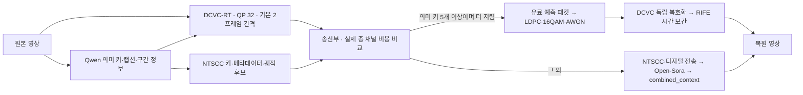

# BSU: LGVSC 기반 의미 영상 전송 모델

LGVSC에서 출발해 **의미 키·캡션과 예측 압축 정보를 이용해 영상을 전송·복원**하는 연구 구현입니다. 현재 기본 BSU는 **DCVC-RT + Practical-RIFE4.25와 `combined_context` 대체 경로를 결합한 모델**입니다. 원본 LGVSC 구현과 이 저장소에서 수정한 부분을 구분합니다.

2026-10-16 사용자 요청으로 아래 검증 프로필을 기본 채택했습니다. 과거 `FC-LGVSC`·`combined_context` 실험명과 동결 산출물은 그대로 유지합니다.

## 현재 기본 구조

기본 명령은 [`bash scripts/run_bsu.sh`](docs/RUN_GUIDE.md#bsu-default)입니다. 기존 Qwen 의미 선택·캡션 산출물과 정규화 원본 PNG를 입력으로 사용합니다. **QP 32·2프레임 간격·의미 키 최소 5개**를 고정하며, 추가로 시험한 적응형 간격·QP 탐색은 기본에 포함하지 않습니다.



- 처음·끝·급격한 화면 변화 양쪽 프레임을 보존합니다. Qwen 의미 키와 DCVC 전송 시점은 서로 다른 역할입니다.
- 경로 선택은 키 개수와 직렬화·오류정정까지 포함한 실제 비용으로 결정합니다. 화질 정답이나 행동 라벨로 경로를 고르지 않습니다.
- 신경 압축 경로는 최초 참조 영상과 이후 예측 특성을 전송하며, 수신부는 받은 패킷과 고정 가중치만 사용합니다. 캡션·구간 정보도 유료 패킷에 포함하지만 DCVC/RIFE 자체는 텍스트 조건을 사용하지 않습니다.
- `combined_context` 경로는 Qwen 의미 선택·고정 캡션 LoRA, NTSCC 키, Open-Sora와 궤적·시간·구간 연결 보정을 유지합니다. 새 생성 어댑터 학습은 기본 모델에 포함하지 않습니다.
- 이전 [`run_bsu_webvid.sh`](docs/RUN_GUIDE.md#bsu-webvid-benchmark)와 [`run_bsu_kinetics.sh`](docs/RUN_GUIDE.md#bsu-kinetics-benchmark)는 기존 `combined_context` 배치의 생성·재개 명령입니다. 기본 하이브리드 모델 명령과 구분합니다.
- LGVSC 대조는 [`run_lgvsc_kinetics.sh`](docs/RUN_GUIDE.md#lgvsc-kinetics-matched)로 보존합니다. 공통 실행 보정이 포함된 로컬 비교이며 논문 원본 수치의 정확한 재현으로 표시하지 않습니다.

<a id="status"></a>
<a id="scope"></a>
## 검증 범위와 한계

현황 정리: **2026-10-16**. 동일 Kinetics-400 개발 영상 **14편·3,333프레임·576×320·24fps·AWGN 10dB**에서 기본 BSU는 **2,470,155 복소 채널 사용량**으로 이전 BSU보다 **43.76% 절감**했습니다. LGVSC의 1,407,617 대비 **1.75배**이며 PSNR 26.305dB, LPIPS 0.23462, 행동 Top-1 12/14·Top-5 14/14입니다. 영상별 화질·동작 허용 기준은 14/14 통과했습니다. [세 모델 비교와 증거](docs/RESULTS.md#bsu-predictive-default)

적응형 간격+QP 후보는 이 기본 모델에서 추가 1.12%를 줄였지만 시험 인코딩·복원 비용에 비해 이득이 작아 **연구 옵션으로 유지**합니다. 위 결과는 이미 관찰한 개발 자료의 비교이며 전체 Kinetics-400·미사용 영상·연속 60초·독립 의미 오류 평가를 입증하지 않습니다. 아래 표는 이전 구성 요소의 검증 이력입니다.

`feat/bsu-unified`의 [통합 BSU 송신 학습 확장](docs/RESULTS.md#bsu-unified-sender)은
학습형 보완 토큰·시간 차분 부호화·중요도 맵과 생성 조건 어댑터의 공동 학습을 구현했습니다.
200회 코덱 사전학습과 3회 공동 학습·재개를 확인했으며 본학습은 아직 시작하지 않았습니다.
피아노·골프 각 17프레임의 개발 검증에서는 **동일 품질에서 전송량 감소를 입증하지 못했습니다.**
연구 프로필과 [본학습 명령](docs/RUN_GUIDE.md#bsu-unified-sender)을 제공하며 기본 모델로 채택하지 않습니다.

| 확인한 범위 | 현재 근거 |
|---|---|
| LoRA 기본 경로 연결 | 7.5초·180프레임, 9키·8캡션 추출과 복원 경로의 캡션 import 완료 |
| 보강 캡션 비교 | 미사용 ClipShots 12원본·24구간에서 기존 LoRA 대비 사실 51→54/83, 동작 17/25·오류 7/24 유지 |
| 기존 FC-LGVSC 복원 | assistant 캡션 조건 4편, 어댑터 없는 Qwen 조건 7.5초 표본의 송수신·복원 완료 |
| 별도 Qwen 사건 쌍 + 보강 캡션 | TVSum 60초 복원·원본 LGVSC 대조 완료; 평균 화질 개선·전송량 31.70% 감소, 독립 의미 검수는 미완료 |
| Zea 항구 전체 복원 | 494프레임·20.58초 완료; 구간 경계의 버벅임 확인, 시간 조건·공동 생성 후보는 비채택 |
| Zea 동일 16초 대조 | 기존 고정 22키 Qwen과 공개 LGVSC 정책의 복원·정량 비교 완료; Qwen의 움직임 오차 증가. 새 가변 개수 선택과 별도 결과 |
| Qwen 의미 변화 순차 선택 | 저동작 2키·보행 4키 선택 검증. 항구 16초 2키 복원·3종 비교 완료; 고정 22키 대비 전송량·큰 화면 변화 감소, 화질 악화. [상세 결과](docs/RESULTS.md#bsu-zea-three-way) |
| 압축 움직임·수신부 학습 후보 | 17조건 복원·평가 완료. 항구 전송량 91,495 유지·PSNR 개선, 질감·움직임 및 저동작 회귀로 비채택. 캡션 효과와 학습 기여도도 분리. [상세 결과](docs/RESULTS.md#bsu-motion-pilot) |
| 키 예산 재배분·구조 앵커 | 6조건 복원·평가 완료. 총전송량 92,472에서 PSNR 15.930→20.128dB, LPIPS 0.35002→0.44075로 악화. 고정 22키 품질 목표 미달·비채택. [상세 결과](docs/RESULTS.md#bsu-structure-anchors) |
| 저주파 구조 주입 후속 | 같은 패킷으로 5조건 완료. 저주파 3조건 PSNR 16.384~17.337·LPIPS 0.38755~0.41522, 강한 보정에서 밝기 번쩍임 확인. 세부·구도 동시 보존 실패로 비채택. [상세 결과](docs/RESULTS.md#bsu-frequency-anchors) |
| 시간축 보정 원인 대조 | 4조건 완료. 연속 0.29009는 희소 0.7 대비 PSNR +0.276dB·광류 오차 −21.9%, LPIPS +0.11%·DISTS +1.49%. 이 손익을 수용해 저주파 보정 개발 기준안으로 선택. 기본 BSU 대비 우수성·최종 목표 달성은 별도. [상세 결과](docs/RESULTS.md#bsu-temporal-support) |
| 7원본 궤적·시간 보정 | 시간 보정은 7편 모두 광류·움직임 변화 오차 감소, 추가 전송 없음. 궤적 합성은 평균 PSNR +1.041dB지만 이중 윤곽으로 연구 옵션 유지. 항구 유료 궤적 후보는 LGVSC 대비 +1.43% 전송. [수치·실패·채택 범위](docs/RESULTS.md#bsu-trajectory-cadence) |
| 아직 입증하지 않은 것 | 새 LoRA 기본 경로의 최종 복원 품질 개선, 넓은 일반화, 독립적인 할루시네이션 완화 |

51→54는 **기존 Astra 정답 LoRA와 보강 LoRA의 고정 4키 비교**입니다. 무학습 Qwen 대비 개선 수치가 아니며 원본 단위 불확실성 구간은 개선 없음도 포함합니다. 선택 정확도·전송량·복원 품질 향상으로 확대하지 않습니다. 실패 사례와 실험별 조건은 [결과](docs/RESULTS.md)에 보존합니다.

과거 사건 쌍·InternVL 혼합 선택의 완료 결과를 새 가변 개수 Qwen 선택의 검증으로 합치지 않습니다. [선택·실행 방식](docs/RUN_GUIDE.md#qwen35-fc)과 [동일 16초 기준선 비교](docs/RUN_GUIDE.md#lgvsc-qwen-16s-baseline)의 입력 대응을 구분합니다. 2026-10-08 정리로 삭제한 비채택 산출물과 보존 자료는 [데이터 문서](docs/DATA.md#artifact-retention)에 구분합니다.

평가 목표는 동일 원본·채널에서 기준선과 제안 방식의 Added/Missing/Distorted, 시간 흐름, 전송량·처리 시간을 비교하는 것입니다. AWGN, 연속 60초 이상 및 저·중·고전환 확장이 연구 범위이며, 목표와 완료 결과를 구분합니다.

**남은 문제:** 기본 BSU의 전송량은 아직 LGVSC보다 75.5% 많습니다. 고전환·가림·작은 객체에서의 손실, 대체 생성 경로의 내용·동작 오류, 미사용 원본·긴 영상·다른 SNR 검증이 남아 있습니다. 과거 궤적 실험의 +5% 탐색 상한을 이번 모델이 달성했다고 표시하지 않습니다. [후속 후보](docs/research/BSU_RATE_QUALITY_IDEAS_2026-10-11.md) · [단계별 상태](docs/RESULTS.md#bsu-progress)

## 시작하기

Linux/WSL2, NVIDIA GPU, Python 3.10, Conda, FFmpeg를 사용합니다. 개발 검증 GPU는 RTX 4080 16GB입니다. 기본 Qwen 로더는 여유 VRAM 12,000MiB 이상을 확인합니다. 입력 크기·프로세스별 할당량은 [실행 안내](docs/RUN_GUIDE.md)에 구분합니다.

```bash
# 독립 Qwen 캡션 환경·고정 revision 모델 준비 (uv 필요)
bash scripts/bootstrap_qwen35.sh
bash scripts/run_qwen35_caption.sh doctor

# 임의의 짧은 영상에서 기본 Qwen 단독 추론 확인
bash scripts/run_qwen35_caption.sh caption \
  --video /absolute/path/input.mp4 --start 0 --end 2 \
  --output outputs/my_caption.json
```

위 단독 점검은 LoRA·InternVL·수신단 전체 실행이 아닙니다. 기본 하이브리드 실행은 [BSU 기본 명령](docs/RUN_GUIDE.md#bsu-default), 의미 입력 준비는 [설치·데이터·어댑터 준비 및 실행](docs/RUN_GUIDE.md#public-start)을 따릅니다.

**코드만 clone하면 기존 실험 전체를 바로 재현할 수 있는 상태는 아닙니다.** 데이터·고정 주석·가중치·prepared inventory는 Git에 포함하지 않습니다. 기본 LoRA의 해시·검증 명령과 전달 패키지 절차를 제공하지만 공개 다운로드 URL은 아직 없습니다. 새 장비에서는 경로를 설정하고 새 실행 폴더에서 준비해야 하며 기존 동결 기록의 경로·해시를 덮어쓰지 않습니다.

<a id="documents"></a>
## 공개 문서

| 문서 | 역할 |
|---|---|
| [모델 구조](docs/MODEL_ARCHITECTURE.md) | LGVSC와 변경점, 학습·추론 구조 |
| [실행 안내](docs/RUN_GUIDE.md) | 설치, 가중치, 추론·학습·평가·복구 |
| [데이터](docs/DATA.md) | 확보, 분할, 전처리, 주석, 전달 범위 |
| [평가 지표](docs/METRICS.md) | 계산식, 평가 절차, 집계·판정 한계 |
| [실험 결과](docs/RESULTS.md) | 기준선·ablation·실패 사례·재현 정보 |
| [BSU 전송량·품질 연구안](docs/research/BSU_RATE_QUALITY_IDEAS_2026-10-11.md) | 통합 아이디어, 검증 이력, 남은 연구 후보 |
| [외부 저작물](THIRD_PARTY_NOTICES.md) | LGVSC·외부 모델 출처와 기존 고지 |

## 코드와 인용

- `src/semantic_transmission/`: 추출·학습·송수신·평가 실행기
- `scripts/`, `configs/`, `tests/`, `environment/`: 실행 명령, 설정, 검사, 환경 명세
- `01_data_prep/`–`07_downstream/`: 원본 LGVSC 단계별 구현
- `data/`, `outputs/`, `.local/`: Git에서 제외한 로컬 자료

이 저장소는 [LGVSC 공개 구현](https://github.com/TT2TER/LGVSC)의 파생 연구입니다. [LICENSE](LICENSE)와 [기존 저작물·원본 인용](THIRD_PARTY_NOTICES.md)을 함께 확인합니다. 본 소프트웨어 인용은 [CITATION.cff](CITATION.cff)로 제공하며, 자체 논문의 출판 정보는 아직 등록하지 않았습니다.
