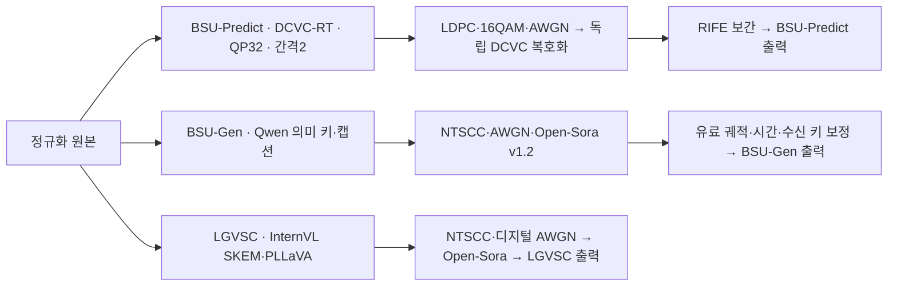
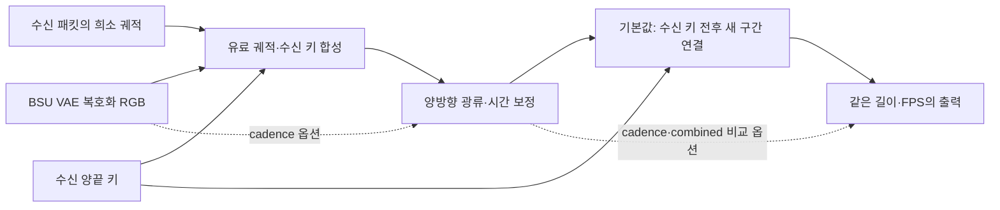
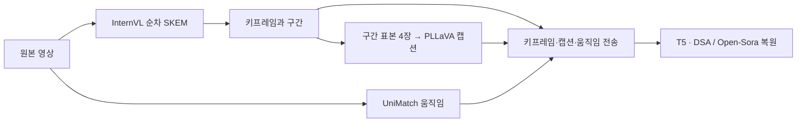
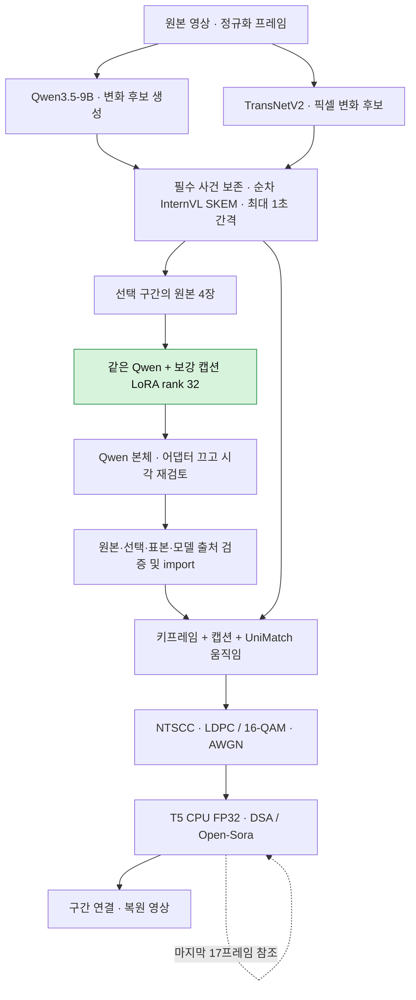
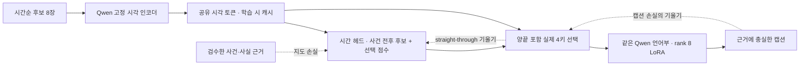
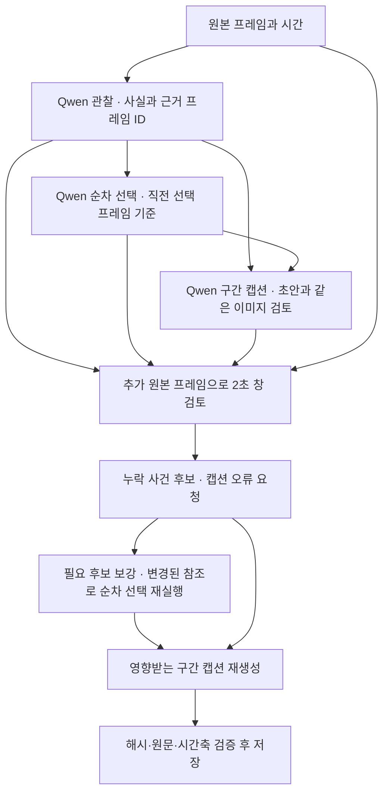
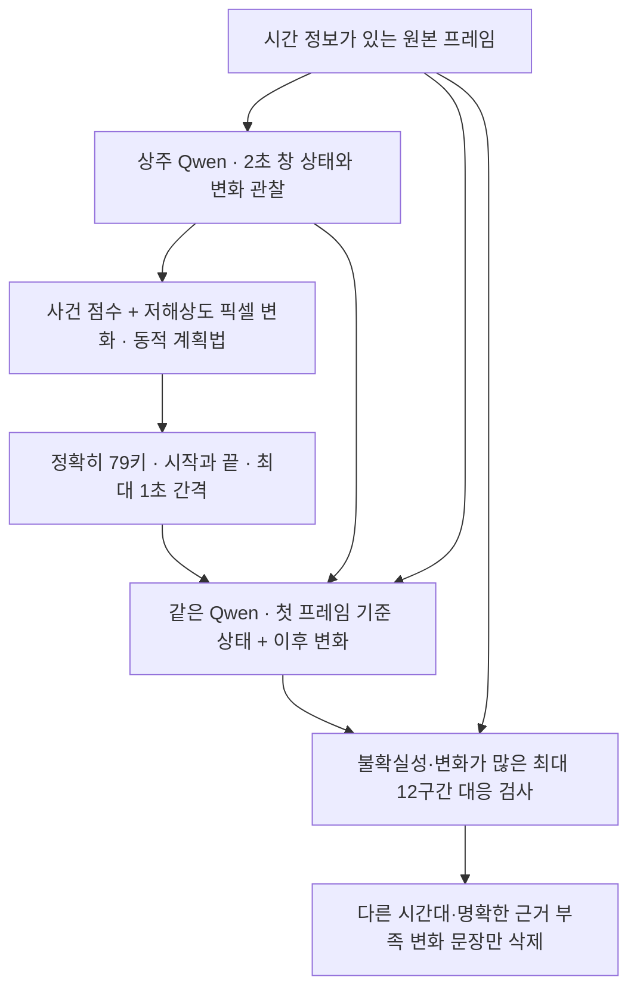
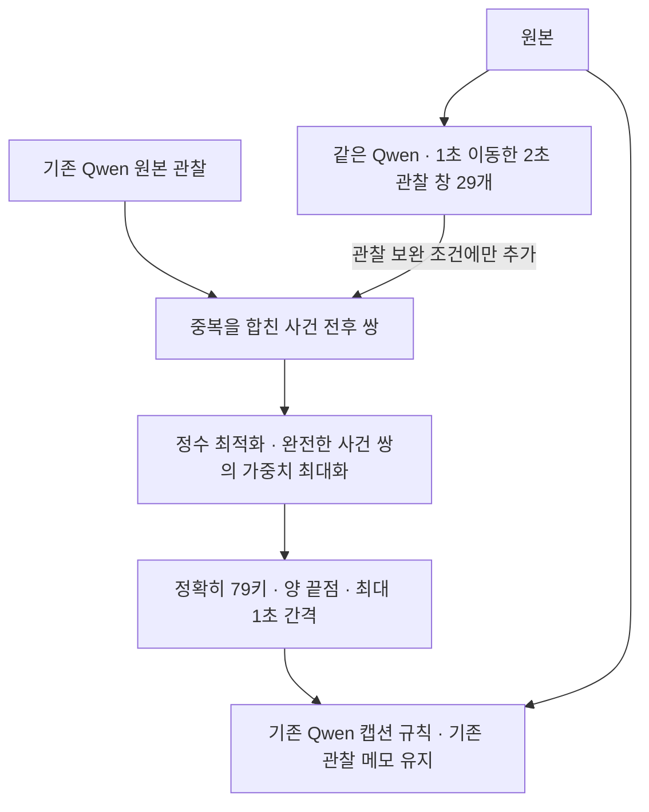

# 모델 구조

<a id="sparc"></a>
## SPARC — 의미 키와 적응적 참조 프레임의 예측 압축

현재 `SPARC` 브랜치의 기본 모델이다. [프로필](../configs/sparc.json) · [실행기](../src/semantic_transmission/sparc.py) · [실행](RUN_GUIDE.md#sparc).

송신기는 BSU-Gen과 동일한 `qwen35_sequential_semantic_v1`을 사용한다. Qwen3.5-9B NF4가 가장 최근에 채택한 원본과 다음 후보를 비교한다. 후보 간격은 4이며 고정 의미 키 예산은 없다. 불확실한 판정은 재검토하고, 여전히 불확실하면 중단한다. 캡션 LoRA·LTX·Open-Sora는 호출하지 않는다. 실제 모델 응답과 검증 기록을 저장하며 재개 시 소스 해시·프롬프트·모델 출처가 일치하는 호출만 재사용한다. 설명 길이 제한을 반복 위반하면 실제 검증 오류와 각 설명 16단어 제한을 전달해 한 번의 제한된 재시도 묶음을 수행한다. 원문·실패는 보존하고 의미 판정을 임의로 고치지 않는다.

[`sparc_selection.py`](../src/semantic_transmission/sparc_selection.py)는 의미 키와 양끝, 검출한 장면 전환 양쪽을 보존한다. 구간이 4프레임보다 길면 분할하고, 64×36 RGB 원본을 양끝의 선형 보간과 비교한 MAE가 6/255를 넘으면 오차가 큰 시점을 추가한다. 수신 출력이나 평가 점수는 사용하지 않는다. 인접 원본 RGB의 평균 절대 차이가 40/255를 넘으면 장면 전환 후보로 취급한다. 두 임계값은 초기 고정 휴리스틱이며 학습되거나 보편적 안전성이 검증된 기준은 아니다.

선택한 프레임을 장면별로 시간순 DCVC-RT 부호화한다. 각 장면의 첫 프레임은 I, 나머지는 P이며 양쪽에서 이전 복원 특징을 참조한다. 의미 키라는 이유만으로 모두 I 프레임으로 바꾸지 않는다. 외부 DCVC 연산·가중치는 기존 `predictive_codec.Codec`와 동일하다. 장면별로 참조 상태를 초기화해 이전 장면에 의존하지 않는다.

[`sparc_transport.py`](../src/semantic_transmission/sparc_transport.py)의 단일 패킷은 영상 시간표·크기·FPS·고정 모델 식별자·앵커 시점·장면별 스트림 경계와 DCVC 비트스트림을 담는다. 헤더 부분만 zlib 무손실 압축하며 DCVC 바이트는 그대로 둔다. 전체 패킷을 실제 LDPC(6144,9216)·16QAM·AWGN 10dB로 보내고 CRC/비트 오류를 확인한다. 캡션, 선택기 사유, 원본 특징은 수신 조건에 포함하지 않는다.

독립 수신 프로세스가 받은 패킷으로 DCVC 앵커를 복호화한다. RIFE4.25는 전달된 시점으로 `(현재 시점-왼쪽 앵커)/(오른쪽 앵커-왼쪽 앵커)`의 비율을 사용해 간격 2~4의 중간 프레임을 복원한다. 장면 전환 양쪽은 인접한 앵커이므로 전환을 가로질러 보간하지 않는다. PNG 단계의 앵커 보존과 최종 MP4의 전체 프레임 수·FPS·크기를 검사한다. MP4 재압축 뒤의 픽셀 동일성을 주장하지 않는다.

`uniform-matched`는 동일한 검출 장면 전환과 최대 간격을 지키며 적응 선택과 정확히 같은 개수를 시간적으로 배분한다. 의미 키 보존을 강제하지 않아 선택 위치의 효과를 비교할 수 있다. `fixed-stride2`는 기존 2프레임 간격 앵커 정책의 대조이며 SPARC의 동일 장면 초기화·메타데이터 형식을 사용한다. 세 조건은 같은 QP·모델·채널·RIFE 실행 설정을 사용하지만 실제 전송량은 다를 수 있다.

<a id="sparc-motion"></a>
### 의미 키 + 희소 궤적·가시성 실험

[`sparc_motion.py`](../src/semantic_transmission/sparc_motion.py)는 기본 모델과 분리된 무학습 실험이다. 송신기는 같은 원본·키 시점에서 추출한 Qwen 선택과 과거 양방향 추적점 캐시를 검증해 재사용한다. 의미 키만 시간순 DCVC I/P 압축하고, 별도 패킷에 구간 시작·끝, 288×160 좌표계의 1/4픽셀 위치, 시간 knot, 양끝 추적 방향, 추적점 유효성 비트를 담는다. 표현을 줄일 때는 기존 추적점과 knot만 선택하며 원본 추적을 다시 실행하지 않는다. 키 프레임 수를 바꾸면 DCVC 참조 상태가 달라지므로 기존 다중 앵커 비트스트림은 재사용하지 않는다.

키·궤적 패킷 모두 헤더·CRC·압축·LDPC 패딩/패리티를 포함해 전송한다. 키 패킷은 seed42, 궤적 패킷은 seed43, AWGN 10dB·16QAM이다. 궤적은 키 패킷 SHA-256과 시간표에 결합한다. 16점/9knot → 12점/7knot → 8점/5knot → 8점/3knot 순서에서 키 패킷 채널 사용량의 10% 안에 드는 첫 표현을 고르며 복원 화질로 선택하지 않는다.

수신기는 받은 키만 DCVC 복호화하고 고정 RIFE4.25로 중간 영상을 만든다. 기본 모델의 간격 2~4 계약과 별개로 최대 64프레임 간격을 허용하는 실험 계약이며 장면 전환 검출 영상은 거절한다. 받은 궤적을 바탕으로 양끝 키의 외형을 워핑한 후, 추적 유효성·공간 커버리지·양방향 영상 일치도에 따라 기존 RIFE 출력에 최대 0.65 강도로 혼합한다. 불확실한 부분은 원래 출력을 유지하고 수신 앵커는 보존한다. 추적점 유효성은 가림·추적 실패를 보수적으로 표시하며 실제 가림 영역 전체를 나타내지는 않는다.

대조 조건은 키만 전송, 같은 키+궤적, 같은 유료 궤적에서 유효성 비트 무시, 보조 프레임 추가다. 마지막 조건은 긴 구간의 중점을 순서대로 0~4장 추가해 각각 재압축하고, 궤적 조건 총예산 안에 드는 최대 개수를 고른다. 키/궤적 대조는 정확히 같은 수신 키와 RIFE 출력을 사용한다. 모든 조건의 수신 작업에는 원본 경로를 전달하지 않는다. [실행](RUN_GUIDE.md#sparc-motion) · [평가](METRICS.md#sparc-motion)

<a id="sparc-auxiliary-search"></a>
### 보조 프레임 제거·이동 탐색

[`sparc_auxiliary_search.py`](../src/semantic_transmission/sparc_auxiliary_search.py)는 완료된 기본 SPARC 구성을 출발점으로 `제거 → 이동 → 제거`를 수행하는 별도 송신 측 실험이다. 의미 키·양끝·장면 전환 양쪽과 최대 간격 4를 유지한다. 새 선택기를 학습하지 않으며, 원본 광류의 방향 변화·양쪽 앵커에 보이지 않는 영역과 유효한 기존 궤적을 후보 순위에 사용한다. 광류 신호는 물체 라벨이나 실제 가림 정답이 아니다.

각 후보는 DCVC 참조 관계 전체를 다시 압축하고 실제 채널·수신 복호화·RIFE·최종 MP4를 평가한다. 전체 채널 사용량이 감소하고, 최초 기준 영상에 대한 PSNR·LPIPS·12프레임 구간 오차·움직임 영역·시간 변화 오차의 등록 허용치를 통과해야 채택한다. 수신기는 원본을 읽지 않는다. 송신 측 탐색이 같은 개발 영상의 실제 복원 품질을 사용하므로 독립 평가나 학습된 선택기의 일반화 성능으로 해석하지 않는다. 동일 의미 키와 최종 프레임 수를 유지하는 균등 대조도 평가한다. [설정](../configs/sparc_auxiliary_search.json) · [실행](RUN_GUIDE.md#sparc-auxiliary-search) · [결과](RESULTS.md#sparc-auxiliary-search)

<a id="sparc-framer"></a>
### Framer 공개 가중치 수신기 실험

[`sparc_framer.py`](../src/semantic_transmission/sparc_framer.py)는 완료된 희소 궤적 실험의 수신 키·궤적 패킷과 복호화된 키프레임을 해시 검증해 재사용한다. 원본 경로는 수신 작업에 전달하지 않으며, 추가 전송·키 선택·추적·학습을 수행하지 않는다. 각 구간에서 모든 시점에 유효한 수신 궤적을 선택하고 288×160 좌표를 출력 해상도로 변환해 공개 Framer UNet·ControlNet에 양끝 수신 이미지와 함께 제공한다. 유효한 궤적이 없는 구간은 거절한다.

구간의 실제 프레임 수·576×320 해상도로 30단계 생성 후 수신 앵커를 보존하고 24fps MP4를 만든다. 공개 데모의 512×320·14프레임을 그대로 재현한 조건은 아니다. 중단 시 완료 구간의 해시·프로토콜을 확인해 재사용한다. 16GiB GPU용 연산 분할에는 diffusers 0.24의 잘못된 `ff` 호출을 `ff_in`으로 바로잡는 실행 중 호환 처리를 적용하며 원래 연산과 출력·입력 기울기 일치를 검사한다. 가림 영역 전용 모델이나 보정 latent 전송 경로는 없다. [실행](RUN_GUIDE.md#sparc-framer) · [가중치·소스](../THIRD_PARTY_NOTICES.md#sparc-framer-dependencies) · [결과](RESULTS.md#sparc-framer)

<a id="bsu-gen"></a>
## BSU-Gen — 생성 경로 전용 모델

**2026-10-18 보존 경로.** `run_bsu_gen.sh`의 모델은 `BSU-Gen`이다. [`bsu_gen.json`](../configs/bsu_gen.json)과 [`bsu_gen.py`](../src/semantic_transmission/bsu_gen.py)가 실행 계약을 정의한다. 입력은 전체 영상 또는 기존 전체 길이의 `source_prepared.json`이며 576×320·24FPS를 사용한다. [실행](RUN_GUIDE.md#bsu-gen) · [검증 범위](RESULTS.md#bsu-gen)

Qwen3.5-9B의 의미 변화 순차 선택(후보 간격 4, 끝점 포함, 고정 키 예산 없음)과 rank-32 캡션 LoRA·원본 재검토를 사용한다. NTSCC로 키를 부호화하고 캡션·UniMatch 움직임·시점 메타데이터를 LDPC(6144,9216)·16QAM으로 보낸다. AWGN 10dB·채널 seed42, Open-Sora v1.2/STDiT3-XL/2·생성 seed2025·30 steps다.

수신 생성기는 기존 시간 조건 충돌·짧은 구간·T5 캐시·tail17·메모리 보정 정책을 유지한다. 생성 후 `combined_context`의 궤적 합성·시간 보정·수신 키 경계 보존을 적용한다. 궤적 예산은 같은 영상의 기본 전송량 대비 최대 5%이며 유효 패킷이 없으면 궤적 합성만 생략한다. DCVC-RT/RIFE로 전환하지 않는다. 수신 키의 픽셀 보존은 최종 MP4 이전 PNG 기준이다.

`bsu_webvid.run_one`의 생성·전송·평가 연산을 재사용하되 새 작업은 독립 프로토콜·코드 해시·출력 아래 실행한다. Qwen 출력 길이 수정은 기존 `bsu_kinetics_base`의 제한적 형식 재시도를 사용한다. 기존 생성 결과를 새 추론 결과로 재명명하지 않는다. 위 기본 실행기는 Open-Sora 기준선으로 보존한다.

후속 LTX 교체 실험은 [`ltx_receiver.py`](../src/semantic_transmission/ltx_receiver.py)의 수신기에서 Open-Sora 연산을 LTX-2.5 22B Distilled로 대체한다. 기존 BSU 수신 키 두 장을 구간의 정확한 양끝 시점에 조건으로 주고, 수신 캡션과 움직임 scalar를 프롬프트로 사용한다. prompt enhancer는 사용하지 않는다. 2단계 distilled 생성(8+3 steps) 후 동일한 궤적·시간·수신 키 보정을 적용한다. NTSCC/채널 결과를 동일하게 재생하는 비교이며 새 송신 정책이나 추가 원본 조건은 사용하지 않는다. [프로필](../configs/bsu_gen_ltx25.json) · [비교 실행](RUN_GUIDE.md#bsu-ltx)

<a id="bsu-predictive-default"></a>
## BSU-Predict — 별도 예측 전용 모델

**2026-10-18 채택.** 모델·브랜치 이름은 `BSU-Predict`이며 통합 전 `fd37e28`에서 출발한다. [`configs/bsu_predict.json`](../configs/bsu_predict.json)과 [`bsu_predict.py`](../src/semantic_transmission/bsu_predict.py)가 해당 모델의 실행 경로를 정의한다. QP32·기본 간격 2·AWGN 10dB·seed42를 고정하고, 적응형 QP/간격 탐색이나 생성 경로 전환은 수행하지 않는다. 이 브랜치에서는 `run_bsu_predict.sh`로 실행한다. [실행](RUN_GUIDE.md#bsu-predict)

송신부는 영상 또는 `0.png`부터 연속된 정규화 원본을 읽는다. 기존 `dense_temporal_receiver.select_indices`의 격자·끝점·급격한 화면 변화 양쪽 앵커 규칙과 기존 `bsu_dcvc_keys.Codec`에서 추론 연산을 분리한 [`predictive_codec.Codec`](../src/semantic_transmission/predictive_codec.py)의 실제 DCVC-RT 비트스트림을 사용한다. 코덱 연산과 고정 가중치는 통합 전과 동일하며 실험·품질 평가용 import 의존성만 분리했다. 최초 앵커는 I 프레임, 이후 앵커는 예측 참조를 사용하는 P 프레임으로 부호화한다. 원래 의미 키 최소 5개 조건과 비용 라우터를 제거했으며 2프레임 영상도 같은 경로로 처리한다.

새 패킷은 DCVC 비트스트림과 시간 인덱스, 프레임 수, 크기, FPS, 고정 DCVC/RIFE 모델 식별자를 포함한다. 예측 수신기에 사용되지 않는 캡션·의미 구간·궤적은 포함하지 않는다. 따라서 기존 혼합 BSU와 전송 패킷·비용이 같다고 주장하지 않는다. 전체 패킷·CRC·LDPC 패딩/패리티·16QAM의 실제 복소 심벌 수를 계상한다.

수신부는 독립 프로세스에서 받은 패킷만으로 DCVC를 복호화하고 RIFE4.25로 사이 프레임을 보간한다. 원본 경로는 수신 작업에 전달하지 않는다. 수신 앵커의 보존은 MP4 인코딩 전 PNG에서 검사하며 최종 MP4는 프레임 수·FPS·크기를 검사한다. MP4의 손실 압축 후 픽셀 동일성을 주장하지 않는다. 패킷 오류는 실패로 종료하고 다른 모델로 전환하지 않는다.

기존 공개 사전 학습 가중치를 그대로 사용하며 새 모델 학습은 수행하지 않았다. 예측 전용 전체 코호트의 품질·행동·전송량은 새 검증이 필요하다. [검증 범위](RESULTS.md#bsu-predict)

<a id="bsu-hybrid-default"></a>
## 이전 혼합 BSU — 2026-10-16 프로필 보존

[`configs/bsu_default.json`](../configs/bsu_default.json)·[`bsu.py`](../src/semantic_transmission/bsu.py)는 당시 동결 프로필을 유지한다. 의미 키 ≥5개이고 예측 패킷 비용이 더 작을 때 DCVC/RIFE를 택하며, 그 외에는 NTSCC/Open-Sora와 `combined_context`를 실행한다. 현재는 [`run_bsu_hybrid.sh`](../scripts/run_bsu_hybrid.sh)로 명시적으로 실행한다. [당시 14편 결과](RESULTS.md#bsu-predictive-default)

<a id="bsu-webvid-default"></a>
## 이전 WebVid 배치의 combined_context 경로

아래는 2026-10-13에 채택한 생성 경로다. 10월 16일에는 혼합 모델, 10월 18일부터는 위 예측 전용 모델을 개발 기준으로 사용한다. 기존 배치에서 [`bsu_default.py`](../src/semantic_transmission/bsu_default.py)가 정식 배치 명령의 실행기이며, [`bsu_receiver.py`](../src/semantic_transmission/bsu_receiver.py)의 **궤적·수신 키 합성 → 시간 보정 → 새 구간 연결**을 기본 `combined_context`로 사용한다. 새 연결은 검증한 [`receiver_key_context.py`](../src/semantic_transmission/receiver_key_context.py)의 연산을 그대로 호출한다. 수신 키와 주변 생성 프레임을 양방향 광류로 연결하며 8~24프레임 범위 규칙을 사용하고 짧은 구간·장면 전환에서는 줄인다. 후속 잔차·경로·게이트는 추가하지 않는다.

모든 인접 키 구간을 처리하며 공유 키 프레임은 한 번만 기록한다. 새 기본값은 **수신된 키의 RGB**와 전체 길이·FPS를 보존한다. 손실 MP4의 픽셀 일치를 뜻하지 않는다. `combined`는 이전 궤적·시간 보정만 수행하는 비교 옵션이며, `cadence`·`none`도 유지한다. [`bsu_webvid.py`](../src/semantic_transmission/bsu_webvid.py)와 [`bsu_sequence_refinement.py`](../src/semantic_transmission/bsu_sequence_refinement.py)는 과거 동결 코드로 보존한다. 새 실행기의 모드·연결 코드·파라미터는 새 프로토콜에 포함하고, 기존 프로토콜은 저장된 방식으로 재개한다.

송신부는 기존 `combined`와 동일한 원본 궤적 추출·패킷·예산을 사용한다. 별도 LDPC/QAM/AWGN 전송의 실제 비용을 기본 BSU 비용에 더하며, 기본 추가 예산은 해당 BSU 영상 대비 5%다. 새 구간 연결 자체의 추가 비용은 0이다. 디지털 메타데이터는 6/8dB에서 QPSK, 10dB에서 16-QAM을 사용하고 전체 심벌을 계상한다. 유효 궤적이 없으면 궤적 합성을 생략하고 시간 보정·새 구간 연결은 수행한다. 수신 보정에는 원본 픽셀을 전달하지 않는다. 이중 윤곽·일부 정지 회귀와 독립 의미 검증 미완료는 남는다. [실행 및 평가](RUN_GUIDE.md#bsu-webvid-benchmark)

<a id="bsu-lgvsc-blocks"></a>
## BSU와 LGVSC 내부 블록다이어그램

BSU-Gen, BSU-Predict, 과거 LGVSC 비교 경로의 구조다.



BSU-Predict에는 DSA·Qwen·Open-Sora 실행 단계가 없다. 아래 절은 과거 생성 모델 및 구성 요소 실험의 기록이며 현재 예측 전용 모델의 실행 경로에 포함되지 않는다.

<a id="bsu-adaptive-receiver"></a>
## BSU 수신 보정 후보 — 적응형 시간 간격과 가림 합성

[`adaptive_receiver.py`](../src/semantic_transmission/adaptive_receiver.py)는 현재 궤적·키 합성+시간 보정의 두 연산을 각각 바꿔 시험하는 모듈이다. VAE 복호화 뒤의 생성 RGB·수신 키·이미 전송된 희소 궤적만 사용하며 원본·평가 점수를 읽지 않는다. 하나의 공통 설정을 모든 영상에 적용한다.

- **적응형 시간 보정:** 양방향 DIS 광류의 속도·속도 변화·신뢰도와 수신 궤적의 비선형성을 검사해 보간 간격을 8/4/2/1프레임 중 고른다. 불확실한 구간은 1프레임 간격으로 두어 기존 프레임을 유지하고, 검출된 컷을 가로질러 보간하지 않는다.
- **가림을 고려한 키 합성:** 궤적 가시성·정렬 가능 영역·생성 영상과의 일치도로 양끝 키의 가중치를 정한다. 두 키가 다를 때 더 신뢰할 수 있는 키를 우선하고, 모두 불확실하면 보정을 줄인다. 광류로 이전 가중치를 옮겨 현재 가중치와 평활화하되 새로 가려진 키의 기여는 즉시 차단한다.

두 연산 모두 프레임 수·FPS·끝 프레임을 보존하며 현재 유료 궤적 결합 대비 **추가 전송 0·추가 학습 없음**이다. 가시성은 희소 추적·광류 기반 추정이지 물체별 가림 정답이 아니다. 생성기에 누락된 동작이나 양끝 키에 없는 외형을 복원한다고 보장하지 않는다. 현재 WebVid 기본 경로와 분리한 실험으로 [11원본 2×2 결과](RESULTS.md#bsu-adaptive-visibility)와 [실행 명령](RUN_GUIDE.md#bsu-adaptive-visibility)을 제공한다.

<a id="bsu-trajectory-receiver"></a>
## BSU 선택형 수신 보정 — 궤적 합성과 시간 보정

[`bsu_refine.py`](../src/semantic_transmission/bsu_refine.py)는 **VAE 복호화 뒤의 RGB 출력**에 적용하는 양끝 2키 전용 명령이다. 2026-10-13부터 기본 `combined_context`는 유료 궤적의 비검사 합성·시간 보정·새 구간 연결을 수행한다. `cadence`는 이전 4프레임 간격 시간 보정만, `combined`는 새 연결 없는 이전 결합, `guarded_combined`는 과거 윤곽 검사 합성을 선택한다. 새 기본값은 생성 끝점 대신 수신 끝점 RGB를 보존하며 추가 전송·학습·RFLOW 내부 수정을 요구하지 않는다.



[`sparse_trajectory.py`](../src/semantic_transmission/sparse_trajectory.py)는 송신부에서 LK 양방향 검사를 통과한 최대 16점·9시간 매듭을 1/4픽셀 위치·가시성으로 부호화한다. 실제 패킷·FEC 비용에 맞춰 점·시점을 줄이고 예산이 부족하면 우회한다. 시점은 선형 경로 예측 오차를 이용해 고른다. 이는 적응형 **궤적 시간 매듭**이며 이미지 앵커 배치 전체 구현은 아니다. 수신부는 카메라 유사 변환·국소 잔여 이동으로 두 키를 정렬한다. [`guarded_trajectory_receiver.py`](../src/semantic_transmission/guarded_trajectory_receiver.py)는 생성 영상과 참조의 국소 불일치 영역을 합성에서 제외한다. 의미 오류 검출기나 자동 재생성은 아니다.

7원본에서 시간 보정은 일부 화질 지표 손실을 수용해 명령 기본 모드로 채택했다. 궤적 합성은 이중 윤곽·저동작 정지 악화로 연구 옵션이다. [T-GVC](https://arxiv.org/abs/2507.07633)의 희소 궤적 전송과 [OCAI](https://openaccess.thecvf.com/content/CVPR2024/html/Jeong_OCAI_Improving_Optical_Flow_Estimation_by_Occlusion_and_Consistency_Aware_CVPR_2024_paper.html)의 일관성·가림 처리 발상을 참고했으며 해당 논문 전체 모델·학습·성능을 재현하지 않았다. [실측·한계](RESULTS.md#bsu-trajectory-cadence) · [실행](RUN_GUIDE.md#bsu-trajectory-cadence)

<a id="fc-lgvsc"></a>
## BSU 의미 추출과 이전 생성 경로 — 가변 개수 선택

2026-10-09 사용자 요구에 따라 `run_qwen35_pairs_video.sh`와 LGVSC 대조 명령의 Qwen 기본 선택을 수정했다. [`qwen35_semantic_selection.py`](../src/semantic_transmission/qwen35_semantic_selection.py)는 **직전 채택 원본 프레임과 새 후보를 Qwen 본체로 비교**한다. `changed`일 때 후보를 채택하고 참조를 갱신하며, `same`이면 기존 참조를 유지한다. `uncertain`은 중간 원본을 추가로 보고 재판정하며, 계속 불확실하면 미완료로 중단한다. 고정 키 수·시간 간격 보강·픽셀 변화 점수로 키를 채우지 않는다. 처음·끝 프레임만 경계 조건으로 보존한다.

기본 4프레임 후보 간격은 Qwen의 관찰 빈도다. 키 간격의 상한이나 하한이 아니다. 같은 내용이 유지되면 긴 구간이 가능하고, 의미 변화가 자주 확인되면 키가 늘어난다. 누적 변화는 직전 후보가 아닌 직전 채택 키와 비교한다. 직접 JSON 판정을 쓰므로 InternVL PSSS의 확률값·0.35 임계값을 재현한 것은 아니다. 표본 사이의 짧은 사건이나 Qwen 오판을 모두 해결했다고 주장하지 않는다.

의미 추출은 채택 캡션 LoRA 초안과 본체 재검토를 사용한다. 아래 10월 9일 검증의 NTSCC/AWGN·T5·Open-Sora 경로는 이전 하이브리드의 생성 분기와 비교용으로 보존한다. `fixed_budget`은 명시한 대조 옵션으로만 남긴다. 새 키 개수로 기존 캡션·복원 영상을 재명명하지 않는다. 저동작 2키·보행 4키 선택과 16초 항구 2키의 실제 복원을 완료했다. 항구의 단일 긴 구간에서는 조건 충돌·짧은 입력 시간표 보정이 모두 발동하지 않았다. [선택 검증과 남은 오판](RESULTS.md#qwen-semantic-selection) · [복원 비교](RESULTS.md#bsu-zea-three-way) · [실행·출처·재개](RUN_GUIDE.md#qwen35-fc)

## 이전 개발 경로 — InternVL 혼합 선택과 Qwen 캡션

2026-10-03부터 **대화형 assistant가 맡던 후보·캡션 작성을 로컬 Qwen3.5-9B NF4로 전환**합니다. 최종 키프레임 중복 판단은 기존 InternVL SKEM을 유지합니다.

**2026-10-07 사용자 요청으로 보강 캡션 LoRA rank 32를 새 실행의 기본 초안 작성기에 채택했습니다.** `qwen35_evidence_repair_v3/caption/update-000060-e002-n0000`을 고정하며, `evidence/judgment/preference` 조건이나 시간·선택 헤드를 채택한 것은 아닙니다. Qwen 본체 하나에 어댑터를 연결하고 후보 생성·시각 재검토에는 끕니다. GPT6-Astra는 학습 정답·평가에 사용했으며 온라인 추론 구성요소가 아닙니다.

기존 LGVSC의 저장소 비교 경로는 다음과 같습니다. 논문 전체 실험을 재현했다는 의미는 아닙니다.



아래는 보존된 이전 혼합 경로입니다. 초록색 블록은 캡션 학습 어댑터입니다. 위 두 Qwen 영상 실행 명령의 새 선택기와 구분합니다.



- **후보:** 2초 창을 6 FPS·최대 13장으로 관찰. Qwen은 관찰한 프레임 사이의 변화만 제안하며, 처음·끝·컷·출입·가림 후보를 보호합니다.
- **캡션:** 선택된 `[시작, 다음 키프레임)`마다 기존 표본식의 원본 4장을 사용합니다. 전송 키프레임 4장을 새로 고르는 단계가 아닙니다. 초안에는 보강 LoRA와 학습 때의 언어부 FP32 norm을 적용하고, 재검토에는 어댑터를 끈 본체·기존 BF16 norm을 사용합니다. 최대 79단어·JSON·출력 잘림 검사는 유지합니다. 같은 모델의 재검토는 독립 정답이 아닙니다.
- **출처:** `local_qwen35`, `Qwen/Qwen3.5-9B`, 고정 revision·NF4·어댑터 가중치/설정 SHA256·역할별 활성 여부를 보존합니다. 초안 어댑터 누락·다른 역할에 적용·가중치 변경 시 중단합니다. 기존 `assistant_provided` 캡션을 Qwen 출력으로 바꾸어 표시하지 않습니다.
- **수신부:** 마지막 17프레임 참조·T5 CPU FP32 준비/재사용·조건 충돌 방지·짧은 구간 시간표 수정·BF16 생성 30단계를 유지합니다. 새 캡션에는 새 T5 조건이 필요합니다.
- **검증 범위:** 10월 3일 어댑터 없는 Qwen은 7.5초 표본의 자동 추출·AWGN 송수신·180프레임 복원·화질 평가를 완료했습니다. 이 결과를 이번 LoRA 복원 결과로 재명명하지 않습니다. 새 캡션 채택의 근거·제약과 연결 검증은 [결과](RESULTS.md#qwen35-caption-adoption), 명령은 [실행](RUN_GUIDE.md#qwen35-fc)을 확인합니다.
- **새 기본 연결 확인:** 7.5초 원본에서 9키·8캡션, 실패 0개, 출처 검증과 복원 경로의 캡션 import 완료. 관련 테스트 196개 통과. 새 캡션으로 최종 영상 복원·품질 비교는 하지 않았습니다.


## 별도 연구 모듈과 이전 비교 구조

아래 실험 경로는 개별 검증 상태를 가진 비교 구현이며, 새 기본 경로에 모두 적용됐다는 뜻이 아닙니다.

<a id="bsu-next-design"></a>
### 후속 후보 — 압축 시각 정보와 복원용 조건 학습

**2026-10-12, 구조 앵커·저주파·시간축 원인 대조에 이어 7원본 궤적·시간 보정 검증 완료. 구조 조건 학습은 미실행.** 의미 변화에 따른 Qwen 가변 키 선택을 유지하면서 복원 근거를 보강하는 후보들이다. 낮은 강도의 연속 저주파 보정은 해당 개발 분기의 기준안으로 선택했다. 최신 RGB 시간 보정은 [별도 수신 보정 명령](#bsu-trajectory-receiver)의 기본 모드로 채택했다. 전체 복원 명령에는 자동 연결하지 않았으며 최종 품질 목표는 미달이다. 아래 논문의 전체 구조·학습을 재현했다는 뜻은 아니다. [최초 결과](RESULTS.md#bsu-structure-anchors) · [저주파 결과](RESULTS.md#bsu-frequency-anchors) · [시간축 대조](RESULTS.md#bsu-temporal-support) · [7원본 결과](RESULTS.md#bsu-trajectory-cadence)

| 검토 순서·근거 논문 | 논문에서 사용하는 구조 | BSU에 차용할 부분과 제약 |
|---|---|---|
| 1. [DiSCo](https://arxiv.org/html/2512.00408v2), [CVPR Findings 2026](https://openaccess.thecvf.com/content/CVPR2026F/html/Wang_Low-Bitrate_Video_Compression_through_Semantic-Conditioned_Diffusion_CVPRF_2026_paper.html) | 시공간 해상도를 줄여 압축한 영상·텍스트를 LTX-Video 조건으로 넣고 LoRA를 flow matching으로 학습 | 중간 구도·색·배치를 보조 영상으로 전달. 키 예산 재배분과 기존 RFLOW 주입을 시험했으며 압축 조건을 읽는 별도 학습은 미실행 |
| 2. [DiffVC-ONE](https://arxiv.org/html/2608.20515v1), 2026-08 프리프린트 | 영상 latent 압축기와 Wan-2.1 VACE 기반 한 단계 생성 복원기를 연결하고 전송량·MSE·LPIPS·DISTS를 함께 학습 | 원본 특징을 복원의 기준으로 삼는 설계. 송신 압축기와 수신부를 함께 바꾸는 큰 작업이며 BSU 수신부의 단순 패치가 아님 |
| 3. [CPSGD](https://arxiv.org/html/2602.05201v1), [ICASSP 2026 채택 기록](https://arxiv.org/abs/2602.05201) | 배경은 카메라 자세, 전경은 분할 마스크로 압축하고 SVD 계열의 두 조건 어댑터를 학습 | 카메라 이동과 물체 윤곽을 분리. 작은 물체·가림·깊이 추정 한계와 마스크 전송 비용을 검증해야 함 |

현재 시험한 흐름은 **Qwen 가변 키·캡션 + 끝 키 축소 + 압축 저해상도 영상 → 실제 채널 → 수신 영상의 시간 위상을 맞춘 VAE latent → 기존 RFLOW 시간 마스크 주입**이다. 보조 영상도 실제 전송 정보로 계산하며 생성 출력 RGB를 혼합하지 않는다. 코드는 [실험 실행기](../src/semantic_transmission/bsu_anchor_experiment.py)와 [구조 앵커](../src/semantic_transmission/structure_anchors.py)에 있다. 조건 활용에 문제가 남으면 작은 어댑터·LoRA를 검토하되 학습을 시작부터 필수로 두지 않는다. 기존 움직임 CNN과 이번 무학습 주입은 별도 실험이다.

후속 [저주파 주입](../src/semantic_transmission/frequency_anchors.py)은 같은 수신 latent를 사용하되 초기 잡음을 덮어쓰지 않는다. RFLOW의 깨끗한 상태 추정 `z + τv`와 수신 구조의 차이를 공간 FFT로 저주파 투영하고, `강도 × Δτ/τ`를 곱해 Euler 갱신 뒤 더한다. 기존 46개 시간 위치만 보정하고 키 0/110은 고정한다. 전 주파수 보정과 저주파 보정을 같은 강도에서 비교한 [실행기](../src/semantic_transmission/bsu_frequency_experiment.py)도 별도 경로다. 고주파를 직접 바꾸지 않아도 이후 신경망 반응·VAE 복호화에서 원본 질감 보존이 보장되지는 않으며, 실제로 구도 이탈과 강한 보정의 밝기 번쩍임이 남았다.

먼저 같은 전송 예산으로 보조 정보를 압축했을 때 중간 배치가 얼마나 남는지 확인하고, 학습 메모리 검사를 거쳐 조건 어댑터의 실제 생성 학습으로 진행하는 순서를 제안했다. DiSCo 주 설정은 13B 본체·rank 256 LoRA 약 6억 2,500만 파라미터·8,000개 학습 영상으로, 현재 RTX 4080 16GB에서 그대로 재현 가능하다고 확인한 바 없다. 작은 구성의 가능성도 실제 검사 전이다. 논문 수치·가중치를 현재 BSU의 결과·채택 모델로 표기하지 않는다. [현재 상태](RESULTS.md#bsu-progress) · [전송·평가 기준](METRICS.md#bsu-reconstruction-evaluation)

[시간축 대조 실행기](../src/semantic_transmission/bsu_temporal_support_experiment.py)는 위 공간 필터·RFLOW 코드를 변경하지 않고 보정 위치만 46개 또는 고정 키를 제외한 111개로 전달한다. [지원 범위 구성](../src/semantic_transmission/temporal_anchor_support.py)은 강도 0.7과 0.29009009의 2×2 대조를 생성한다. 새 정보를 보내거나 구조 latent를 다시 인코딩하지 않는다. 연속 조건도 고정 키 0/110에서는 보정을 하지 않으며, 보정 잔차 자체가 매끄럽다는 수학적 보장은 없다. 알려진 번쩍임 감소는 확인했으나 구도·세부 복원까지 해결하지는 못했다.

### BSU 압축 움직임 조건 — 실험 경로

`compact_motion.py`는 송신부 원본의 인접 프레임에서 카메라의 2차원 이동·회전·확대율과 2×2 영역 잔여 움직임을 추정한다. 구간당 15개 시점의 12개 수치·추적 신뢰도를 양자화해 CRC로 보호된 메타데이터 패킷에 넣는다. 원본 영상이나 중간 이미지를 수신부에 넘기지 않는다. 이는 물체 ID·가림·깊이까지 표현하는 궤적 코덱은 아니다.

`motion_condition_adapter.py`는 수신 시작·끝 키의 VAE latent를 수신 움직임으로 정렬하고, 작은 3D CNN으로 latent 보정값을 예측한다. 그 결과를 RFLOW 잡음 제거 안의 조건으로 사용한다. STDiT·VAE 본체는 고정하며 별도 원본의 VAE latent를 정답으로 학습한다. Tora 재현이나 생성기 종단간 학습으로 표시하지 않는다. 출력 RGB 프레임은 VAE가 복호화한다.

실험은 같은 키·캡션·실제 난수에서 기존 생성, 움직임 값 0인 학습 어댑터, 실제 수신 움직임을 사용하는 어댑터를 비교했다. 항구에서는 PLLaVA 캡션만 바꾼 조건을, 추가 대조에서는 CNN을 끈 움직임 정렬 조건도 복원했다. **2026-10-10, 실제 학습·17조건 평가를 완료했으나 비채택**이다. 전송량 유지와 일부 지표 개선은 확인했지만 질감·인물 윤곽 손상과 저동작 회귀가 남았다. [결과·한계](RESULTS.md#bsu-motion-pilot) · [실행 방법](RUN_GUIDE.md#bsu-motion-pilot)

[과제 현황](../README.md) · [개선 실험](RESULTS.md#decoder)

### 동일 16초 LGVSC/Qwen 비교 경로 — 선택 정책별 실행 분리

[`lgvsc_qwen_baseline.py`](../src/semantic_transmission/lgvsc_qwen_baseline.py)는 공통 입력 준비 → 공개 LGVSC 정책 → Qwen 조합을 순차 실행한다. 10월 8일 완료본은 고정 개수 사건 쌍 선택이며, 10월 9일 이후 새 기본은 위의 의미 변화 순차 선택이다. 출력 폴더와 정책 ID를 분리한다. LGVSC는 InternVL SKEM·PLLaVA와 `align=5`·직전 생성 구간 전체의 VAE 인코딩 후 마지막 5 latent 참조·공개 연결 규칙을 사용한다. Qwen은 채택된 캡션 LoRA와 tail17·조건 충돌 방지·짧은 구간 시간표 수정이 있는 수신부를 사용한다. 수신 키 보간 후처리는 두 경로에 넣지 않는다.

입력·NTSCC/Open-Sora 가중치·SNR·생성 단계 수를 맞추지만 키 위치·구간 길이·출력 시각 대응은 다를 수 있다. 로컬 모델 배치·통신 어댑터를 사용하는 공개 정책 비교이며 논문 GIF와의 비트 단위 재현은 아니다. 명령 구현을 성능 개선 결과로 취급하지 않는다. [입력 범위](DATA.md#zea-inputs) · [명령·재개·난수 범위](RUN_GUIDE.md#lgvsc-qwen-16s-baseline) · [검증 상태](RESULTS.md#lgvsc-qwen-baseline-status)

### 생성 수신부 내부의 시간 조건 실험 — 2026-10-07

현재 개선 대상은 **수신 키 → VAE 조건 latent → STDiT 생성 → VAE 복호화 → 구간 연결**이다. 아래 키프레임 픽셀 보간 경로는 비채택이다. 첫 내부 실험은 [`receiver_temporal_alignment.py`](../src/semantic_transmission/receiver_temporal_alignment.py)의 끝 조건 표현과 배치를 바꾼다. 단일 이미지 VAE 조건을 마지막 latent에 그대로 옮기는 대조군과, 마지막 VAE 블록 길이에 맞춰 수신 키의 spatial latent를 시간 방향으로 반복 인코딩하고 마지막 slot만 조건으로 쓰는 후보를 구분한다. 반복한 키 이미지를 출력 프레임으로 사용하지 않는다.

[`receiver_alignment_experiment.py`](../src/semantic_transmission/receiver_alignment_experiment.py)는 기존 배치 / 위치만 수정 / VAE 시간 문맥도 수정의 3개 조건을 항구·보행·인물 회전·저동작 영상의 짧은 창에서 비교한다. 수신 데이터·캡션·가중치와 VAE/초기 latent/RFLOW 난수 해시를 고정한다. 원본은 생성 이후의 별도 평가 모듈에서만 읽는다. 첫 12조건 생성·평가는 완료했으나, 경계 튐 감소와 중간 동작 오차 증가가 함께 나타나 **범용 개선으로 채택하지 않았다**. 기존 기본 수신부를 교체하지 않는다. [결과](RESULTS.md#receiver-temporal-alignment) · [실행](RUN_GUIDE.md#receiver-temporal-alignment)

### 인접 구간 공동 생성 실험 — 2026-10-08

[`receiver_joint_windows.py`](../src/semantic_transmission/receiver_joint_windows.py)는 같은 VAE 시간축을 공유하는 두 창의 RFLOW 속도 예측을 겹치는 latent 위치에서 매 단계 평균한다. 수신 키 조건은 고정하고 공유 영역은 양쪽 문맥으로 함께 갱신한다. 같은 시간축·조건·초기 잡음·시간표·모델 호출 수를 쓰되 공유 영역을 먼저 생성한 뒤 고정하는 순차 대조군을 함께 구현했다. 원본 프레임·추가 학습·출력 픽셀 보간은 사용하지 않는다.

새 두 조건은 잡음까지 일치하지만, 과거 기본 수신부는 다른 latent 시간축을 사용하므로 별도 참조다. 첫 네 장면 시험에서 공동 생성은 같은 시간축의 순차 방식보다 일부 움직임 지표가 개선됐으나, 기존 수신부보다 나은 연속성을 입증하지 못해 **비채택**이다. 기본 경로는 유지한다. [결과](RESULTS.md#receiver-joint-windows) · [실행](RUN_GUIDE.md#receiver-joint-windows)

### 수신 키프레임을 활용하는 움직임 보정 — 2026-10-07

**비채택·개발 중단:** 사용자는 이 보간 경로 대신 범용 생성 수신부 내부 개선을 요청했다. 아래는 보존된 과거 실험 구조이며 현재 개선 방향이 아니다.

[`receiver_motion_bridge.py`](../src/semantic_transmission/receiver_motion_bridge.py)는 완료한 Open-Sora 출력 뒤에 적용하는 선택적 수신단입니다. 수신 키프레임 두 장의 affine 카메라 이동을 구하고, 전송된 프레임 번호의 실제 간격에 따라 중간 위치를 정합니다. 생성 프레임의 위치를 보정한 `geometry` 대조군과, 같은 위치로 옮긴 수신 참조가 서로 일치하는 영역을 결합한 `hybrid` 출력을 분리합니다.

입력은 수신 메타데이터·수신 키 PNG·기존 생성 PNG입니다. 원본/정답·추가 패킷·새 캡션·모델 학습은 사용하지 않습니다. 짧고 정합이 안정적인 구간에만 적용하며, 불확실한 영역/구간은 생성 출력을 유지합니다. 영상 양끝과 키 시각을 보존하고, 거부된 이웃 구간과 만날 때 보정 비중을 낮춥니다. `align=5`와 VAE 시간 대응은 그대로이므로 **생성기 내부 정렬의 근본 수정이 아니라, 수신 참조 기반 복원 경로의 추가**입니다.

Zea 영상에서는 최종 픽셀의 평균 수신 참조 가중치가 약 97.9%여서 개선의 대부분이 키프레임 기반 복원에서 나옵니다. 캡션 모델 개선 효과로 해석하지 않습니다. 정합 검사는 의미 보존을 보장하지 않으며, 한 항공 영상의 결과를 인물·독립 물체 운동·컷이 많은 영상으로 확대하지 않습니다. [실행](RUN_GUIDE.md#receiver-motion-bridge) · [대조 결과](RESULTS.md#zea-motion-repair)

## 전체 흐름

**영상 → 대표 프레임·설명·움직임 추출 → 전송 → AI 영상 생성 → 시간순 연결**

<a id="qwen35-evidence-repair"></a>
## 캡션·중간 근거·반례 학습 경로 — 2026-10-07 학습·개발 비교 완료

이전 Astra rank 32 Qwen의 언어부 LoRA를 공통 출발점으로 사용한다. 시각부·선택기는 고정하고 새 시간 모듈은 추가하지 않는다. 네 조건을 독립적으로 비교하도록 구현했다: `caption`은 보강 문장 CE, `evidence`는 CE+0.3×전체 근거 경로 손실, `judgment`는 여기에 0.1×확인/반박/판단불가 분류 손실, `preference`는 여기에 0.1×캡션 비교 손실을 추가한다.

근거 손실은 전·후 위치만 남기던 계산을 바꿔 각 단계의 관측 위치를 예측하고 **모든 단계가 올바른 순서인 대안 경로들의 확률 합**을 높인다. 중간 단계가 틀리면 양끝이 맞아도 손실이 생긴다. 검수된 세 단계의 인접 쌍도 별도 문제로 사용한다. `판단 불가`는 반박과 다른 클래스로 학습하며, 캡션 비교는 올바른 문장의 평균 토큰 로그확률이 누락/모순 문장보다 설정 margin만큼 높아지도록 한다. 보조 문제의 사실 문장은 캡션 추론에 입력하지 않는다.

여러 단계의 Qwen 그래프를 동시에 저장하지 않도록, 작은 로짓/손실 값에서 목적함수 기울기를 구한 뒤 같은 RNG 상태로 각 호출을 다시 계산해 순차 역전파하는 경로를 구현했다. CPU 작은 모형에서 중간 단계·대안 경로·dropout·캡션 비교의 기울기를 확인했고, 이후 사용자가 네 조건 모두 2 epoch·60 update를 완료했다. 최대 학습 할당량은 약 9.51GiB였다. 3분류 정답은 48→58/60으로 개선됐지만 개발 자유 캡션에서 보조 손실의 전반적인 추가 이득은 확인하지 못했다. 시각부·선택기는 갱신하지 않았으며 구조 전체의 개선 결과로 확대하지 않는다. [완료 결과](RESULTS.md#qwen35-evidence-repair-result) · [자료](DATA.md#qwen35-evidence-repair-data) · [실행](RUN_GUIDE.md#qwen35-evidence-repair)

<a id="qwen35-grounded-caption"></a>
## 고정 키의 캡션·근거 연결 비교 — 2026-10-06 완료

기존 Astra 정답·rank 32 Qwen을 출발점으로 삼고, 같은 4키에서 문장 손실만 사용하는 조건과 근거·순서 손실을 추가하는 조건을 비교했다. 사용자 실행으로 두 조건 모두 2 epoch·62 update 완료했다. 새 검증/평가 28구간의 자유 캡션 비교에서 근거 조건은 최종 평가 사실 17→18/47, 동작 12→11/25, 정정 오류 2→3/16으로 전반 개선 기준을 통과하지 못했다. [결과와 한계](RESULTS.md#qwen35-grounded-result)

```mermaid
flowchart LR
    V[동일한 원본 4장] --> F[고정된 Qwen 시각 특징]
    F --> Q[Qwen 언어부 + 같은 rank 32 LoRA]
    Q --> C[캡션 문장 예측]
    Q --> E[사실의 근거 위치 A/B/C/D 예측]
    T[교사 사실 문장 · 정답 위치는 숨김] --> E
    C -. 캡션 CE .-> Q
    G[교사 근거 집합 · 전후 순서] -. 정답 감독 .-> E
    E -. 0.3 × 근거 선택 손실 .-> Q
```

문장 대조군은 근거 문제를 제외한다. 추가 조건은 상태의 근거 한 위치 또는 시간 사실의 전·후 두 위치를 예측한다. 주석상 가능한 대안 프레임은 모두 정답으로 인정하고 같은 시점·역순 쌍은 제외한다. 캡션과 근거 문제의 기울기는 같은 언어부 LoRA를 갱신한다. 시각 인코더·기존 선택 헤드는 고정되어 이번 결과가 자동 선택기 개선을 뜻하지 않는다. 추가 시간 모듈·객체 추적 헤드는 넣지 않았다.

학습 정답을 질문으로 제공하는 보조 감독이며 자유 추론에 교사 사실을 넣는 설계가 아니다. 실제 평가에서도 같은 원본 4장과 캡션 프롬프트만 사용했다. 검증 근거 문제 12개가 모두 양끝 `A→D`에 집중되어 상수 답과 시간 이해를 구분하지 못했고, 주어진 사실의 위치 예측이 자유 캡션에서 사실을 찾아 보존하는 능력으로 전이됐다는 근거도 없다. [자료](DATA.md#qwen35-grounded-data) · [실행](RUN_GUIDE.md#qwen35-grounded-training) · [구현](../src/semantic_transmission/qwen35_grounded_training.py)

<a id="qwen35-training"></a>
## 단일 Qwen 학습 실험 — 2026-10-05

Qwen3.5-9B의 고정 시각 인코더 출력에 작은 시간 합성곱 헤드를 붙이고, 선택된 실제 프레임의 시각 토큰을 Qwen 언어부 LoRA에 전달한다. 사건 후보·선택·캡션이 공유하는 학습 경로이며, 아래 기존 FC-LGVSC 실행 경로를 자동 교체하지 않는다.



- 후보 헤드와 선택 헤드는 공유 시각 특징을 LayerNorm·MLP·시간 합성곱으로 처리한다. 8개 중 처음·마지막을 포함한 4개 조합 15종에 점수를 주며, 순서를 뒤섞거나 중복 프레임을 출력하지 않는다.
- 순전파는 한 조합의 실제 토큰을 사용한다. 역전파에만 부드러운 조합 확률의 기울기를 사용하는 straight-through estimator를 적용해 캡션 CE가 후보·선택 헤드로 전달된다. 이산 선택의 정확한 기울기가 아니라 근사 추정이며, 점수 향상 보장은 아니다.
- 헤드 지도 손실은 사건 전후 양쪽 근거, 사실 근거의 존재, 약한 시간 분산을 함께 반영한다. 사실 근거 중 한 장이 선택됐다는 것은 사실 전체가 캡션에 재현되었다는 의미가 아니다. 사실 재현은 별도 캡션 검토로 평가한다.
- 단계별 학습: 헤드만 학습 → 헤드를 고정하고 언어부 LoRA 학습. 공동학습: 헤드와 LoRA를 함께 갱신하고 캡션 CE + 근거 지도 손실 사용. Qwen 원래 가중치와 시각 인코더는 고정한다. GRPO·CapRL·CuRe 전체 알고리즘 재현이나 전체 9B 파라미터 학습이 아니다.
- 추론은 Qwen 시각 인코더 한 번, 작은 헤드, 선택된 시각 토큰을 재사용한 캡션 생성으로 구성된다. 별도 대형 선택 모델을 로딩하지 않는다. 학습 정답·평가 정답은 추론 입력에 들어가지 않는다.
- RTX 4080에서 세 단계의 실제 갱신·저장·재개·추론과 캡션 CE의 두 헤드 연결을 검증했다. 긴 영상의 순차 선택, 미사용 평가 정확도 향상, 실제 전송·복원 개선은 아직 검증하지 않았다. [코드](../src/semantic_transmission/qwen35_multitask.py) · [학습기](../src/semantic_transmission/qwen35_training.py) · [명령](RUN_GUIDE.md#qwen35-training)

<a id="qwen35-fact-training"></a>
### 사실 근거를 보존하는 공동학습 — 주석 v3

기존 Qwen·시각 특징·작은 헤드·4키 구조를 유지하고, 학습 정답과 손실을 보완한 별도 실험이다. 기존 v1 코드·정답·체크포인트는 수정하지 않는다.

- **시간 근거:** 사실의 `evidence_groups`마다 선택된 프레임이 하나 이상 있어야 근거가 보존된다. 예를 들어 컵을 잡은 상태와 빈 선반 상태를 각각 요구한다. 전체 근거를 합친 집합에서 한 장만 찾는 v1 사실 보존 판정과 구분한다. 연속 동작도 떨어진 두 시점의 근거를 요구한다.
- **선택 손실:** 15개 유효 조합에 대해 사건 전후 누락과 사실 근거 누락을 계산하고, 선택 확률에 따른 기대 누락 비용을 최소화한다. 동작 사실은 정적 속성보다 두 배 가중하며 후보 헤드 BCE도 사용한다. 이 계산에 정답을 쓰는 것은 학습 단계뿐이다.
- **캡션 손실:** 실제 선택된 4장으로 근거가 확보되는 사실만 정답 문장에 포함한다. 사실마다 토큰 CE를 평균한 뒤 사실 단위로 결합해 긴 쉬운 문장이 손실을 지배하지 않게 한다. 동작 사실 가중치 2, 정적 사실 1, 종료 토큰 보조 CE 0.05다. 캡션 손실은 기존 straight-through 경로로 두 헤드에 전달된다.
- **대조군:** 같은 수정 주석·초기 staged 모델·학습 순서·학습률로 전체 캡션 CE + v1 근거 손실을 쓰는 일반 공동학습을 별도 실행한다. 사실 학습의 비교 대상은 해당 대조군이며, 데이터 보완과 손실 변경을 모두 처음 학습 전 기준선과 비교해 개별 효과로 주장하지 않는다.
- **표집·종료:** 학습 64구간을 모두 유지하고 이산 사건 구간을 반복해 사건/비사건 각 46개인 92항목 순서를 두 조건에 동일하게 적용한다. 비사건은 정지 장면과 동의어가 아니다. 최대 2 epoch, 비개선 1 epoch에 조기 종료한다. 최적 모델은 검증 사건 포착·시간 사실 근거 보존이 초기 모델보다 감소하지 않는 후보 중 공통 고정 근거 캡션 CE로 선택한다.
- **검증과 추론 구분:** 고정 근거 CE에서는 검증 정답으로 정한 동일한 4장·동일한 목표 문장을 사용한다. 이는 학습 진단용 teacher-forced 손실이다. 자유 캡션 추론에서는 학습된 헤드가 실제 원본으로 4장을 선택하며 사건·사실 정답을 제공하지 않는다. CE 개선과 자유 생성의 사실 정확도 개선은 별개로 검토한다.

[학습 구현](../src/semantic_transmission/qwen35_fact_training.py) · [수정 주석](../configs/qwen35_fact_annotations_v3.json) · [설정](../configs/qwen35_fact_joint_v2.json) · 원본 재검수（로컬 산출물 `outputs/qwen35_fact_joint_v3/data_review.html`）

<a id="qwen35-pairs-caption-comparison"></a>
## 동결 선택과 보강 캡션의 결합 비교 — 복원 완료, 독립 검수 대기

`bash scripts/run_qwen35_pairs_caption_comparison.sh`는 과거 assistant 후보 + InternVL 79키와 Qwen 사건 전후 쌍 보존 79키에 **동일한 채택 캡션 LoRA·본체 재검토**를 연결하는 별도 비교입니다. 같은 원본 60초에서 선택 결과를 재사용하고, 캡션·전송·수신단·화질 평가를 새로 실행합니다. 기존 기본 경로는 교체하지 않습니다. 공통 키는 프레임 ID별 AWGN을 적용해 같은 송수신 심볼을 검증하며, 실제 전송량을 기록합니다.

선택별로 구간과 캡션 입력 표본이 달라지며 후보 관찰 정책도 원래 다르므로 InternVL/Qwen 모델 하나만 바꾼 대조는 아닙니다. 마지막 자동 의미 진단은 원본·복원 표본을 본 **동일 Qwen 계열의 비독립 검토**입니다. 2026-10-07 두 조건의 캡션·송수신·60초 복원·평가가 완료됐으나, 화질 지표와 실제 사례에서 개선·악화가 함께 나타났습니다. 자동 캡션 채점의 차량 유무·방향 오판도 확인되어 독립 검수 `PENDING`을 유지하며 기본 선택은 교체하지 않습니다. [결과·판정 범위](RESULTS.md#qwen35-pairs-caption-launcher) · [한 명령 실행·재개·범위](RUN_GUIDE.md#qwen35-pairs-caption-comparison)

위 혼합 선택의 후보 작성자는 당시 세션 기록상 **GPT-6-Astra**입니다. 사용자가 요청한 원본 LGVSC 대비 주 비교는 별도로 **InternVL2-8B 순차 SKEM + PLLaVA-7B + 기존 수신단 → Qwen 사건 쌍 + 보강 캡션 + 수정 수신단**으로 정정했습니다. 같은 60초에서 전송량 31.70% 감소·최종 MP4 화질 5개 평균 지표 개선을 확인했으며, 구조 변경 각각의 인과효과와 독립 의미 오류 감소는 미검증입니다. [원본 LGVSC 대조 결과](RESULTS.md#qwen35-pairs-vs-lgvsc)

<a id="qwen35-feedback"></a>
## Qwen 단일 모델 상호 피드백 추출 실험 — 2026-10-04

후보·선택·캡션의 세 역할을 **하나의 상주 Qwen3.5-9B NF4**로 실행하는 별도 추출기를 구현했습니다. 가중치를 학습하는 구조가 아니라 원본 근거를 공유하는 추론 흐름입니다. 기존 InternVL 연결 복원 경로와 과거 결과를 보존하며, 새 추출기의 키프레임·캡션 정확도를 따로 검증합니다.



- 관찰은 2초 창·6 FPS이고 0.5초 간격의 선택 후보도 포함합니다. 출입·가림·장면 전환과 양 끝점을 보호하며 최대 키프레임 간격은 24프레임입니다. 선택은 직접 `select/skip` 판정이며 PSSS 0.35를 재사용하지 않습니다.
- 캡션은 기존 네 표본과 구간의 첫·마지막 프레임을 모두 유지합니다. 추가 이미지가 들어와도 이 표본을 교체하지 않으며, 다른 구간의 정보가 현재 구간으로 넘어가지 않도록 검증합니다.
- 관찰 사실, 선택의 추가 확인 요청, 캡션과 그 불확실성을 함께 재검토합니다. 각 2초 창마다 최대 12장의 추가 원본 관찰을 한 번 수행하고, 수정은 최대 한 차례·추가 후보는 영상당 24개로 제한합니다. 예산을 넘긴 사건은 삭제하지 않고 미처리 요청으로 기록합니다.
- 피드백은 요청별로 원본 프레임 ID·대상 캡션·시간 구간을 검사합니다. 잘못된 요청과 제외 이유를 보존하고 유효한 요청만 적용합니다. 응답 전체를 세 차례 파싱하지 못하면 해당 창은 미처리 실패로 남기며, 모델이 오류 없음을 확인한 것으로 취급하지 않습니다.
- 키프레임 변경 뒤에는 최신 선택 참조를 사용해 전체 순차 흐름을 다시 계산하고, 동일한 입력의 호출만 캐시로 재사용합니다. 수정된 경계의 캡션은 다시 생성합니다.
- GPT6-Astra 원본 기준과 평가 파일은 추출기가 읽지 않습니다. 사용자 요청에 따라 작성한 AI 기준이며 사람 정답이 아닙니다. [실행과 산출물](RUN_GUIDE.md#qwen35-feedback)
- **60초 평가 완료:** 피드백 전후 오류 구간 23→27, 사실 재현 76→77/123, 사건 포착 17/18 동일·키프레임 증가. 실행 가능한 실험 경로로 보존하고 기본 채택은 보류합니다. [수치·실패 사례](RESULTS.md#qwen35-feedback-result)

<a id="qwen35-state-delta"></a>
## 상태·변화 캡션과 고정 키프레임 예산 — 2026-10-04 실험

Qwen3.5-9B NF4 하나를 유지하며 [CodecCap](https://arxiv.org/html/2605.26967v1)의 기준 상태/변화 표현, [LFS](https://arxiv.org/html/2601.14594v2)의 시간 분산과 개수 제한, [ProgressCaptioner](https://vision.cs.utexas.edu/projects/ProgressCaptioner/)의 캡션–프레임 대응 검사를 차용합니다. 원 논문의 추가 모델·선택기 학습·미세조정을 재현한 것은 아닙니다.



- 공유 관찰은 `visible/occluded/exited/uncertain` 상태와 실제 근거 프레임을 기록합니다. 캡션에는 그 구간에 실제로 제공한 프레임만 근거로 하는 관찰을 전달하며, 이전 창의 객체 존재를 자동 승계하지 않습니다.
- 키프레임은 Qwen 사건 전후 점수와 32×18 픽셀 변화 점수로 정합니다. 별도 CLIP/DINO 모델은 없습니다. 정확한 총 개수·양 끝·최대 간격을 제약으로 적용하고 6프레임 미만 간격에는 벌점을 부여합니다. 예산이 불가능하면 오류를 반환하며 키를 몰래 추가하지 않습니다. LFS 학습 선택기 자체와는 다른 구현입니다.
- 구간의 네 기존 표본과 첫·마지막 프레임을 보존합니다. Qwen은 첫 프레임의 기준 상태와 최대 세 개의 시간순 변화를 반환하고, 코드는 이 문장을 그대로 연결해 79단어 이하의 완전한 캡션을 만듭니다. 첫 프레임 근거·변화의 전후 순서·구간 밖 근거를 검사합니다.
- 최대 12구간에서 원본과 이웃 구간을 보고 각 문장을 `target/neighbor/neither/uncertain`으로 분류합니다. 기준 상태가 확인된 경우에만 명확히 잘못 대응한 변화 문장을 삭제합니다. 새 주장·객체명 변경·전체 재작성은 하지 않으며, 판별 불가는 별도로 남깁니다. 같은 모델의 판정은 독립 정답이 아닙니다.
- 네 조건은 기존 152키 고정, 예산 79키, 균등 79키, 예산 79키+대응 검사입니다. 기존 152키 조건은 입력 구간과 캡션 표본이 같지만 관찰·프롬프트·호출 예산이 달라 전체 캡션 절차의 비교입니다. 평가 기준은 추출기에서 읽지 않습니다.
- 구현: `qwen35_state_delta.py`; 형식 복구와 전체 문장 출력 스키마는 `qwen35_state_delta_resume.py`, `qwen35_state_delta_match.py`의 선언·해시로 추적합니다. 문장이나 근거를 코드가 만들어 채우지 않으며 실패 원문도 보존합니다. 평가: `qwen35_state_delta_eval.py`. [실행](RUN_GUIDE.md#qwen35-state-delta)
- **60초 검증 완료:** 같은 79키에서 균등→제안 선택의 사건 포착 7→12/18, 오류 구간 20→17/60, 사실 재현 77→75/123. 대응 검사 12구간은 모두 통과 판정해 수정이 없었습니다. 78캡션 모두 불확실성을 보고하지 않아 검사 대상이 앞 8.167초에 몰리는 한계도 확인했습니다. 기본 복원 경로 채택은 보류합니다. [완료 결과](RESULTS.md#qwen35-state-delta-result)

<a id="qwen35-event-pairs"></a>
## 사건 전후 쌍 보존과 겹친 관찰 — 2026-10-05 후속 실험

앞선 79키 선택은 각 프레임 점수를 더하므로 사건 전후 중 한쪽만 남아도 점수를 얻었습니다. 가까운 키 간격 벌점도 짧은 등장 사건의 전후를 함께 선택하는 데 불리했습니다. 후속 선택기는 **전후 두 프레임이 모두 선택된 사건만 보상**합니다. 같은 전후 쌍의 중복 서술은 최대 가중치 하나로 합치며, 가까운 사건 근거 쌍에 간격 벌점을 주지 않습니다.



- 첫 조건은 기존 관찰을 그대로 사용해 선택 목적함수를 바꾸고, 둘째 조건은 같은 선택기에 원본 관찰 창을 1초 이동한 29개 결과를 추가합니다. 추가 창은 고정 시간표이며 평가 오류 위치나 모델의 불확실성 자기 보고로 정하지 않습니다.
- 완전한 사건 쌍의 가중치를 먼저 최적화하고, 같은 최적값 안에서 기존 키 보존을 최대화한 뒤 픽셀 변화로 동률을 풉니다. 원본 1,440프레임이 후보이며 정수 최적해가 입증되지 않으면 성공으로 처리하지 않습니다.
- 캡션 프롬프트·기존 관찰 메모·표본 규칙·첫/마지막 표본 보존·모델 설정을 유지합니다. 추가 관찰은 선택기에만 주어 캡션에 추가 단서를 넣는 효과와 분리합니다. 선택이 달라지면 구간·실제 표본은 달라집니다.
- 추출기는 Astra 사건 좌표를 읽지 않습니다. 정답 좌표를 쓰는 최소 키 개수 계산은 예산 자체가 불가능한지 확인하는 별도 진단이며, 배포 가능한 선택 결과로 보고하지 않습니다.
- 구현: `qwen35_event_pairs.py`, 평가: `qwen35_event_pairs_eval.py`. 기존 결과를 덮어쓰지 않는 별도 실험 경로입니다. [실행](RUN_GUIDE.md#qwen35-event-pairs)
- **60초 검증 완료:** 기존 79키→쌍 보존→겹친 관찰 추가의 사건 포착 12→14→12/18, 오류 구간 17→15→15/60, 사실 재현 75→67→63/123입니다. 정확도 지표의 동시 개선은 확인되지 않아 기본 채택하지 않습니다. [원인·수정 결과](RESULTS.md#qwen35-event-pairs-result)

## 기존 비교 방식 — assistant 작성 FC-LGVSC v2

**FC-LGVSC (Faithful Caption-guided LGVSC): 원본에 충실한 캡션 v2와 혼합 키프레임으로 영상을 복원하는 LGVSC 파생 방식.**

- **선택:** AI가 변화 후보·필수 사건을 고르고 SKEM이 중복 판단; 최대 1초 간격으로 키프레임 보강.
- **설명:** 원본 표본 4장으로 AI가 작성한 수정 캡션 v2; 위치·가림·움직임·흐림을 명시하고 추측 배제.
- **전송:** 키프레임·캡션·UniMatch의 움직임 정보를 NTSCC·디지털 전송 경로로 보내며 AWGN 잡음 적용.
- **복원:** LGVSC의 DSA/Open-Sora가 수신 정보와 직전 구간의 마지막 17프레임을 참고해 영상 생성.
- **T5 처리:** 검증에 사용한 CPU FP32 문장 조건을 저장·재사용. 영상 생성기는 BF16·30단계 유지.
- **조건 충돌 방지:** 시작·끝 키프레임이 같은 칸에 겹치면 끝 조건을 마지막 칸으로 이동.
- **시간표 수정:** 2~16프레임 구간의 길이 계산을 고쳐 초기 잡음이 실제로 제거되도록 처리.
- **준비 방식:** AI 후보·캡션은 원본을 확인해 미리 작성·저장한 자료를 불러옴.
- **실행:** `bash scripts/reconstruct_fc_lgvsc.sh`; 다른 영상은 `--video person_walk|single_subject|candle_flowers` 중 하나 지정. [선택·작성 기준](../README.md#scope) · [실행 안내](RUN_GUIDE.md#default-method)
- **채택·검증:** 2026-10-01 두 수정을 개발 기본에 추가하고 4편 전체 복원 완료. 기존 LGVSC 대비 평균 화질 개선, 일부 새 왜곡·보행 시간 증가. 독립 완화 효과는 미검증. [비교](RESULTS.md#fc-lgvsc-four)

<a id="caption-providers"></a>
## 캡션·선택 경로와 출처

| 경로 | 실제 처리 | 연결 상태 |
|---|---|---|
| 기존 LGVSC | InternVL 순차 SKEM + PLLaVA 캡션 | 비교 기준선 |
| BSU 의미 추출 | Qwen 본체의 의미 변화 순차 선택 → Qwen + 보강 LoRA 초안 → 본체 재검토 | 10월 9일부터 가변 개수 기본 선택. 항구 2키 복원·비교 완료, 일반적 품질 개선 미입증 |
| 이전 FC-LGVSC 혼합 경로 | Qwen 본체 후보 → InternVL SKEM → Qwen + 보강 LoRA 초안 → 본체 재검토 | 10월 7일 캡션 LoRA 채택 기록. 현재 BSU의 최종 선택기는 Qwen이며 이 혼합 경로는 비교용 보존 |
| 기존 FC-LGVSC v2 | assistant가 원본을 보고 후보·v2 캡션 작성, 선택 후보는 SKEM 검사 | 준비된 4편 복원 완료; 비교용 보존 |
| 로컬 자동 전처리 | Qwen3-VL-8B INT8 후보·캡션 + TransNetV2·픽셀 컷 후보 + 기존 SKEM | 별도 배치 중단, 복원 연결 미검증 |
| Qwen3.5 캡션 실험 | Qwen3.5-9B NF4로 고정 구간의 캡션 생성 | 문맥 유무 비교까지 완료, 기본 복원 미적용 |
| Qwen3.5 선택 실험 | 직전 선택 프레임과 후보의 짧은 단일 호출 판정 | 30쌍 시간 측정; SKEM 점수 동등성·전체 선택 품질 미검증 |
| Qwen3.5 상호 피드백 | 단일 Qwen의 후보·순차 선택·캡션·추가 원본 수정 | 60초 Astra 기준 평가 완료, 정확도 우위 미확인·복원 미실행 |

- **기존 캡션 import:** 구간별 `[시작, 끝)`의 PLLaVA와 같은 4개 샘플 인덱스, 원본·선택·샘플 해시와 캡션 bundle을 검증. `assistant_provided`로 출처를 남기고 PLLaVA 추론은 생략. 샘플 위치가 같아도 작성 모델·프롬프트·정확도가 같다는 뜻은 아님.
- **문맥 입력:** 현재 구간 표본 일부를 직전 최대 2초·최대 4장으로 교체. 두 조건의 이미지 수·시각 토큰 예산을 맞추고 원래 4개 샘플은 유지. CONTEXT/TARGET와 시각을 표시하고, 검출한 컷을 넘는 문맥은 사용하지 않음.
- **출력 검증:** 새 일반 실행은 최대 79단어·빈 출력·잘림을 검사. 형식 검사는 사실 검증이 아니며, 같은 VLM의 재검토도 독립 정답이 아님.
- **연결 범위:** 새 Qwen3.5 추출 결과에는 출처를 보존하는 전용 importer를 연결했습니다. 과거 Qwen3-VL 배치·독립 캡션·문맥 비교 JSON은 이 새 결과와 별개입니다. [자동 추출](RUN_GUIDE.md#legacy-local-extraction) · [Qwen 실행](RUN_GUIDE.md#qwen-local-environment) · [과거 결과](RESULTS.md#qwen-caption)

## 모델별 역할

- **SKEM / InternVL:** 공개 LGVSC 비교 경로의 최종 선택기. 이전 혼합 경로에서는 AI 후보를 검사하며, 현재 BSU 기본 선택에는 사용하지 않음.
- **Qwen3.5-9B:** 현재 BSU의 의미 변화 순차 선택·시각 재검토는 본체, 캡션 초안은 채택 LoRA를 사용; NF4 로컬 추론.
- **AI 캡션 v2:** 기존 비교 방식의 구간 설명; assistant가 작성·저장한 문장을 불러옴.
- **PLLaVA:** 기존 비교 방식의 설명 모델; 기본 v2 실행에서는 생략.
- **T5:** 수신한 문장을 영상 생성기가 사용하는 숫자 정보로 변환.
- **UniMatch:** 프레임 사이 움직임을 추정해 구간당 숫자 하나로 요약.
- **NTSCC:** 키프레임을 통신 신호로 바꿔 보내고 수신 이미지로 복원.
- **LDPC / 16-QAM:** 설명·위치 등 보조정보의 오류 정정과 신호 변환.
- **AWGN:** 잡음이 섞이는 통신 채널; 현재 주 조건 10 dB.
- **DSA:** 구간 길이에 맞춰 생성 길이와 조건을 구성.
- **Open-Sora:** 수신 키프레임·설명·움직임·이전 구간을 이용해 영상 생성.
- **VAE:** 영상과 압축 표현을 변환; 키프레임의 시간 위치를 현재 점검 중.

## 현재 한계

- 선택 속도: 기존 전체 SKEM은 60초 사례에서 약 23시간; 혼합 선택 기록은 12분 30초, 사전 AI 관찰 시간 제외.
- 자동화 범위: 새 Qwen 경로는 준비된 전체 길이 영상 inventory를 입력으로 자동 추출·전송·복원하도록 연결. 임의 영상 입력·103편 전체 완료·기존 v2와의 품질 동등성은 별도 검증 대상.
- 변경 전 v2: 기존 SKEM·PLLaVA 대비 전송량 −30.0%·평균 화질 소폭 개선. 이후 참조·T5 변경은 시간 −16.6%, 화질 지표 혼합. [중간 BF16 실험](RESULTS.md#tail17-t5-result)
- 동적 정보: 객체별 속도·방향·등장 시각을 충분히 전달하는지 미검증.
- 생성 품질: 중간 프레임의 형태·동작 오류와 이전 구간 오류 전파 가능.
- 장면전환: 검출·패킷 갱신·검출 실패 대안의 효과 검증이 남음.

<a id="static-audit"></a>
## 코드 분석 — 할루시네이션·화질에 영향을 주는 부분

2026-09-30, **참조 변경 전 v2의 코드·설정·기존 로그만 분석한 기록**. 당시 모델 실행·비교 실험·모델 코드 변경 없음. 이후 적용한 참조 변경은 아래 별도 기록. 영상 오류의 직접 원인·기여도는 미확정.

| 위치 | 코드에서 확인한 동작 | 품질·의미 오류에 미칠 수 있는 영향 |
|---|---|---|
| 수신: 키프레임 조건 위치 | 첫 구간에서 시작·끝 키프레임의 압축 표현이 같은 위치에 배치되어 시작 조건을 덮어씀 | 시작 모습 소실·끝 장면 조기 반영; 최우선 확인 대상 |
| 수신: 이전 구간 참조 | 이전 생성 영상을 재인코딩하고 참조 시작 위치를 5칸 단위로 조정. 다음 구간의 시작 수신 키프레임은 따로 재주입하지 않음 | 이전 오류 전파·과거 동작 반복·경계 불연속 |
| 수신: VAE | 영상을 압축 표현으로 바꾸고 복원. 시간축은 17프레임→5칸, 한 장의 키프레임은 1칸 | 압축 표현 고정이 최종 픽셀·객체 형태 보존을 보장하지 않음 |
| 수신: 텍스트 조건 생성 | 문장·움직임 점수·미적 점수를 조건으로 생성; 텍스트 유도 강도 `cfg_scale=7`, 미적 점수 `aes=6.5` | 설명 해석에 따른 새 구도·객체·질감 가능; 특정 설정이 악화 원인인지는 미확정 |
| 송신: 움직임 요약 | 광류의 절댓값 평균을 숫자 하나로 축약하고 소수점 한 자리의 문장으로 전달 | 객체별 방향·속도·위치 소실; 카메라 이동과 객체 이동 구분 부족 |
| 송신: 선택·캡션 | AI 후보·필수 사건 + SKEM 비교, 최대 1초 간격. 캡션은 구간별 표본 4장 | 후보·표본 사이의 짧은 사건 누락 가능; 기본 v2에서는 PLLaVA 미사용 |
| 양단: 시각 정보 전송 | NTSCC 손실 부호화·AWGN을 거친 수신 이미지를 생성 조건으로 사용 | 작은 객체·경계의 손실이 생성에 영향을 줄 가능성 |
| 수신: 장면 갱신·오류 대응 | 실행 경로에 컷별 참조 초기화나 생성 후 의미 오류에 따른 재처리 분기 없음 | 이전 장면 혼입·잘못 생성한 구간을 그대로 출력할 위험 |

- **첫 구간의 확정된 충돌:** 원본 0~12번(13프레임) → 압축 표현 4칸. 끝 조건 위치 `3`이 `align=5`로 `0`이 되어 시작 조건을 덮어씀. 저장된 마스크도 `[0, 1, 1, 1]`이며, 마지막 칸은 생성 대상. [조건 생성](../04_semantic_decoder/scripts/mydemo_new_align_sh.py#L162) · 위치 조정·대입（로컬 산출물 `.local/vendor/Open-Sora/opensora/utils/inference_utils.py#L168`）
- **프레임 수와 내용 대응은 별개:** `concatenation_policy='endpoint_exact'`는 출력 중복 제거용. 현재 `conditioning_alignment`는 기본 `official_release`여서 조건 위치 조정은 계속 적용됨. [분기](../04_semantic_decoder/scripts/mydemo_new_align_sh.py#L390) · [연결](../src/semantic_transmission/temporal.py#L36)
- **위치 조정 규모:** 끝 조건 70/78구간, 이전 참조 시작 68/77회. 기존 로그의 마스크 78개와 계산 결과 일치; 이 비율은 오류 발생률이 아님. 시점별 계산·코드 해시（로컬 산출물 `outputs/etri_v2_code_audit_20260930/analysis.json`）
- **동작 표본 반복:** 짧은 구간의 `[0,10,20,30]` 요청을 끝 프레임으로 제한해 36/78구간에서 표본이 중복. 전체 234쌍 중 53쌍은 같은 프레임 비교; 간격으로 나눠 속도로 변환하지 않음. [광류](../src/semantic_transmission/workers.py#L290)
- **생성의 자유도:** 키프레임은 VAE 압축 표현에 주입하며, 복원 후 수신 PNG로 되돌려 붙이는 과정은 없음. 텍스트는 객체 수·정체성·궤적을 강제로 고정하는 규칙이 아님. [생성·디코딩](../04_semantic_decoder/scripts/mydemo_new_align_sh.py#L568)
- **난수:** VAE도 확률 표본을 뽑고 생성기는 별도 잡음을 사용. 같은 시드라도 참조 길이·호출 순서를 바꾸면 같은 잡음이라는 보장이 없어, 후속 비교에서는 각각 고정 필요. VAE（로컬 산출물 `.local/vendor/Open-Sora/opensora/models/vae/vae.py#L182`） · 생성기（로컬 산출물 `.local/vendor/Open-Sora/opensora/schedulers/rf/__init__.py#L73`）
- **구분할 사항:** 현재 v2의 메타데이터는 송수신 일치·비트 오류 0. 캡션의 통신 중 변조 근거는 없으며, 시각 채널 손실은 별개. T5는 300토큰에서 자르지만 실제 v2 문장이 잘렸는지는 이번 분석에서 확인하지 않음.

세 오류 시점과의 연결·미확정 사항은 [결과 문서](RESULTS.md#static-code-audit) 참고. 조건 위치 조정 해제는 과거 다른 구간에서 새 왜곡을 만들어 일괄 해결책으로 확정하지 않음.

<a id="fc-lgvsc-cause-audit"></a>
## 최신 오류 분석 — 2026-10-01

기존 FP32 영상 4편·로그 확인과 CPU 조건 재현. **새 복원·모델 수정 없이 처리 오류와 원인 후보를 구분.** 이미지·상세 근거（로컬 산출물 `outputs/fc_lgvsc_condition_audit_20261001/review.html`）

| 오류 | 확인한 처리 | 판단 |
|---|---|---|
| 보행 0.33초·`tv_low_08` 0.5초 화면 붕괴 | 짧은 첫 구간의 끝 조건이 시작 조건을 덮어씀; 수신 키프레임은 정상 | 충돌 확정, 화면 붕괴의 최우선 원인 후보 |
| `tv_low_08` 54.5초 큰 얼굴 생성 | 끝 조건 위치·마지막 17프레임 참조 정상; 중간 생성 프레임에서 새 얼굴 발생 | 첫 구간 충돌과 별도 문제; 생성기·VAE의 세부 기여도 미확정 |
| `tv_low_08` 59.21초 문 위치·형태 왜곡 | 끝 압축 조건 11→10칸 이동, 움직임은 숫자 하나로 전달 | 시간·동작 정보 후보; 각각의 영향 미검증 |

- **재현:** 실제 코드로 조건 마스크 120개 재현·로그 일치, 마지막 17프레임 참조 116회 검사 통과. 위치 이동 횟수는 오류 발생률이 아님.
- **전달:** 캡션 120개 순서·저장값 정상, 최대 109/300토큰으로 길이 제한에 걸리지 않음. 보조정보 비트 오류 0.
- **발생 단계:** 검사한 오류는 MP4 변환 전 PNG에 이미 존재; 주변 수신 키프레임에는 같은 대형 왜곡이 없음.
- **후속:** 충돌 해소 뒤 남은 초반 모자이크는 짧은 구간의 생성 시간표 오류로 확인. [VAE 대조 검사](RESULTS.md#vae-short-schedule)

<a id="condition-fix"></a>
## 기본에 적용한 수정 — 키프레임 조건 충돌 방지

- **처리:** 모든 구간의 조건 겹침 검사 → 충돌할 때만 끝 키프레임을 원래 마지막 압축 위치에 배치.
- **범위:** 현재 보행·60초 영상의 첫 구간 각 1곳 수정; 충돌 없는 구간의 위치 보정·이전 참조 처리 유지.
- **검사:** 4편·120구간 CPU 재현 통과. 충돌 2곳의 양 끝 조건 보존, 나머지 118구간의 텐서·마스크 동일. 기록（로컬 산출물 `outputs/fc_lgvsc_condition_fix_validation_20261001/validation.json`）
- **비교 통제:** 수신 자료·T5 저장값 재사용, 기존 VAE·생성 잡음 해시와 일치 검사. 구간 길이·전송량 동일.
- **한계:** 압축 칸이 하나뿐인 첫 구간(4프레임 이하)은 두 조건을 담을 수 없어 실행 전에 중단. 중간 얼굴 생성·VAE 시간축 대응은 별도 문제.
- **상태:** 단독 비교에서 0.33초 개선·초반 깨짐 잔존. 아래 시간표 수정과 결합해 보행 전체 검증 후 기본 채택. [단독 결과](RESULTS.md#condition-fix-person)
- **연결:** [충돌 처리](../src/semantic_transmission/condition_collision.py) · [기본 실행기](../src/semantic_transmission/fc_lgvsc.py) · [복원 명령](RUN_GUIDE.md#default-method). 기존 비교 실행기·완료 결과는 보존.

<a id="short-schedule"></a>
## 기본에 적용한 수정 — 짧은 구간의 생성 시간표

- **위치:** Open-Sora `timestep_transform`의 `num_frames // 17 * 5` 계산.
- **동작:** 2~16프레임을 0칸으로 계산 → 첫 생성 시각 NaN, 나머지 0. 보행 9프레임에서는 30번 계산해도 초기 잡음이 그대로 남음.
- **시험:** 실제 VAE 압축 길이 3칸으로 시간표만 바꾸자 모자이크 해소. 같은 VAE의 정상 영상 압축·복원은 통과.
- **구현:** 2~16프레임만 실제 VAE 압축 길이로 계산. 1프레임·17프레임 이상은 기존 시간표 유지; 유효 시각·고정 조건 보존·생성 정보 갱신을 매 구간 검사.
- **검사:** CPU 회귀 검사 88개 통과, GPU 전용 1개 제외. 생성 잡음 소비량·긴 구간 계산 동일성 확인.
- **상태:** 보행 10초·15구간 완료. 첫 9장은 짧은 시험과 픽셀 일치, 난수 581개 일치. 초반·전체 평균 개선, 후반 일부 악화 잔존. 구현 오류 수정으로 기본 채택. [전체 결과](RESULTS.md#schedule-fix-person)
- **코드:** [시간표 수정·검사](../src/semantic_transmission/short_schedule.py) → [두 수정 연결](../scripts/etri_schedule_fix_decoder.py) → [기본 실행기](../src/semantic_transmission/fc_lgvsc.py). 기존 완료 실행은 유지.
- **기본 연결 검사:** 관련 테스트 107개·4편 입력 검사 통과 후 전체 복원 완료. TVSum·보행 첫 구간에 두 수정 적용; 밀밭·등갓은 적용 대상이 없어 이전 FP32와 영상 해시 동일.

<a id="tail17"></a>
## 적용한 변경 — 마지막 17프레임 참조

- 처리: 직전 생성 구간의 마지막 17프레임 추출 → VAE 압축 5칸 → 다음 구간의 참조로 사용.
- 짧은 구간: 첫 프레임을 앞에 반복해 17장으로 맞춤. 시간 위치 보정 `align=5`는 유지.
- 연결: [기본 명령](../scripts/reconstruct_fc_lgvsc.sh) → 두 수정·FP32 조건 연결 → [수신단 연결 코드](../scripts/etri_tail17_decoder.py)에서 매 구간 적용.
- 기록: 실행 시 `receiver/tail_reference_trace.json`에 선택한 프레임 번호·압축 크기 저장; 전체 구간 적용 여부 검사.
- 입력·출력: 기존 v2 수신 자료 재사용, 추가 전송량 0. 과거 BF16은 `_v2_tail17_t5gpu_console/`, 현재 기본은 기존 FP32 경로에 `_fc_lgvsc_default_v1/`을 붙여 저장.
- 검증 상태: T5 변경과 함께 60초 복원·화질 측정 완료. 77회 참조 전달 확인; 참조만의 효과·할루시네이션 완화 입증은 미완료.
- 남은 문제: 잘못 생성된 이전 내용의 전파, 캡션·동작 정보 부족. 첫 구간 조건 충돌은 기본 경로에서 수정.

<a id="t5-cache"></a>
## 이전 가속 실험 — T5 GPU 사전 계산·재사용

현재 기본은 보행 검증에 사용한 CPU FP32 저장값을 재사용합니다. 아래 GPU BF16은 과거 비교 기록입니다.

- 순서: 실제 생성용 문장 준비 → T5 GPU 변환 → 디스크 저장 → T5 프로세스 종료 → 영상 생성.
- 입력 보존: 캡션·미적 점수·움직임 점수·문장 정리 순서는 기존 코드와 동일.
- 메모리: 한 문장씩 BF16으로 계산; T5와 영상 생성 모델을 동시에 GPU에 올리지 않음.
- 재사용 조건: 모델·토크나이저·문장·정밀도·코드·환경 일치. 해시가 다르거나 저장값이 손상되면 재사용하지 않음.
- 복원 연결: 저장된 문장 조건을 읽고, CFG의 무조건 조건은 기존 생성 모델에서 그대로 사용.
- 확인 결과: 실제 78개 GPU 사전처리 48.7초(모델 검사·로딩 포함), 저장값 78개 재사용·기존 입력 문장 일치·관련 테스트 77개 통과. 검증 기록（로컬 산출물 `outputs/etri_hybrid_keys_tv_low_08_v1/reconstruction_assistant_captions_v2_tail17_t5gpu/validation/text_cache_validation.json`）
- 후속 결과: 78개 저장값을 사용해 복원 42분 28초 완료. 참조 변경도 함께 적용돼 T5만의 가속·화질 영향은 미분리; 독립 의미 오류 검수는 미완료.
- 구현: [저장·검증 코드](../src/semantic_transmission/text_embedding_cache.py) · [복원 연결](../scripts/etri_t5_cached_decoder.py) · [과거 실행](RUN_GUIDE.md#legacy-bf16).
- 터미널 표시: [표시 실행기](../src/semantic_transmission/reconstruction_console.py)가 기존 로그의 진행률과 GPU 전체 사용률(1초 간격)을 한 줄에 표시. 표시 기능은 생성 계산에 관여하지 않음.

### T5 FP32 확인용 별도 경로 — 60초 복원 완료

- T5: CPU FP32로 새 계산·저장. 영상 생성기의 BF16 변환·30단계·마지막 17프레임 참조 유지.
- 난수: VAE 호출별·구간별 초기 잡음·RFLOW 반복 잡음을 분리된 시드로 생성하고 해시 기록. 텍스트 준비 과정의 난수 소비와 분리.
- 비교: 새 FP32/BF16 실행 사이에는 잡음 해시 검증 가능. 과거 잡음은 복구 불가; CPU/GPU 장치 차이도 있어 순수 정밀도 효과로 단정하지 않음.
- 구현: [복원 실행기](../src/semantic_transmission/precision_reconstruction.py) · [FP32 캐시](../src/semantic_transmission/precision_text_cache.py) · [난수 제어](../src/semantic_transmission/generation_noise.py) · [명령](RUN_GUIDE.md#t5-fp32).
- 상태: FP32 준비·60초 복원·화질 측정 완료. 비교 페이지의 목록 표시 오류 수정 후 기존 결과로 완료; 같은 잡음의 BF16 비교·의미 오류 검수는 미완료.
- 출력 수정: [비교 페이지 실행기](../src/semantic_transmission/precision_review.py)는 지표 5개만 숫자로 표시. 동결 추론 코드·난수 계약은 유지하고 출력 코드 해시를 결과에 별도 기록.

<a id="implementation"></a>
## 주요 코드

- [workers.py](../src/semantic_transmission/workers.py): 전처리·선택·설명·움직임 추출 연결.
- [SKEM](../02_semantic_encoder/skem/MLM-keyframe-internvl.py): 키프레임 비교·선택.
- [혼합 선택](../src/semantic_transmission/hybrid_selection.py): AI 후보·필수 사건·SKEM 비교·1초 간격 보강.
- [혼합 선택 복원](../src/semantic_transmission/hybrid_reconstruction.py): 저장된 키프레임부터 복원·평가까지 실행·재개.
- [AI 캡션](../src/semantic_transmission/assisted_captions.py): 원본 표본 준비·작성된 설명 검증·PLLaVA 대신 불러오기.
- [수정 캡션 v2](../src/semantic_transmission/caption_revision.py): 새 설명을 별도 동결하고 기존 설명과 복원·전송량 비교.
- [codec_transport.py](../src/semantic_transmission/codec_transport.py): 부호화·채널·전송량 계산.
- [생성기](../04_semantic_decoder/scripts/mydemo_new_align_sh.py): 조건 주입·이전 구간 참조·영상 생성.
- [temporal.py](../src/semantic_transmission/temporal.py): 구간 경계의 중복 프레임 제거.
- [etri_60s.py](../src/semantic_transmission/etri_60s.py): 장시간 실행·재개·전체 복원 검사.
- [official_quality.py](../src/semantic_transmission/official_quality.py): 화질 평가.
- [models.json](../configs/models.json): 모델·가중치 설정.

<a id="reproduction"></a>
## 논문 재현·학습 범위

- 알고리즘: LGVSC의 주요 구성 사용; 논문 전체 실험 재현은 미완료.
- 가중치: 공개 사전학습 모델 사용; NTSCC는 quality-4, 논문 가중치와 동일성 미확인.
- 로컬 변경: 메모리 절약·결과 재사용·시간축 연결·실패 재개 지원.
- 경계 연결: `endpoint_exact`로 중복 제거; 생성 조건의 시간 위치 정렬은 별도 문제.
- 전송량: 시각·메타데이터를 합산하며 모든 물리 통신 비용을 포함하지는 않음.
- 추가 학습: 최근 실험은 학습 없이 선택 방식·생성 조건을 변경.
- 남은 확인: 모듈별 이미지·동영상 학습 자료와 사용 체크포인트의 이력.

[상세 구조·학습 범위](https://github.com/SangukBae/semantic_transmission/blob/4f566feabe213b870e5c1e441ef9b369b348d589/docs/MODEL_ARCHITECTURE.md) · [논문 대응 감사](https://github.com/SangukBae/semantic_transmission/blob/f41bc8885e8d8409e59b162fe7be63c0d11ee737/docs/LGVSC_PAPER_IMPLEMENTATION_AUDIT.md)
