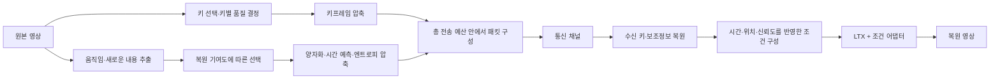

# BSU-Gen 구조·압축·조건 전달 개선 연구 후보

**2026-10-22 상태 보완:** 공동 키·전송률 예측기는 별도로 구현했지만 600개 정답 구축과 본학습의 완료 근거가 없고 현재 프로세스도 없다. [설계](BSU_JOINT_ALLOCATION_PREDICTOR.md) · [최신 상태](../RESULTS.md#bsu-joint-allocation-status). 아래 완료된 조합/패킷 검증과 미완료 후속 실행을 구분한다.

작성·결과 반영일: 2026-10-19

상태: 2025~2026년 논문·공식 구현을 참고한 12개 연구 후보에 **원격 LTX+NTSCC+ 14편 비교, 로컬 키·예산 배분 파일럿, 메타데이터 무손실 압축의 실제 채널 검증**을 반영했다. 후보 번호는 이전 문서와 대응하도록 유지하며 실행 우선순위와는 구분한다. 11번의 패킷 압축은 아래 조건에서 전송 절감을 확인했지만 기본 경로에는 아직 활성화하지 않았다. 다른 후보의 기대 효과를 검증·채택된 개선으로 표시하지 않는다.

## 완료 결과와 연구에 주는 의미

### 원격: 코덱 교체의 전송 절감과 품질 손익

`sangukcom`의 14편·3,333프레임·121개 생성 구간 비교가 완료됐다. 입력·출력·실행 기록 37,473개 파일의 해시 감사가 통과했다. AWGN 10dB, 생성 seed 2025, 동일 키 시점·캡션·궤적을 사용한 **기존 양끝 두 키 생성 경로**다. 최근 기본화한 다중 키 생성 경로의 전체 검증으로 해석하지 않는다. [완료 분석·조건·영상별 수치](../validation/2026-10-19-bsu-ltx-plus-analysis.json)

품질은 최종 MP4의 **영상별 평균을 다시 평균**, 전송량은 전체 합계다. 전송량은 영상 심볼·메타데이터·궤적·LDPC 패딩 및 오류정정 비용을 포함한 복소 채널 사용 횟수이며, 실제 무선 링크의 동기화·파일럿 등은 포함하지 않는다.

| 조합 | 총 채널 사용량 ↓ | PSNR ↑ | LPIPS ↓ |
|---|---:|---:|---:|
| LGVSC / NTSCC | 1,407,617 | 17.376 dB | 0.3765 |
| BSU / Open-Sora / NTSCC | 4,392,383 | 20.477 dB | 0.3028 |
| BSU / LTX / NTSCC | 4,392,383 | 21.703 dB | 0.2726 |
| BSU / LTX / NTSCC+ | 3,943,660 | 21.696 dB | 0.2789 |

LTX/NTSCC 대비 NTSCC+는 전송량을 **10.22%** 줄였고 14편 모두 절감됐다. 평균 PSNR 차이는 −0.006dB지만 LPIPS는 **2.29% 증가하고 12편에서 악화**, DISTS도 평균 1.36% 악화했다. 가짜 정지 검출률은 21.22%→22.40%, 광류 오차는 0.607→0.613, 움직임 크기 보존 비율은 0.781→0.773이었다. 이 움직임 수치는 행동 정확도·환각에 대한 독립 평가가 아닌 진단 지표다.

수신 키 평균 PSNR도 35.326→34.881dB로 낮아졌다. **두 코덱의 실제 전송량이 다르므로 NTSCC+ 구조 자체가 품질을 떨어뜨린다고 단정할 수 없다.** 동일 총전송량에서 코덱별 전송률을 조정한 비교가 필요하다. Open-Sora 조합 대비 PSNR +1.22dB·LPIPS 7.9% 개선은 유지하지만, LGVSC 대비 사용량이 2.80배여서 동일 전송량 우위는 입증하지 않았다.

| 비용 구성 | NTSCC | NTSCC+ | 변화 |
|---|---:|---:|---:|
| 영상 심볼 | 3,860,159 | 3,199,468 | −17.1% |
| 기본 디지털 메타데이터 | 357,120 | 569,088 | +59.4% |
| 궤적 | 175,104 | 175,104 | 동일한 기존 배정 유지 |

전송률 인덱스 원시 데이터가 **48,600→116,640바이트**로 늘었다. 디지털 비용 증가 211,968회가 영상 심볼 절감 660,691회의 **32.1%를 상쇄**했다. 이 병목을 근거로 **11번의 무손실 전송률 인덱스·메타데이터 압축을 먼저 검증**했다. 뒤이은 별도 패킷·채널 실험에서는 전체 메타데이터 압축으로 기존 NTSCC+ 대비 총량을 추가 8.53% 줄였다. 코덱 교체 비교와 압축 추가 검증은 구분한다.

### 로컬: 같은 예산에서 키 수와 장당 전송량을 바꾼 결과

`COMPLETE_BSU_KEY_BUDGET_PILOT`: 축구 37프레임·골프 25프레임, 3조건씩 **생성 6회·8개 생성 창·raw/최종 평가 12회**가 35분 52초에 완료됐다. 59개 단계 기록과 1,008개 고유 파일의 해시, 실제 패킷·심볼 비용, 수신 키 18장의 최종 PNG 보존, 프레임별 지표 재집계를 확인했다. 새 NTSCC+ 송수신과 **LTX 다중 키 조건**을 사용했고 AWGN 10dB·seed 2025를 고정했다. [완료·무결성·수치 기록](../validation/2026-10-19-bsu-key-budget-pilot.json)

| 영상 | 배분 방식 | 키 시점 | 실제 총 채널 사용량 ↓ | 최종 PSNR ↑ | 최종 LPIPS ↓ |
|---|---|---|---:|---:|---:|
| 축구 | 기준 3키 | 0, 32, 36 | 120,924 | 21.837 dB | 0.2588 |
| 축구 | 4키·장당 저율 | 0, 13, 32, 36 | 120,920 | 23.228 dB | 0.2483 |
| 축구 | 양끝 2키에 예산 집중 | 0, 36 | 120,914 | 19.798 dB | 0.3183 |
| 골프 | 기준 3키 | 0, 8, 24 | 75,392 | 29.424 dB | 0.1570 |
| 골프 | 4키·장당 저율 | 0, 8, 17, 24 | 75,392 | 30.007 dB | 0.1899 |
| 골프 | 양끝 2키에 예산 집중 | 0, 24 | 75,384 | 27.706 dB | 0.1673 |

각 영상 안에서 기준 대비 실제 사용량 차이는 최대 **0.0107% 미만**이다. 전송 예산이 거의 같은 상태에서 다음 손익을 확인했다.

- **4키의 시간 정보는 유효한 후보:** 최종 PSNR은 축구 +1.391dB, 골프 +0.582dB였다. 모든 조건의 키 시점을 제외한 **공통 비키 프레임**에서도 +1.367dB·+0.705dB로, 직접 수신 키의 비중이 늘어서만 생긴 향상은 아니다. 공통 평가 프레임은 각각 33장·21장이다.
- **4키가 모든 지표에서 우수하지는 않다:** 골프 LPIPS는 0.1570→0.1899, DISTS는 0.0784→0.0915로 악화했다. 축구의 광류 오차도 0.327→0.399로 커졌다. 반면 골프 광류 오차는 0.214→0.175, 가짜 정지는 8.43%→5.36%로 개선됐다. PSNR이나 움직임 크기 하나로 후보를 선택하면 이 손익을 놓친다.
- **2키 예산 집중은 이번 두 영상에서 불리:** 최종 PSNR이 각각 −2.039dB·−1.718dB, LPIPS·DISTS도 모두 악화했다. 특히 골프는 수신 키 평균 PSNR이 35.842→37.090dB로 높아졌어도 최종 영상은 나빠졌다. 축구에서는 장당 전송률 계수 `eta`를 높여도 선택된 키들의 평균 PSNR은 32.697→32.129dB로 낮아졌다. 키 집합도 달라지므로 `eta` 증가를 측정된 화질 향상과 동일시하지 않는다.

이 결과는 **9번의 최종 복원 기여도 기반 예산 배분을 우선 개발할 근거**다. 모든 영상에 4키를 고정하거나 양끝 2키로 줄이는 정책의 채택 근거는 아니다. 현재 기본의 “여러 수신 키를 한 생성 창에서 활용”하는 기능과, 이번의 “송신 키를 추가하고 장당 전송률을 낮추기”는 별개 변경이다.

두 영상은 이미 개발에 사용한 짧은 구간이며 원격 비교와 일부 원본이 겹친다. **14편+2편을 독립 16편 검증으로 합산하지 않는다.** 키 수 변경에 따라 캡션 구간·궤적 구성·후처리 구간도 변하고, 4키는 생성 창이 1개에서 2개로 늘었다. 같은 seed도 창의 모양이 달라 동일 잡음 텐서를 의미하지 않는다. 따라서 순수한 키 개수 효과보다 **배분·조건 구성 정책 전체의 비교**다. 별도 seed·미사용 영상·다른 SNR·긴 영상·독립 행동 평가는 남아 있다.

### 업데이트한 우선순위

| 순서 | 후보 | 지금 먼저 할 이유 | 다음 판단에 필요한 증거 |
|---|---|---|---|
| 1 | **11: 전송률 인덱스·메타데이터 무손실 압축** | 전체 패킷 압축으로 원격 총량 추가 8.53%·로컬 7.04% 절감, 10dB 완전 복원 확인 | 기본 경로 통합·전송 회계 반영; 낮은 SNR의 채널 실패는 별도 해결 |
| 2 | **9: 시간 정보와 키별 전송량의 공동 배분** | 같은 예산에서도 배분에 따라 복원 성능이 크게 달라짐 | 공통 비키 화질·움직임을 함께 개선하는 고정 정책 |
| 3 | **10: 후처리 분리 검증, 1: 생성 중 궤적 활용** | PSNR 향상과 움직임·지각 품질의 손익을 해결해야 함 | 같은 수신 패킷에서 원인별 효과 분리 |
| 4 | **2·3: 궤적 압축·키 간 시간 문맥 압축** | 새 특징을 보내기 전 기존 정보의 중복 절감 | 손실·참조 비용까지 포함한 동등 품질 또는 동등 예산 이득 |
| 5 | **4·6: 패치·저해상도 시간 정보의 효용 검증 → 5·7: 특징 압축·선택 학습** | 어떤 정보가 추가 키보다 유리한지 먼저 확인 | 동일 비용의 추가 키·키율 조절보다 좋은 결과 |
| 장기 | **8·12: 외형 메모리·잡음 코드북** | 긴 영상과 탐색 비용 검증이 별도로 필요 | 오류 누적·송신 계산량까지 포함한 이득 |

우선순위는 현재 증거를 바탕으로 한 연구 판단이다. 11번의 제한된 완료 검증을 다음 12개 후보 전체의 범용적인 개선 효과로 확대하지 않는다.

## 핵심 방향

가장 유력하게 보는 방향은 **키프레임으로 이미 전달되는 정보는 재사용하고, 중간 영상의 복원에 부족한 정보만 골라 압축해서 생성기에 전달하는 BSU 구조**다.

이를 위해서는 **무엇을 추출할지 → 어떻게 압축할지 → LTX가 어디에서 활용할지 → 얼마만큼 보낼지**를 함께 설계해야 한다. 특징을 작게 만드는 것만으로는 생성 품질이 좋아지지 않고, 유용한 정보를 보내더라도 생성기가 활용하지 못하면 전송량만 늘어난다.

NTSCC+에서 가져올 핵심은 **문맥을 이용해 중복을 줄이는 방식**이다. NTSCC+는 잠재 특징 사이의 공간적 관계를 압축·복원에 활용한다. BSU에서는 이를 **키프레임 사이의 시간적 관계**, **이미 전달한 외형과 새로 전달할 움직임 사이의 관계**로 확장할 수 있다. [NTSCC++ 저자 공식 설명](https://semcomm.github.io/ntscc_plus/)

작성 시점의 BSU-Gen은 NTSCC+로 키 이미지를 각각 인코딩하고, LTX에는 다중 키와 캡션을 제공한다. 기존 궤적은 기본 경로에서 생성 후 보정에 사용된다. 따라서 시간 문맥을 이용한 압축과 생성 중 움직임 조건 활용에 설계 여지가 있다. [키 인코딩 코드](../../src/semantic_transmission/codec_transport.py) · [LTX 조건 구성 코드](../../src/semantic_transmission/bsu_ltx_pipeline.py)

전체적으로는 다음 구조를 목표로 할 수 있다. 보조정보 후보를 모두 보내는 것이 아니라, 구간별로 필요한 것을 선택하는 구조다.

## 1. 기존 궤적을 LTX의 움직임 조건으로 직접 연결하기

**움직임 개선의 우선 후보로 유지하되, 실행 순서는 무손실 패킷 압축과 예산 기준선 정비 다음으로 둔다.** 현재 보내는 궤적을 생성 단계에서 활용하면, **추가 전송 없이** 움직임 제약을 강화할 수 있다. 원격 비교에서 가짜 정지가 증가했다는 사실만으로 그 원인을 궤적 조건 부재로 확정하지는 않는다.

작성 시점에 확인한 LTX 공식 문서에는 희소 점 궤적을 입력받는 **Motion Control IC-LoRA**가 있다. LTX-2.5에서 LTX-2.3용 motion-track 어댑터를 사용하는 공식 워크플로도 안내한다. 따라서 앞서 제시한 “별도 학습이 필요하다”는 설명은 범위를 좁혀야 한다. **기존 어댑터에 맞게 궤적을 변환하는 첫 실험은 새 학습 없이 시도할 수 있다.** [LTX 공식 Motion Control 문서](https://docs.ltx.io/open-source-model/feature-guides/structural-control/motion-control)

구체적인 경로는 다음과 같다.

> 수신 궤적 → 시간별 점 좌표와 가림 처리 → 공식 형식의 궤적 안내 영상 → Motion Control IC-LoRA → LTX 생성

이전의 “키프레임을 궤적으로 휘어서 가짜 중간 이미지를 만들기”와는 입력 방식이 다르다. 궤적에 맞게 학습된 조건 경로를 활용한다는 점이 핵심이다.

다만 공식 예제는 단일 단계 생성이고 현재 BSU는 두 단계 생성이므로, 다중 키·양끝 제약·샘플링 경로와의 호환성을 먼저 확인해야 한다. 궤적 생성 제어의 연구 근거로는 [Tora, CVPR 2025](https://openaccess.thecvf.com/content/CVPR2025/html/Zhang_Tora_Trajectory-oriented_Diffusion_Transformer_for_Video_Generation_CVPR_2025_paper.html)와 [T-GVC, AAAI 2026](https://github.com/Chigland/T-GVC)가 직접 관련된다.

첫 비교는 동일 수신 키·궤적·캡션·생성 창을 고정하고 공식 움직임 조건만 켜고 끈다. 원시 생성과 동일한 후처리 후를 모두 평가해 10번의 보정 효과와 분리한다. 단일 단계로 경로를 바꿔야 한다면 먼저 해당 경로 자체의 대조군을 둔다. 두 완료 실험에는 이 공식 어댑터의 효과 검증이 포함되지 않았다.

## 2. 카메라 움직임과 물체 움직임을 분리해서 압축하기

**알고리즘으로 시작하기 좋은 후보다.** 카메라가 오른쪽으로 이동하면 배경의 많은 점이 비슷하게 움직인다. 이를 점마다 반복해서 보내는 대신 다음처럼 표현할 수 있다.

> 전체 화면의 공통 움직임 + 공통 움직임으로 설명되지 않는 물체별 이동량

송신부에서 전역 변환을 추정하고, 각 궤적에는 그 변환을 뺀 잔여 움직임만 남긴다. 이후에는 다음을 적용한다.

- 일정하게 움직이는 구간은 시작·끝 또는 적은 수의 곡선 제어점만 전송한다.
- 방향 전환·접촉·가림·재등장 시점에 제어점을 집중한다.
- 비슷한 궤적은 대표 궤적과 작은 차이로 표현한다.
- 좌표 차분과 가림 상태를 양자화·엔트로피 부호화한다.

예를 들어 **8개 점 × 4개 시점 × 좌표 2개 × 10비트 = 80바이트**다. 이는 좌표만 계산한 예시이고 시간·식별자·가림·통신 부가비용은 별도다.

추적기는 CoTracker3 같은 사전학습 모델을 활용할 수 있다. 다만 추적 정확도와 압축 효율은 별도로 검증해야 한다. 시차가 큰 장면에서는 하나의 전역 변환이 부정확하므로, 여러 움직임 그룹이나 기존 표현으로 돌아가는 경로가 필요하다. [CoTracker3 공식 논문](https://arxiv.org/abs/2410.11831)

이번 원격 비교에서 궤적 비용은 175,104회로 동일했다. 코덱 교체의 절감 원인도 악화 원인도 궤적 압축 효과로 해석하지 않는다. 우선 현재 좌표의 무손실 차분·패킷 압축을 비교하고, 제어점 축소처럼 정보를 바꾸는 단계는 1번의 생성 조건과 기존 후처리 양쪽에서 동작을 보존하는지 별도로 검증한다.

## 3. 키프레임끼리 시간 문맥을 공유해서 압축하기

**전송량 감소의 핵심 후보다.** 현재는 같은 배경이 여러 키에 반복되어도 각각 이미지 코덱으로 처리한다. 이를 다음처럼 바꿀 수 있다.

> 첫 키: 독립 압축\
> 다음 키: 이전에 복원한 키로 예측할 수 없는 정보 중심으로 압축

개발 경로는 두 가지다.

| 경로 | 구현 방법 | 의미 |
|---|---|---|
| 빠른 검증 | 선택된 키들을 DCVC 계열로 함께 압축하고, 원래 시간 위치에 복원해 LTX에 전달 | 시간 중복 제거의 실익부터 확인 |
| 본격적인 BSU 연구 | 이전 키의 특징을 사용하는 시간 문맥 인코더·디코더를 학습 | 키 전송과 생성 조건에 맞춘 구조 개발 |

첫 경로에서도 최종 영상 복원은 LTX가 담당한다. 키의 시간 위치와 생성 구간을 고정하면, 키 압축 방식의 영향을 비교하기 쉽다. DCVC-RT는 시간 정보를 활용하는 효율적인 신경망 압축 설계의 참고가 된다. [DCVC-RT, CVPR 2025](https://arxiv.org/abs/2502.20762)

주의할 점은 **NTSCC 채널을 거친 실제 수신 키를 송신기가 정확히 알지는 못한다는 것**이다. 디지털 방식의 일치하는 복원 문맥을 사용하거나, 채널 오차에 견디는 시간 문맥 모델이 필요하다. 장면 전환에서는 독립 키로 초기화해야 한다.

로컬에서 낮은 장당 전송률의 추가 키가 PSNR을 높인 결과는 **시간 위치를 확보하면서 키 중복을 압축**하는 방향의 동기가 된다. 시간 문맥 코덱 자체의 효과는 아직 측정하지 않았다. 11번으로 개선한 독립 키 패킷을 기준으로 삼고, 참조 식별자·갱신 키·채널 오류 전파 비용까지 포함한다. 디지털 코덱과 JSCC의 비교는 파일 크기가 아니라 오류정정까지 포함한 동일 채널 사용량·SNR에서 수행한다.

## 4. 키프레임으로 설명되지 않는 부분만 학습된 특징으로 보내기

**중장기 딥러닝 연구의 중심으로 유지하며, 먼저 추가 키와 비교해 정보의 효용을 확인한다.** 예를 들어 시작·끝 키에는 사람이 서 있지만, 중간에 잠깐 공을 잡았다 놓는 동작이 있다고 하자. 배경과 사람 외형은 키로 전달할 수 있지만, **중간의 손·공 관계와 시점**은 부족할 수 있다.

이를 위한 송신부를 다음처럼 설계할 수 있다.

> 원본 중간 영상 특징 추출\
> → 키·움직임으로 예측한 특징과 비교\
> → 부족한 시간·공간 영역 선택\
> → 작은 보조 특징으로 압축

수신부는 보조 특징을 해당 시간과 위치의 LTX 조건으로 넣는다. 첫 구현은 학습 특징보다 해석하기 쉬운 **작은 실제 영상 패치**로 시작하고, 효과가 확인되면 패치를 잠재 특징으로 대체할 수 있다.

이번 로컬 4키는 PSNR 향상과 지각·움직임 지표의 악화가 함께 나타났다. 패치·특징의 목표도 단순 PSNR 극대화보다 **키를 지나치게 저율로 만들지 않으면서 부족한 중간 사건을 전달**하는 것으로 구체화한다. 같은 예산을 추가 키 또는 기존 키의 전송률 조절에 쓴 대조군과 비교하고, 공통 비키 프레임·작은 물체·사건 시점에서 이득이 확인된 정보부터 학습한다. “패치를 보내면 좋아진다”는 결론은 아직 없다.

학습에서는 다음이 중요하다.

- 특징 복원 오차뿐 아니라 **최종 영상의 복원 오차**를 줄이도록 학습한다.
- 배경처럼 키에서 이미 얻을 수 있는 정보의 중복 전송을 억제한다.
- 위치·시간·크기 정보까지 전송 비용에 포함한다.
- 보조정보가 없을 때도 기본 복원이 가능하도록 학습한다.
- 작은 공·손·도구처럼 면적은 작아도 동작에 중요한 부분을 평가한다.

GNVC-VD는 압축된 시공간 잠재 특징과 생성기의 조건 어댑터를 결합한다는 점에서 좋은 참고다. 다만 Wan2.1 기반 연구이므로 LTX에 맞는 별도 연결·학습이 필요하다. [GNVC-VD, CVPR 2026](https://openaccess.thecvf.com/content/CVPR2026/html/Mao_Generative_Neural_Video_Compression_via_Video_Diffusion_Prior_CVPR_2026_paper.html)

이전 **2026-10-16 작업 기록**에는 BSU의 학습된 추가 특징 토큰 실험이 있지만, 동일 품질에서 전송량을 줄이는 데 성공했다는 근거는 없었다. 이번 제안은 그 기록을 바탕으로 **LTX가 실제로 활용하는 조건 경로, 중복 억제, 최종 복원 기여도**를 함께 설계하자는 것이다. 당시 결과를 현재 LTX의 결과로 해석하지 않는다.

## 5. 특징을 중요도 순서로 배열해 필요한 만큼만 보내기

**4번과 잘 결합되는 후보다.** 모든 구간에 토큰 32개를 보내기보다 다음과 같은 표현을 학습한다.

> 앞쪽 토큰: 큰 움직임과 중요한 사건\
> 뒤쪽 토큰: 자세·작은 물체·세부 외형 보완

단순한 구간에서는 앞의 몇 개만 보내고, 복잡한 구간에서는 더 많이 보낸다. 학습 중 토큰 뒷부분을 무작위로 제거해, 짧은 접두부만으로도 복원하도록 만들 수 있다.

FlexTok은 가변 길이 토큰과 중요도 순서 학습의 참고다. **이미지 생성 연구의 원리를 BSU의 보조정보에 응용하는 제안**이며, 해당 토큰을 LTX에 바로 넣을 수 있다는 뜻은 아니다. [FlexTok, ICML 2025](https://flextok.epfl.ch/)

토큰 수가 줄어도 코드북 크기·위치 정보·패킷 비용 때문에 실제 전송량이 비례해서 줄지는 않는다. 따라서 학습의 비트 추정치와 실제 부호화 결과를 모두 확인해야 한다.

실행은 4번의 효용 검증 뒤로 둔다. 원격에서 확인한 메타데이터 증가를 반복하지 않도록 토큰 인덱스·길이·위치·코드북 식별자까지 실제 비용에 넣고, LDPC 블록 경계를 넘는 시점의 비용도 9번 선택기에 반영한다. 앞쪽 토큰이 실제로 더 큰 최종 복원 이득을 주는지는 토큰 길이별 성능 곡선으로 검증한다.

## 6. 낮은 해상도의 시간 정보를 보내고, LTX가 외형을 복원하도록 만들기

**적용 범위가 넓은 후보다.** 희소 궤적만으로 표현하기 어려운 물결·연기·옷 변형·다수 물체에는 낮은 해상도의 보조영상이 더 유리할 수 있다.

> 선명한 소수 키 + 작게 압축한 보조영상 → 구조·시간 정보를 유지하는 LTX 복원

예를 들어 144×80의 낮은 프레임률 영상이나 압축된 시공간 잠재 특징을 보낸다. 해상도·시간 간격·품질은 예산 안에서 조절한다. DiSCo는 텍스트·시공간적으로 축소된 영상·선택적인 구조 조건을 조합하고, GNVC-VD는 복원된 잠재 특징을 생성 복원의 출발점으로 활용한다. [DiSCo 논문](https://arxiv.org/abs/2512.00408) · [GNVC-VD 방법](https://arxiv.org/html/2512.05016v2)

다만 **저해상도 보조영상 자체가 새로운 해결책은 아니다.** 로컬의 이전 주파수 제한 보조영상 실험은 등록된 품질 기준을 통과하지 못했다. 따라서 이번에는 압축 왜곡에 맞춘 조건 어댑터와 시간 정렬까지 바꿔야 재시도할 이유가 있다. [이전 실험 기록](../validation/2026-10-12-bsu-frequency-anchors.json)

로컬 2키 실패를 보조영상의 성공 근거로 대체하지 않는다. 3키·4키 기준과 같은 총예산에서 충분한 키 품질을 남길 수 있는지, 보조영상이 추가 키보다 중간 움직임을 잘 전달하는지를 먼저 확인한다. 조건 어댑터 검증 없이 단순 저해상도 영상을 추가하는 실험의 우선순위는 낮춘다.

## 7. 영상 내용에 따라 보조정보의 종류를 선택하기

**범용성을 높이는 방법이다.** 모든 영상에 같은 표현을 강제하지 않고, 제한된 후보 중 필요한 것을 고른다.

| 구간의 특징 | 우선 검토할 정보 |
|---|---|
| 사람의 관절 동작이 중요 | 희소 자세·손 위치·접촉 시점 |
| 차량·물체의 이동이 중요 | 점 궤적·크기 변화 |
| 외곽 모양의 변화가 중요 | 압축된 윤곽·마스크 |
| 유체·복잡한 변형 | 저해상도 보조영상·학습 특징 |
| 새 물체가 잠깐 등장 | 해당 영역의 패치·외형 특징 |
| 변화가 거의 없음 | 추가정보 생략 |

처음에는 규칙으로 선택하고, 이후에는 작은 네트워크가 **예상 복원 개선량과 실제 비용**을 예측하게 할 수 있다. 수신기에는 정보의 종류와 유효 여부를 명시해, “누락된 조건”과 “실제 움직임 없음”을 구분하도록 한다.

여러 조건의 역할 구분과 일부 조건을 제거하는 학습은 관련 조건부 영상 압축 연구에서도 사용한다. [Conditional Video Generation for High-Efficiency Video Compression](https://arxiv.org/abs/2507.15269)

축구와 골프의 손익 차이는 적응형 선택의 연구 동기지만, 두 영상의 종류만 보고 정책을 나누는 규칙을 학습할 근거는 부족하다. 검증된 소수 후보부터 시작하고 송신부 움직임·가림·예산 특징으로 선택한다. 별도 개발 집합에서 규칙을 고정한 뒤 미사용 영상에서 평가하며, 시험 원본의 최종 점수를 보고 고르는 결과는 실용 선택기의 성능과 분리해 탐색 상한으로만 보고한다.

## 8. 물체 외형을 한 번 저장하고, 이후에는 움직임과 변화만 보내기

**긴 영상에 유망한 후보다.** 같은 사람이 가려졌다 다시 나타나는 경우를 생각하면, 매번 외형 전체를 보내기보다 수신부에 이미 있는 외형을 재사용할 수 있다.

> 최초 외형 참조 + 물체 식별자 + 위치·자세 변화 + 필요한 외형 갱신

기존 수신 키에서 외형을 추출하면 최초 참조도 추가 전송 없이 만들 수 있다. 이후 새로 보이는 면이나 옷·도구의 변화만 갱신한다.

BSU에 적용할 때는 수신 키에서 만든 참조와 생성 결과에서 만든 참조를 구분해야 한다. 생성 오류를 확정된 외형처럼 계속 재사용하면 오류가 누적된다. 장면 전환과 식별 실패에서는 참조를 초기화하고, 실제 절감 효과는 긴 영상에서 확인해야 한다.

이 방법은 BSU 설계 후보이며, 작성 시점에 구현된 기능은 아니다.

이번 짧은 로컬 구간과 원격 비교로 외형 메모리의 장시간 절감·오류 누적을 판단할 수 없다. 11·9·1·10번 이후의 장기 과제로 유지한다.

## 9. 키·궤적·패치의 예산을 최종 복원 기여도로 배분하기

**단기 구조 개선의 중심으로 우선순위를 높인다.** 완료된 3키·4키 저율·2키 예산 집중 비교는 최종 복원 기여도를 고려해야 한다는 근거다. 다만 해당 파일럿의 추가 키 선택은 송신부의 저해상도 선형 보간 잔차를 사용하는 대리 지표이고, 기여도 예측기를 구현·학습한 결과는 아니다. 다음 선택들을 같은 틀에서 다룬다.

**2026-10-19 구현 업데이트:** Gated Attention·RMSNorm·SwiGLU 기반 공동 키·전송률 예측기와 실제 패킷 비용 제약 계층을 별도 경로로 구현했다. 후보의 품질 변화·순위·선택 regret을 학습하며, 예산 검사는 학습하지 않는다. 기존 두 영상의 6개 후보로 30스텝 개발 학습과 선택 동작을 확인했고, 실제 NTSCC+의 키별 비균등 eta 인코딩·수신 복원 및 LTX 조건 구성까지 확인했다. **독립 영상의 화질 개선·본학습 완료·기본 경로 채택을 의미하지 않는다.** [구조·데이터·실행 가이드](BSU_JOINT_ALLOCATION_PREDICTOR.md) · [검증 기록](../validation/2026-10-19-bsu-joint-allocation.json)

- 키별 전송률을 조정하고 실제 수신 품질 확인하기.
- 중간 키 한 장 추가하기.
- 궤적 제어점 늘리기.
- 작은 물체 패치 보내기.
- 보조 특징 토큰 추가하기.

선택 기준은 대략 다음과 같다.

$$
\text{우선순위}
=
\frac{\text{예상되는 최종 복원 오류 감소량}}
{\text{추가되는 실제 채널 사용량}}
$$

처음에는 후보를 실제 복원해 비교하고, 그 결과로 작은 기여도 예측기를 학습한다. 추론 시에는 원본의 송신부 특징과 예산을 보고 선택하므로, 매번 LTX를 여러 번 실행할 필요를 줄일 수 있다.

선택들 사이에는 상호작용이 있으므로, 위 비율만으로 전역 최적이라고 할 수는 없다. 초기에는 제한된 후보 조합을 탐색하는 편이 검증하기 쉽다.

이번 결과에 따라 첫 후속 실험을 다음처럼 구체화한다.

1. **전송률-품질 기준선:** 키 시점·캡션·생성 창을 고정하고 NTSCC와 NTSCC+의 전송률을 각각 바꿔 동일 총 채널 사용량에서 비교한다. 11번의 메타데이터 절감만 적용한 경우와 절감분을 영상 심볼에 재배정한 경우를 구분한다. 수신 키 화질과 최종 화질을 함께 측정해 원격의 품질 차이가 운영 전송률로 얼마나 설명되는지 확인한다.
2. **시간 정보 확보와 키별 비균등 배분:** 3키 기준과 4키 후보를 유지하고, 모든 키의 `eta`를 똑같이 낮추는 방식에 더해 기존 주요 키 품질을 유지하며 추가 키에 적은 예산을 주는 후보를 비교한다. 공통 배경보다 새 사건·방향 전환·긴 무키 구간을 후보로 고려하되, 규칙과 임계값은 개발 집합에서 고정한다. 예산이 부족하면 추가 키를 생략하는 경로를 둔다.
3. **생성 창 변화 분리:** 가능한 조건에서는 창의 시작·끝과 캡션을 고정해 키·율의 영향을 비교한다. 별도로 다중 키 묶음·겹침 정책을 비교해 이번 4키에서 함께 바뀐 창 개수의 영향을 확인한다. 2키는 시간 조건을 제거하는 대조군으로 남기고 기본 정책으로 채택하지 않는다.
4. **복원 기여도 학습:** 후보별 실측 결과가 충분히 모인 다음에 송신부 특징으로 품질·움직임 개선량과 실제 비용을 예측한다. 데이터 분리는 원본 영상 단위로 하고, 수신기의 선택·조건 조절에는 수신 정보만 사용한다.

목적함수는 PSNR 단일 최대화 대신 **왜곡·지각 품질·움직임의 손익과 채널 비용을 함께** 다룬다. 먼저 지표 간 우열이 갈리는 후보를 그대로 보고하고, 가중치·허용 악화 폭·예산 오차 범위를 시험 전에 정한다. 최소 키 품질·최대 시간 간격 등의 제약은 새로운 제안이며 이번 결과만으로 값을 확정하지 않는다. 골프의 “키는 선명해졌지만 최종 영상은 악화”와 축구의 “PSNR은 좋아졌지만 광류 오차는 악화”를 함께 통과 기준에 반영한다.

2026년 GVCHR는 많이 참조되는 프레임에 더 높은 품질을 배정하고 생성기의 참조 구조까지 연결한다. BSU에서도 **키가 여러 생성 구간에 미치는 영향**을 예산 배분에 반영할 근거가 된다. [GVCHR, 2026년 프리프린트](https://arxiv.org/abs/2608.11618)

## 10. 수신 조건의 신뢰도에 따라 생성 제약과 후처리를 조절하기

**추가 전송 없이 시작할 수 있다.** 같은 궤적이라도 가림·추적 오류가 있을 수 있고, 같은 키라도 채널 손상이 다르다. 이를 모두 같은 강도로 강제하면 잘못된 조건이 복원을 방해할 수 있다.

작은 조건 조절 모듈에 다음을 입력한다.

> 수신 키 품질 추정 + 궤적 일관성 + 유효성 + 시간 간격 + 채널 상태

출력은 시간·영역별 조건 강도다. 신뢰할 수 있는 조건은 더 강하게 활용하고, 불확실한 조건은 영향력을 줄인다. 수신 데이터만으로 계산하는 버전은 추가 전송이 없다.

이는 정확한 원본을 알아내는 장치가 아니라 **잘못된 조건의 피해를 줄이려는 장치**다. 학습에는 실제 채널 손상과 추적 오류를 포함해야 한다. LTX의 IC-LoRA는 공간·시간 마스크와 조건 강도 조절 인터페이스를 제공하므로 연결 지점도 있다. [LTX IC-LoRA 공식 문서](https://docs.ltx.io/open-source-model/usage-guides/ic-lo-ra/)

**첫 구현 범위에 기존 후처리의 신뢰도 조절을 추가한다.** 원격 LTX/NTSCC+에서 원시 생성→기존 후처리 적용 시 평균 PSNR은 20.820→21.696dB, LPIPS는 0.2872→0.2789로 좋아졌지만 DISTS는 0.1104→0.1145로 악화했다. 움직임 크기 보존 비율은 0.869→0.773으로 감소하고 가짜 정지는 20.93%→22.40%로 증가했다. 같은 생성 결과에서의 손익이므로 후처리를 분리해 볼 직접적인 이유가 있다.

그러나 로컬 축구 기준의 가짜 정지는 후처리로 3.81%→0.60%로 줄었고, 골프 기준의 움직임 크기 비율은 0.963→1.237로 커졌다. **보정을 일괄 제거하거나 움직임 크기를 무조건 늘리는 것이 해법은 아니다.** 다음 비교는 생성 결과를 재사용해 궤적 합성·시간 보정·키 주변 보정을 각각 끄고 켜고, 조합 효과를 확인하는 것이다. 원본은 평가에만 사용하고 보정량은 수신 궤적의 유효성·수신 키와 생성 결과의 불일치·가림 등으로 결정한다. 이 검증 후에 1번의 생성 중 움직임 조건과 결합한다.

## 11. 전송률 인덱스·메타데이터 무손실 압축과 패킷 구성 최적화하기

**첫 검증을 완료했고, 기본 경로 통합의 우선 후보로 둔다.** NTSCC+에서 줄인 영상 심볼 비용의 32.1%를 메타데이터 증가가 상쇄한 관측을 바탕으로 5비트 포장·전체 패킷 압축을 구현해 비교했다. 작은 특징의 바이트 수를 줄여도 오류정정 블록 수가 그대로이면 실제 비용은 줄지 않을 수 있으므로 실제 채널 사용량으로 판정했다.

**2026-10-19 완료 결과:** 기존 영상 심볼과 궤적 비용을 유지한 원격 14편에서 아래 결과를 얻었다. 새 포맷의 16바이트 헤더·패딩·LDPC 비용을 포함한다. [전체 수치·실제 채널 검증·무결성 감사](../validation/2026-10-19-bsu-metadata-compression.json)

| 전송 표현 | 기본 디지털 비용 | 전체 채널 사용량 | 기존 NTSCC+ 대비 추가 절감 |
|---|---:|---:|---:|
| 기존 uint8 | 569,088 | 3,943,660 | — |
| 5비트 인덱스 | 442,368 | 3,816,940 | 3.21% |
| **전체 패킷 zlib** | **232,704** | **3,607,276** | **8.53%** |
| 5비트 후 zlib | 255,744 | 3,630,316 | 7.95% |

전체 압축은 원격 14편 모두에서 총량을 5.29~14.88% 줄였고, 로컬 두 영상·6개 배분 조건 합계에서는 7.04%를 줄였다. 원본·압축 후보 중 실제 바이트 수가 가장 작은 것을 선택하는 `auto`는 20개 모두 전체 패킷 zlib를 선택했다. **5비트 포장과 전체 압축을 무조건 결합하지 않고, 헤더까지 포함한 실제 크기로 선택한다.** 압축이 이득이 없으면 원본을 보낸다.

실제 LDPC·16QAM·AWGN 총 200회 중 **10dB 비교 120/120회는 비트 오류 없이 원본 패킷을 완전히 복원**했다. 8dB 진단에서는 원본 40회·압축 40회가 모두 거부돼, 낮은 SNR에서의 사용 가능성·신뢰도 향상은 확인하지 못했다. 100개 원본/후보 조합의 복원·기존 궤적 해시 연결·153개 키 descriptor와 542개 산출물 해시를 확인했다. 새 신경망 추론이나 화질 재평가는 하지 않았으며, 품질 판단의 근거는 **디코더 입력 바이트의 동일성**이다.

구현은 별도 포장/복원 모듈과 검증 실행기에 한정되며 **기본 경로는 미적용**이다. 공간·시간 예측 부호화, 궤적과의 패킷 결합, 절감분 재배정은 아직 미검증이다. [포장·복원 구현](../../src/semantic_transmission/bsu_metadata_compression.py) · [검증 명령](../RUN_GUIDE.md#bsu-metadata-compression)

**후속 영상 검증 — 2026-10-22 확인: 중단·전체 미완료.** 원격 상태는 `INTERRUPTED / generate`, 완료 조건 표시는 10/28이며 최종 코호트 `RESULT.json`은 없다. [확인 근거](../validation/2026-10-22-research-status-reconciliation.json). 다음은 시작 당시의 계획이다: 원격에서 14편의 비압축 대조군과 압축군을 모두 새로 복호화·생성·평가한다(28개 조건·242개 생성 구간·평가 56회). 기존 GPU 복호화 반복에서 발견한 미세한 반올림 차이를 통제하도록 두 조건에 같은 결정적 복호화 설정을 적용하고, 압축군의 키·LTX 입력이 새 대조군과 일치하는지 확인한다. 주 비교는 새 두 조건 사이의 전송량과 화질이며, 과거 영상과의 비교는 진단으로 분리한다. **14편 전체의 영상 화질 보존 완료 결과는 아니다.** [원격 진행 명령](../RUN_GUIDE.md#bsu-metadata-e2e) · [실행 기록](../validation/2026-10-19-bsu-metadata-e2e.json)

기본 NTSCC+ 구현은 **26개 전송률 선택지의 인덱스를 1개당 8비트(`uint8`)**로 저장한다. 위 완료 결과와 후속 확장 후보를 구분해 다음 방법을 다룬다. [전송률 선택지·직렬화 코드](../../src/semantic_transmission/ntscc_plus_codec.py)

| 후보 | 변경 | 먼저 검증할 것 |
|---|---|---|
| 고정 5비트 포장 | 0~25 인덱스를 5비트로 저장하고 수신 후 기존 인덱스로 복원 | 길이·패딩·순서·범위 검증과 byte-exact 역변환; 4비트로는 26개를 표현할 수 없음 |
| 공간·시간 예측 후 무손실 엔트로피 압축 | 반복 인덱스와 인접 차이를 압축; 이득이 없으면 고정 포장 선택 | 예측에 쓴 문맥을 양쪽이 동일하게 재현하며 복원 누락·참조 오류가 없는지 |
| 전체 메타데이터 무손실 압축 | 반복 JSON 키·식별자·캡션 표현까지 묶어 압축 | 압축 플래그·길이·CRC·해제 비용을 포함한 실제 패킷 크기 |
| 패킷 결합과 빈 공간 활용 | 메타데이터·궤적·선택 보조정보의 공통 블록 활용 | 블록 수 감소와 함께 지연·동시 손실 범위가 허용되는지 |

원격 실행의 인덱스 116,640개는 5비트 포장 시 **인덱스 본문 72,900바이트로 37.5% 감소**했다. 그러나 헤더·CRC·LDPC 블록 단위 비용까지 포함한 **전체 전송 절감은 3.21%**였다. 5비트 포장은 14편 중 12편에서 채널 사용량을 줄였고 나머지 2편은 블록 수가 같았다. 전체 패킷 압축의 8.53%와 단순 합산하지 않는다.

현재 디지털 채널 기본 설정은 정보 6,144비트, 부호화 후 9,216비트, 심볼당 4비트다. 따라서 별도 블록 하나를 추가하면 **2,304개의 복소 채널 사용**이 발생한다. [현재 채널 설정](../../src/semantic_transmission/metadata_channel.py)

따라서 다음을 함께 설계해야 한다.

- 같은 시간 구간의 캡션·궤적·토큰을 적절하게 묶는다.
- 반복되는 식별자·타임스탬프·메타데이터를 압축한다.
- 이미 확보된 블록의 남는 공간을 고려해 정보를 선택한다.
- 중요한 기본 정보와 선택적 보완 정보를 분리해 보호한다.
- 묶음 때문에 늘어나는 지연과 동시 손실 범위도 평가한다.

이전 BSU 코호트의 디지털 패킷 무손실 압축 기록과 별도로, 이번에는 **현재 NTSCC+·LTX 완료 패킷에서 절감률을 새로 측정**했다. [기존 실제 채널 검증](../validation/2026-10-15-bsu-rate-preservation-research.json)

완료 검증에서는 저장된 패킷의 포장/복원 후 실제 디지털 채널 전송을 수행했다. 영상 심볼은 기존 값을 유지하고, 수신된 압축 패킷을 기존 메타데이터로 완전히 복원했다. 따라서 기존 디코더에 전달할 캡션·키 인덱스·전송률·정규화 값과 궤적의 해시 연결을 보존한다. 수신 키 이미지와 LTX 영상은 다시 생성하지 않았다. 디지털 채널은 같은 SNR·seed를 적용했지만 전송 길이·부호어가 달라지므로 동일한 물리 잡음 표본 비교라고 주장하지 않는다.

첫 검증에서는 절감분을 쓰지 않고 기존 입력을 보존하는 것을 확인했다. 다음에는 같은 총예산으로 절감분을 키 심볼·추가 키·궤적에 재배정하는 9번 실험을 수행한다. **메타데이터 절감과 절감분 재투자의 품질 이득을 별도로 보고**한다.

## 12. 생성기의 잠재 잡음·코드북 선택을 압축정보로 보내기

**탐색 가치가 있는 장기 후보다.** 송수신기가 공유하는 코드북을 두고, 송신기가 원본에 가까운 복원을 유도하는 코드 조합을 찾아 그 인덱스만 보낸다. 수신기는 인덱스로 같은 잠재 제어값을 재현한다.

ZeroGVC는 재현 가능한 코드북 잡음 벡터의 조합으로 생성 경로를 제어하는 접근을 제안한다. 단순히 “좋은 seed 하나를 찾는다”보다 구조적인 압축 방법이다. [ZeroGVC, 2026년 프리프린트](https://arxiv.org/abs/2606.22371)

전송 표현은 작아질 수 있지만 송신기의 탐색 비용, 실행 재현성, LTX 구조와의 호환성이 부담이다. 따라서 초기 우선순위는 낮게 둔다.

이번 로컬 파일럿은 고정 seed 하나의 비교로, 잡음 코드북 선택의 이득을 검증하지 않았다. 키·패킷·조건 경로의 근거가 더 직접적이므로 이 후보의 우선순위는 올리지 않는다.

## 중심 연구와 실행 순서

단기에는 **11번의 낭비 절감 → 9번의 시간 정보·키별 예산 배분 → 10번·1번의 움직임 보존**을 중심으로 진행한다. 중장기 딥러닝 연구의 중심은 **4번·5번·9번의 결합**으로 유지하되, 추가 정보의 효용과 실제 비용이 먼저 확인돼야 한다.

> **키와 움직임으로 설명되지 않는 시공간 정보만 추출하고, 최종 복원에 기여하는 순서대로 압축·전송하며, LTX가 그 정보를 직접 활용하도록 학습하는 구조**

학습 대상은 우선 **작은 특징 추출·압축 모듈, 예산 선택기, LTX 조건 어댑터**로 제한할 수 있다. NTSCC+와 LTX 본체를 고정한 상태에서 어느 부분이 효과를 만드는지 확인하기 좋다. 다만 본체를 고정해도 LTX를 통과하는 학습의 메모리 비용은 남으므로, 현재 16GB GPU에서의 가능 여부는 별도 측정이 필요하다.

후속 실행 순서와 진입 조건은 다음과 같다. 1단계의 패킷·채널 검증은 완료됐으며, 기본 경로 통합과 절감분 재투자는 후속 과제다.

| 단계 | 실험 | 다음 단계로 진행할 근거 |
|---|---|---|
| 1 | **검증 완료:** 5비트·전체 메타데이터 압축. 다음은 기본 경로 통합·회계 반영 | 10dB 원본 입력 완전 복원·총량 8.53% 추가 절감 확인; 패킷 결합은 미검증 |
| 2 | 동일 예산 코덱 비교와 3키/4키의 비균등 전송률 배분 | 키 화질·시간 정보의 손익을 공통 비키·지각·움직임 지표로 설명 |
| 3 | 저장된 원시 생성의 후처리 단계별 분리, 이어서 공식 Motion Control 대조 | 같은 수신 정보에서 화질·움직임 손익 개선; 두 변경의 원인 분리 |
| 4 | 궤적·시간 문맥 압축, 중간 패치·보조영상의 제한된 비교 | 실제 비용이 같은 추가 키·키율 조절보다 유리한 표현 발견 |
| 5 | 유효 정보의 가변 길이 특징 압축, 기여도 선택기·조건 어댑터 학습 | 단순 정보 전달보다 나은 비용 대비 복원 성능 |
| 6 | 규칙·학습 모델을 고정하고 미사용 영상·여러 SNR/seed·긴 영상 평가 | 영상별 악화율·독립 행동 오류·계산량까지 포함해 이득 유지 |

각 단계에서는 **같은 예산을 추가 키나 키 품질 향상에 쓴 비교군**이 꼭 필요하다. 보조 특징을 보내서 좋아져도, 같은 비용의 키 한 장보다 못하면 그 특징 경로를 채택할 이유가 약하다.

목표는 두 가지로 분리한다. **같은 실제 전송량에서 원본 복원을 개선하는 것**, 그리고 **같은 복원 수준에서 전송량을 줄이는 것**이다. 화질 지표와 함께 동작·작은 물체·사건 시점·긴 구간의 오류 누적을 확인해야 연구 결과를 설득력 있게 만들 수 있다.

범용성 검증에서는 다음 원칙을 고정한다.

- 영상별 평균과 전체 전송량 합계를 구분하고, 평균 개선과 함께 영상별 악화 빈도·폭을 보고한다. 두 개발 영상의 평균만으로 정책을 선택하지 않는다.
- 동일 원본·프레임 시점·해상도·SNR·전송 회계·평가기를 맞춘다. 구간 정책과 생성 창이 달라지는 비교는 이를 명시하고 가능한 범위에서 별도 대조한다.
- 키 시점이 달라질 때는 모든 후보의 키 시점을 제외한 공통 비키 평가를 함께 사용한다. 최종 MP4와 원시 생성·수신 키 품질을 구분해 원인을 추적한다.
- 지각 품질·움직임·사건 정확도를 PSNR의 대체 표현으로 취급하지 않는다. 지표별 허용 악화 폭과 예산 오차를 사전에 정하고, 행동 정확도는 독립 평가를 추가한다.
- 수신 추론에는 수신 데이터만 사용한다. 원본으로 후보를 골라 얻은 성능은 탐색 상한이며, 실제 송신 선택기의 미사용 영상 성능과 구분한다.
- 전송량뿐 아니라 생성 창 수·송신 탐색·추론 시간·메모리·지연도 기록한다. 이번 35분 52초는 해당 파일럿 완료 시간이며 후속 실험 소요 시간의 보장은 아니다.
