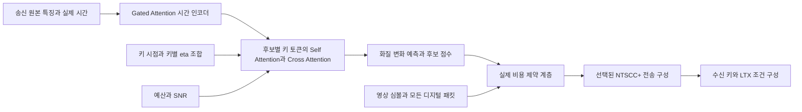

# BSU 공동 키 선택·전송률 예측기

**최신 상태 — 2026-10-22:** 600개 정답 구축은 미완료이며 확인 시점에 관련 프로세스가 없다. 과거 `status.json`의 `RUNNING`은 실제 실행 상태와 다르고 최종 데이터 검사·학습·검증 보고서도 없다. 아래 초기 실행 기록과 설계 계약은 보존한다. [상태와 근거](../RESULTS.md#bsu-joint-allocation-status) · [구조 요약](../MODEL_ARCHITECTURE.md#bsu-joint-allocation) · [자료](../DATA.md#bsu-joint-allocation-data) · [실행](../RUN_GUIDE.md#bsu-joint-allocation) · [평가](../METRICS.md#bsu-joint-allocation-metrics)

구현일: 2026-10-19. **별도 실행하는 연구 경로이며 기본 BSU 정책에는 적용하지 않았다.**
학습형 모델이 키 시점·키별 전송률 조합을 평가하고, 고정된 제약 계층이 실제 전송량으로
가능한 조합을 선택한다. NTSCC+와 LTX 본체는 학습하지 않는다.

## 구현 구조



- 기본 모델: hidden 256, 4 heads, 시간 인코더 3블록, 후보 인코더 2블록, **4,575,008 파라미터**.
- RMSNorm, SwiGLU, attention 출력에 query-dependent headwise sigmoid gate 적용.
- 후보 내부의 키 토큰끼리 self-attention하고, 원본 시간 특징에 cross-attention한다.
- 위치는 배열 순번만 쓰지 않고 실제 초 단위 시간과 상대 시간을 함께 표현한다.
- 후보별 키 개수와 영상 길이는 padding/mask로 처리한다. 후보 배열 순서는 점수에 영향을 주지 않는다.
- 후보마다 키별 eta가 다를 수 있다. 키 하나의 점수를 더하는 방식이 아니라 전체 배분 조합을 평가한다.
- 품질 출력은 명시적인 기준 후보 대비 변화량이다. 후보 점수는 순위·선택 목적에 맞게 별도 학습한다.
- `gated=false`로 동일 구조의 일반 Attention 비교가 가능하다. Gated Attention이 BSU에서 더 좋다는 결과는 아직 없다.

코드:

- [모델과 손실](../../src/semantic_transmission/bsu_allocation.py)
- [데이터와 송신 특징](../../src/semantic_transmission/bsu_allocation_data.py)
- [실제 비용·키별 인코딩·수신 복원](../../src/semantic_transmission/bsu_allocation_transport.py)
- [학습·평가·선택 명령](../../src/semantic_transmission/bsu_allocation_training.py)
- [설정](../../configs/bsu_allocation.json)
- [검증 테스트](../../tests/test_bsu_allocation.py)

## 특징과 후보 구성

기본 특징 추출기는 원본 프레임에서 4×4 RGB(48), 이전 프레임과의 차이(16),
Farneback 움직임 통계(6), Laplacian 통계(1)를 추출한다. **71차원의 알고리즘 특징이며
DINOv3나 다른 사전학습 인코더가 연결됐다는 뜻은 아니다.** 그 뒤 시간·후보 처리는 학습형이다.

사전학습 모델의 송신부 특징을 사용할 경우 같은 NPZ 인터페이스에 저장하고
`feature_dim`, `feature_schema`를 변경해 다시 학습한다. feature_schema에는 추출기·가중치·전처리
버전을 구분할 수 있는 식별자를 사용한다. 수신 복원 영상이나 평가값을 특징에 포함하지 않는다.

NPZ에는 `features: float32[T,F]`, `times: float32[T]`, `frame_indices: int64[T]`만 저장한다.
시간은 클립 시작부터의 초이며 0에서 시작해 증가해야 한다. 모든 후보 키의 시점이 캐시에 있어야 한다.

`candidate_grid(key_sets, eta_values, frames, max_candidates=256)`는 명시한 키 집합마다
키별 eta의 조합을 만든다. 예를 들어 3키와 eta 두 값이면 균등 배분뿐 아니라 8개 배분을 만든다.
후보 수가 한도를 넘으면 실패하며 임의로 앞쪽 후보만 남기지 않는다. 원하는 후보 목록을 직접
제공할 수도 있다. 모델은 이 후보 공간 안에서 선택하므로 모든 가능한 배분의 전역 최적을 보장하지 않는다.

## 실제 비용 제약과 코덱 연결

`bundle(visual, metadata, auxiliary_packets, channel)`에 실제 전송할 파일을 모두 등록한다.
첫 디지털 패킷은 메타데이터이고, 뒤에는 별도 부호화되는 궤적 등 보조 패킷을 넣는다.
파일마다 SHA256을 보관하고 학습 데이터 검사와 최종 선택 시 다시 확인한다.

비용은 다음을 합산한다.

1. 실제 `visual.c64`의 복소 심볼 수. 파일 저장 바이트 수를 전송 비트로 오인하지 않는다.
2. 각 실제 디지털 패킷의 길이, LDPC 패딩·패리티, 변조 심볼 비용.
3. 등록된 모든 보조 패킷의 같은 비용.

하나의 패킷 안에 있는 필드별로 LDPC 반올림을 반복하지 않는다. 압축된 메타데이터는
실제 압축 패킷 길이로 비용을 계산하고, 복원한 헤더로 키·전송률·심볼 수를 검사한다.
예산 비교는 int64로 수행한다. 가능한 후보가 없으면 `INFEASIBLE_REGISTERED_BUDGET`으로 실패한다.
기록하지 않은 물리 링크 비용까지 보장하는 것은 아니며, **보조정보 누락 없이 bundle을 구성하는 것은 송신 호출부의 책임**이다.

`encode_candidate(...)`는 각 키 인코딩 전에 개별 eta를 적용하고 원래 코덱 상태를 복구한다.
출력은 `bsu_joint_allocation_inputs_v1` 스키마의 메타데이터와 영상 심볼이다.
이 함수가 반환하는 것은 키 전송만의 bundle이다. 궤적을 보낸다면 만들어진 궤적 패킷까지
포함해 bundle을 다시 구성한 다음 선택해야 한다.

`decode_received(received_directory, output_key_directory, ...)`는 받은 메타데이터·심볼만으로
키 PNG를 복원한다. 원본이나 예측기 특징을 읽지 않는다. 복원한 키와 메타데이터는
기존 `ltx_conditioning.prepare(..., variant='context')`에 연결할 수 있다.
이 스키마를 기존 파일럿 수신기에 그대로 전달하지 말고 새 수신 API를 사용한다.

현재 경로는 후보를 실제 인코딩한 후 정확한 비용을 확인한다. 예측기는 LTX를 후보마다
돌리지 않아도 선택하지만, 후보 인코딩 비용은 남는다. 많은 후보를 다룰 때는 키/eta 인코딩 캐시나
별도 후보 제안기를 붙이는 것이 후속 과제다.

## 학습 목표와 데이터 계약

목표 지표 순서는 `PSNR`, `LPIPS`, `flow_error_mean`이다. 기본 정규화는 각각
1 dB, 0.02, 0.1이며, LPIPS·flow는 감소가 양수가 되게 부호를 바꾼다.
기준 후보 대비 정규화한 개선량의 가중합 `[1, 1, 0.5]`를 utility로 사용한다.
**이 가중치는 미리 정한 연구 설정이며 보편적인 품질의 정답은 아니다.** 결과 보고에서는
개별 지표도 확인해야 한다. 최종 시험 결과를 보고 가중치를 조정하면 독립 시험이 아니다.

손실은 품질 변화의 Huber loss, 실제 개선량 차이에 가중치를 둔 후보 순위 loss,
가능한 후보들의 softmax 기대 regret을 합한다. 여기서 regret은 평가한 후보 중 최선과의 차이다.
학습의 softmax는 미분을 위한 연속 대용이며 추론에서는 실제 비용 제약 후 hard argmax를 사용한다.
학습 중 LTX를 다시 실행하거나 LTX에 역전파하지 않는다.

데이터 JSON의 최상위 필드:

| 필드 | 의미 |
|---|---|
| `schema` | `bsu_joint_allocation_dataset_v1` |
| `feature_schema`, `feature_dim` | 특징 추출 설정 식별자와 차원 |
| `pipeline_id` | 고정된 코덱·생성·후처리·평가 프로토콜 식별자 |
| `records` | 한 원본 구간·예산·SNR에서 비교한 후보들의 묶음 |

각 record에는 `id`, `source_id`, `source_sha256`, `split`, `frames`, `budget`, `snr_db`,
`baseline_id`, `feature`, `candidates`를 넣는다. 필요하면 `minimum_key_spacing`을 지정한다.
`feature`에는 절대 경로 `path`, `sha256`, `source_only: true`가 필요하다.
각 candidate는 `id`, `keys`, `etas`, `bundle`, `metrics`를 가진다.
metrics의 키는 `psnr_db`, `lpips_vgg`, `flow_error_mean`이다. 선택 명령에서는 metrics를 읽지 않는다.

서로 다른 crop·해상도·seed·예산이어도 같은 원본이면 반드시 같은 `source_id`를 지정한다.
동일 source_id 또는 source_sha256이 여러 split에 있으면 거부한다. 서로 다르게 인코딩된 같은
원본까지 SHA256만으로 식별할 수는 없으므로 원본 ID를 정확하게 부여해야 한다.
기본 학습은 train과 validation을 요구하고, 최종 test는 checkpoint의 학습·검증 원본과 겹치면 거부한다.
feature의 source_only 표기는 계약이며 임의 외부 특징의 의미를 자동 판별하는 장치는 아니다.

완료된 파일럿은 `import-pilot`으로 변환할 수 있다. 원본 프레임 해시, 평가 JSON과 최종 MP4 해시,
실제 전송 비용을 확인한다. 변환된 두 영상은 모두 development이며 독립 검증용으로 재분류하지 않는다.

## 명령어

다음 명령은 이번에 생성한 개발 데이터의 무결성을 검사한다.

```bash
bash scripts/run_bsu_allocation.sh audit \
  --dataset outputs/bsu_allocation_20261019/development_data/dataset.json
```

개발 학습의 완료 상태 확인:

```bash
bash scripts/run_bsu_allocation.sh status \
  --output outputs/bsu_allocation_20261019/development_smoke
```

새 파일럿 변환은 기존 파일을 덮어쓰지 않는 새 출력 경로를 지정한다.

```bash
bash scripts/run_bsu_allocation.sh import-pilot \
  --pilot outputs/bsu_key_budget_pilot_20261019 \
  --output outputs/bsu_allocation_new_development_data
```

아래는 **별도로 구축한 원본 분리 학습 데이터가 준비된 후** 사용하는 본학습 명령이다.
해당 데이터셋 경로가 현재 생성돼 있다는 뜻은 아니다.

```bash
bash scripts/run_bsu_allocation.sh train \
  --dataset .local/datasets/bsu_allocation/dataset.json \
  --config configs/bsu_allocation.json \
  --output outputs/bsu_allocation_training --device cuda

bash scripts/run_bsu_allocation.sh watch --output outputs/bsu_allocation_training
```

Ctrl-C/SIGTERM을 받으면 완료한 optimizer step에서 체크포인트를 남긴다. 같은 명령으로
optimizer·scheduler·Torch RNG·source-balanced sampler 상태를 복구한다.
입력·설정·구현 파일 해시가 달라지면 기존 실행을 이어가지 않는다. 강제 종료는 마지막 저장 지점에서 재개한다.
학습은 원본별로 균등하게 뽑고, 그 원본 안에서 구간을 뽑는 복원 추출을 사용한다.

학습된 모델로 후보를 선택하거나 별도 test를 평가하는 명령:

```bash
bash scripts/run_bsu_allocation.sh select \
  --dataset .local/datasets/bsu_allocation/inference.json \
  --checkpoint outputs/bsu_allocation_training/best.json \
  --output outputs/bsu_allocation_selection.json

bash scripts/run_bsu_allocation.sh evaluate \
  --dataset .local/datasets/bsu_allocation/test.json \
  --checkpoint outputs/bsu_allocation_training/best.json \
  --split test --output outputs/bsu_allocation_test.json
```

`select`는 선택 결과와 해시가 연결된 전송 bundle을 저장한다. 자동 전송이나 LTX 실행은 하지 않는다.
모델·특징·생성 파이프라인의 계약이 다르면 거부한다. 개발 checkpoint에는 명시적으로
`--allow-development`가 필요하며, 이 옵션이 일반화나 화질 개선을 의미하지 않는다.

## 이번 검증 범위

- 새 예측기와 기존 예산 파일럿·메타데이터 테스트를 함께 실행: 56개 통과.
- 후보/프레임 padding, 후보 순서 불변성, 실제 시간·eta·예산 입력 반영 확인.
- 예산 경계의 정수 비교, LDPC 768→769바이트 경계, 모든 보조 패킷 비용, 변조된 파일 차단 확인.
- 평가값의 모델 입력 분리, 원본 그룹 누출 차단, 학습 재개 시 가중치·학습 순서 일치 확인.
- 기존 2영상×3후보의 실측 결과로 기본 458만 파라미터 모델을 CPU에서 30스텝 학습.
  동일 개발 자료로 실행을 확인한 것으로, 미사용 영상 검증이나 본학습 완료가 아니다.
- 실제 NTSCC+ 가중치로 키 0/36에 eta 0.1/0.3을 적용해 인코딩하고, 받은 파일만으로 복원.
  이 코덱 검증은 잡음 채널 없이 수행했으며 LTX 조건 요청의 유효성까지만 확인했다.
- 새 정책으로 LTX 영상 생성·화질 비교, 여러 SNR/seed/미사용 영상의 일반화는 아직 검증하지 않았다.

결과: `outputs/bsu_allocation_20261019/`. 공식 검증 기록은
[2026-10-19-bsu-joint-allocation.json](../validation/2026-10-19-bsu-joint-allocation.json).

## 600개 실측 후보 정답 구축

2026-10-19에 별도 구축 경로를 추가했다. **600개 완료 여부는 실행 결과의 상태로 확인한다.**
실행 시작, 코드 테스트 통과, 원본 다운로드 완료를 실측 정답 완료로 계산하지 않는다.

- 원본: [Inter4K 공식 배포](https://github.com/alexandrosstergiou/Inter4K)의
  [공개 미러](https://huggingface.co/datasets/Shilin-LU/Inter4k), 고정 revision
  `5188fdc892565c692c8e05e71cbef920e5fa5e5a`. 각 다운로드를 LFS SHA256·길이와 대조한다.
- 고정 seed로 순서를 정하고, 전체 5초 클립의 표본 5장에 pHash·색상 검사를 적용해
  유사 원본을 제외한 100편을 선택한다. 원본 파일별 1구간, 학습 80편·검증 20편이다.
  미러에 촬영 세션 ID가 없어 동일 촬영에서 파생된 영상까지 완전히 구분한다는 보장은 없다.
- 첫 구축은 **49프레임·24fps·576×320**, AWGN 10dB, 생성 seed 2025로 제한한다.
  시작 위치는 원본별 고정 난수로 정하고 정규화 MP4를 평가 기준으로 사용한다.
  긴 영상·다른 SNR·여러 seed의 범용성은 이 600개만으로 검증하지 않는다.
- 원본마다 Qwen3.5-9B+기존 캡션 LoRA로 초안을 만들고, LoRA를 끈 같은 기반 모델로
  원본을 재검토한다. 그 캡션을 여섯 후보가 공통 사용한다. 독립 의미 검증은 아니다.

| 후보 | 구성 |
|---|---|
| `baseline` | 시작·중앙·끝 3키, eta 0.2 균등 배분 |
| `more_keys` | 송신 원본의 보간 잔차가 큰 시점 1키 추가, 전송률을 예산에 맞춤 |
| `key_quality` | 시작·끝 2키, 전송률을 예산에 맞춤 |
| `unequal_rates` | 같은 3키, 상대 eta 가중치 0.8:1.4:0.8을 공통 배율로 조정 |
| `different_times` | 중간 키 시점을 송신 원본 보간 잔차로 변경, 3키 유지 |
| `random_valid` | 고정 난수로 유효한 중간 시점·비균등 배분 생성 |

기준 후보는 재현 가능한 균등 시점 기준선이며, 현재 서비스의 학습형 키 선택기를 재현하는
기준선은 아니다. 후보 선택에는 생성 결과를 쓰지 않는다. 전송률 탐색은 실제 인코딩 비용만
사용한다. 키 간격은 최소 4프레임이고, 시작·끝 키는 항상 포함한다.

모든 후보에 NTSCC+ 실제 인코딩, LDPC/QAM 메타데이터 채널, AWGN 영상 심볼 채널,
궤적 채널, 받은 파일만 사용하는 키 복원, LTX 다중 키 생성과 기존 후처리를 실행한다.
키 전송은 기준 후보의 비용 이내로 맞추고 궤적도 기준 후보의 실제 궤적 비용 이내로 제한한다.
최종 비용에는 모든 실제 패킷을 포함한다. 사용량이 상한보다 작은 후보도 있으므로 정확히
동일 전송량이라는 주장은 하지 않으며 실제 사용량·이용률을 기록한다.

최종 MP4의 PSNR·SSIM·LPIPS·DISTS·CLIP 및 시간적 진단을 평가하고, 예측기에는
PSNR·LPIPS·광류 오차를 정답으로 저장한다. 실패한 생성·비유한 값·예산 초과는 작업을
중단시키며 임의의 낮은 점수로 대체하지 않는다. 첫 1편의 6후보를 끝까지 처리한 다음
4편 단위로 이어가므로 초기 경로 오류가 나머지 594개로 확대되지 않는다.

```bash
# 최초 실행 / 중단 후 재개
bash scripts/run_bsu_allocation_labels.sh run

# 읽기 전용 진행 상황; 바뀐 줄만 갱신하며 Ctrl-C는 확인 화면만 종료한다.
bash scripts/watch_bsu_allocation_labels.sh

# 완료 후 실제 600개·원본 분리·전송량·평가 증거 재검사
bash scripts/run_bsu_allocation_labels.sh audit
```

실행 위치는 `outputs/bsu_allocation_labels_600_20261019/`이다.

- `corpus/corpus.json`: 원본 해시·시작 시점·중복 검사·80/20 분리.
- `protocol.json`, `code_snapshot/`: 후보·모델·실행 환경과 코드의 고정 기록.
- `labels/<원본>/<후보>/`: 실제 송수신 파일, 원본과 분리된 생성 입력,
  생성·후처리 영상, 평가 JSON·프레임별 CSV, 정답 증거.
- `dataset.json`, `DATASET_AUDIT.json`: 600개 전부 검사한 뒤에만 만드는 학습 자료와 검사 결과.
- `predictor/`: 구축 완료 후 기본 예측기를 80편으로 1,000스텝 학습하고 20편으로 검증.
- `PREDICTOR_VALIDATION.json`: 최선 체크포인트의 선택 regret·지표 변화·예산 위반,
  원본 단위 bootstrap 구간. 체크포인트 선택에 사용한 검증 집합이므로 독립 시험은 아니다.
- `RESULT.json`: `COMPLETE_BSU_ALLOCATION_600_LABELS`일 때 데이터 검사·학습·검증 완료.

완료된 후보와 LTX 구간은 해시 검사 후 재사용한다. 부분 파일은 실패 기록으로 보관하고
동일한 seed로 재개하며, 결과가 나쁘다는 이유로 seed나 원본을 교체하지 않는다.
코드·설정이 바뀌면 기존 실행을 거부한다. 기본 BSU 경로는 자동 변경하지 않는다.
새 조회 명령은 실험에 고정된 코드 파일을 수정하지 않는 별도 화면이다.
한 번만 상태를 출력하려면 `bash scripts/watch_bsu_allocation_labels.sh --once`를 사용한다.

구현: [원본 구축](../../src/semantic_transmission/bsu_allocation_corpus.py),
[실측 정답 파이프라인](../../src/semantic_transmission/bsu_allocation_labels.py),
[구축 설정](../../configs/bsu_allocation_labels.json),
[추가 검사](../../tests/test_bsu_allocation_labels.py).

초기 실행 확인: 관련 66개 테스트와 최선 체크포인트 평가 테스트 1개가 통과했다.
원본 100편·80/20 분리를 확인했고, 첫 원본의 6개 후보는 실제 채널·수신 복원을 통과했다.
첫 기준 후보의 49프레임 LTX 생성과 최종 MP4 평가까지 완료했으며 완료 구간의 해시 재사용도
확인했다. 이는 2026-10-19 초기 실행 확인이다. **2026-10-22에는 600개 전체와 후속 본학습의 완료 근거가 없고 관련 프로세스도 없다.** 품질 개선을 입증한 상태가 아니며 현재 상태는 문서 첫 절을 따른다.
[초기 검증 기록](../validation/2026-10-19-bsu-allocation-labels-600.json)을 참고한다.

## 설계 참고

Gated Attention의 attention 출력 뒤 게이트라는 원리를 BSU용으로 독립 구현했다.
원 논문의 언어 모델 성능을 BSU 성능으로 해석하지 않는다.
[Gated Attention 공식 구현 설명](https://github.com/qiuzh20/gated_attention).

예측 정확도와 최종 선택 성능을 구분하는 학습 방향은
[Decision-Focused Learning, AAAI 2019](https://ojs.aaai.org/index.php/AAAI/article/view/3982)를 참고했다.
여기서는 캐시된 유한 후보의 순위와 기대 regret을 학습하며, 원 논문의 최적화 계층을 그대로 재현한 것은 아니다.
