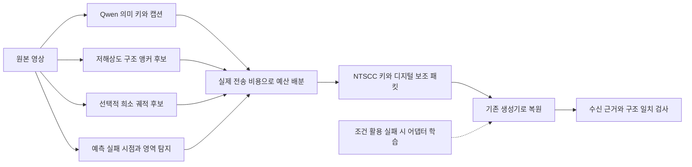

# BSU 전송량·복원 품질 동시 달성 아이디어 — 2026-10-11

[프로젝트](../../README.md) · [구조](../MODEL_ARCHITECTURE.md#bsu-next-design) · [결과](../RESULTS.md#bsu-progress) · [평가 기준](../METRICS.md#bsu-reconstruction-evaluation)

**2026-10-22 현재 브랜치:** 기본 모델은 [BSU-Gen의 NTSCC+·LTX 생성 경로](../MODEL_ARCHITECTURE.md#bsu-gen)다. 공동 배분 예측기는 [별도 미완료 연구](../RESULTS.md#bsu-joint-allocation-status)이며 기본에 적용하지 않았다. 예측 전용 JSCC의 한 영상 실측은 [별도 결과](../RESULTS.md#bsu-predict)로 구분한다. 아래 혼합 BSU 아이디어와 채택 판정은 당시 모델의 이력이다.

**2026-10-16 이력:** 당시 기본은 [DCVC-RT + RIFE 혼합 BSU](../MODEL_ARCHITECTURE.md#bsu-predictive-default)다. Kinetics 개발 14편에서 이전 BSU 대비 전송 43.76% 감소·등록 화질/동작 기준 14/14 통과를 근거로 사용자 요청에 따라 채택했다. LGVSC 대비 1.75배로 전송 목표는 남아 있다. 추가 간격+QP 탐색은 기본 대비 1.12% 절감에 그쳐 연구 옵션으로 보존한다. [두 실험의 측정값](../RESULTS.md#bsu-predictive-default)

10월 16일에 정리한 후속 후보는 선택적으로 유료 잔차·패치를 보내는 방식과 압축 입력·불규칙 간격에 맞춘 보간/보정 학습이다. 이들의 기본 BSU 대비 성능 개선은 아직 검증하지 않았다. 아래 ①~⑥ 번호와 +5% 예산은 10월 11~12일 당시 설계·실험의 기록이며, 현재 기본 모델의 설정이나 달성 기준으로 소급 적용하지 않는다. 생성 내부 어댑터의 학습 명령 구현·계속 학습과 검증된 체크포인트 채택도 구분한다.

**상태: 통합 설계안과 ①·② 검증에 이어 ③·④ 일부·⑤ 일부 및 시간 보정의 7원본 검증 완료, 2026-10-12 갱신.** 최초 6조건·저주파 주입 5조건·시간축 대조 4조건 뒤, 희소 궤적·적응형 궤적 시점·수신 일치 검사·시간 보정을 28조건과 후속 14조건에서 시험했다. 시간 보정은 선택형 보정 명령 기본 모드로 채택했다. 이미지 앵커의 적응형 배치·독립 의미 검사·⑥ 구조 조건 학습은 남아 있다. [최초](../RESULTS.md#bsu-structure-anchors) · [저주파](../RESULTS.md#bsu-frequency-anchors) · [시간축](../RESULTS.md#bsu-temporal-support) · [7원본 실측](../RESULTS.md#bsu-trajectory-cadence)을 설계상의 기대 효과와 구분한다.

목표는 **LGVSC 수준의 총전송량에서 고정 22키 BSU 수준의 원본 재현력**이다. 10월 12일 사용자 지시에 따라 품질 이득이 있으면 소폭 전송 증가도 허용한다. 이번 궤적 탐색은 +5%를 상한 가정으로 사용했다. 기본안은 원문의 **① 의미 키+구조 앵커, ② 키 품질과 앵커 수의 예산 배분, ④ 예측 실패 지점의 앵커 배치**를 결합한다. **③ 희소 궤적은 움직임 복원의 비교 후보, ⑤ 자기 검증은 수신 근거의 검사, ⑥ 조건 학습은 기존 생성기가 조건을 활용하지 못할 때의 확장**으로 포함한다. 추가 제안은 이 구성을 보완하며, 조건 어댑터 학습을 시작부터 필수로 두지 않는다.

**후속 11원본 검증:** 적응형 시간 보정과 가림 합성을 44조건으로 대조했다. 가림 합성은 현재 결합 대비 PSNR +0.589dB·LPIPS −2.22%였지만 이동 인물 잔상과 추가 4편의 정지 증가가 남았다. 적응형 시간 보정은 움직임 변화 오차가 +3.16% 악화했다. 두 변경의 기본 교체는 보류하고 현재 결합을 유지한다. [실측·손익·판정](../RESULTS.md#bsu-adaptive-visibility)

## 1. 10월 11일의 증거와 목표

항구 16초(입력 384프레임, 576×320, AWGN 10dB)의 **공통 381프레임·전달 MP4** 비교다. [결과](../RESULTS.md#bsu-zea-three-way) · [전송량 검증 기록](../validation/2026-10-09-bsu-zea-three-way.json)

| 조건 | 키 | 전송량(복소 채널 사용량) | PSNR ↑ | LPIPS ↓ |
|---|---:|---:|---:|---:|
| LGVSC 공개 정책 기준선 | 2 | 92,475 | 16.619 | 0.36036 |
| BSU 가변 2키 | 2 | 91,495 | 15.905 | 0.36192 |
| BSU 고정 22키 | 22 | 980,599 | 20.927 | 0.29038 |

| 조건 | 시각(NTSCC 키) | 디지털(LDPC/16-QAM) | 키 1장당 시각 비용 |
|---|---:|---:|---:|
| LGVSC | 85,563 | 6,912 | 약 42,800 |
| BSU 가변 2키 | 84,583 | 6,912 | 약 42,300 |
| BSU 고정 22키 | 922,999 | 57,600 | 약 42,000 |

- **관측:** BSU 2키에서 전송량의 약 92%가 키 영상이다. LGVSC 예산까지 여유는 980이며, 새 LDPC 1블록에도 못 미친다. 보조 정보 추가와 키 예산 재배분을 함께 설계해야 한다.
- **가설:** 22키의 잦은 시각 근거가 중간 구도·외형 유지에 기여했을 가능성이 크다. 다만 약 +5dB를 구조 정보만의 효과로 단정할 수 없다. 키 위치·캡션·구간·실제 잡음도 달라 단일 요인의 인과 대조가 아니다.
- **기존 실패에서 얻는 제약:** [10월 10일 움직임 파일럿](../RESULTS.md#bsu-motion-pilot)은 보조 정보 527바이트로 항구 PSNR +1.680dB를 얻었지만, 저동작 회귀와 질감·윤곽 문제가 남았다. 움직임 표현, 시간 정렬, latent 주입 중 어느 요인이 원인인지는 분리되지 않았다.

**PNG 목표는 별도다.** 후속 수신부 실험의 고정 22키 참고값은 공통 381 PNG에서 PSNR **20.969dB**, LPIPS **0.27832**다. 위 MP4 수치와 혼합하지 않는다. PSNR·LPIPS 달성과 객체의 추가·누락·왜곡 감소도 별개로 검증한다. [평가 범위](../METRICS.md#bsu-reconstruction-evaluation)

## 2. 원문 6개 아이디어의 평가와 채택

원문 번호와 제안의 핵심을 유지해 평가한다. 여기서 **채택은 실험 설계에 포함한다는 뜻**이며, 성능이 확인됐다는 뜻은 아니다. 아이디어의 유용성과 원문에 붙은 비용 추정·효과 보장을 따로 판단한다.

| 원래 아이디어 | 타당한 이유와 기대 효과 | 판단 | 통합안에 남길 구체적 내용 |
|---|---|---|---|
| **① 2계층 앵커: 의미 키 + 저해상도 구조 앵커** | 캡션이나 키 워핑으로 추측하던 중간 구도를 실제 관측으로 전달한다. 고해상도 키를 늘리는 것보다 싼 시각 근거가 될 가능성이 있으며, 기존 RFLOW를 이용한 작은 시험도 가능하다. | **기본 구조로 채택** | 의미 키 위치를 유지한 채 72×40·3fps부터 시험. `edit_ratio`를 이용한 무학습 주입도 첫 후보로 유지. 어댑터는 필요할 때 추가 |
| **② 키 품질 대 앵커 수의 예산 곡선** | 키에 집중된 예산을 비키 프레임 복원으로 옮길 수 있는지 직접 검증한다. 구조 앵커가 좋아도 예산을 초과하면 목표를 충족하지 못하므로 선행 가치가 가장 크다. | **최우선 측정으로 채택** | 원문의 끝 키 1/2 해상도 후보를 포함. 원해상도 2키, 저율 키만, 저율 키+앵커를 비교해 키 손실과 중간 프레임 이득을 분리 |
| **③ 전역 affine을 희소 점 궤적으로 교체** | 거친 영역 평균으로 묶이던 서로 다른 물체의 이동을 따로 표현할 수 있다. 저해상도 앵커가 드문 구간의 이동 경로를 전달한다는 점에서 ①과 상보적이다. | **움직임 복원의 비교 후보로 채택** | 16~64점의 궤적을 실제 부호화하고 현재 affine과 비교. 구조 앵커만·궤적만·둘의 예산 재배분을 비교한 뒤 교체 여부 결정 |
| **④ 앵커 위치를 예측 실패 지점으로 결정** | 같은 장면이어도 구도가 바뀌는 문제를 의미 키 선택과 별도로 다룬다. 쉬운 구간에 쓸 비용을 새로 드러난 영역이나 예측 실패 구간으로 옮길 수 있다. | **기본 선택 정책으로 채택** | 고정 간격을 대조군으로 두고 예측 오차·가시 영역을 이용해 배치. 저동작에서는 원래 키 구성을 유지하는 우회 후보 포함 |
| **⑤ 수신측 자기 검증** | 이미 받은 구조 앵커를 이용하므로 새 전송 없이 큰 구도 이탈을 검사할 수 있다. 원본 없이도 수행할 수 있는 수신부 진단이라는 장점이 있다. | **검사는 채택, 자동 재생성은 조건부** | 우선 불일치 점수와 실제 오류의 관계를 기록. 점수가 오류를 구분하고 보정이 이득을 줄 때만 제한된 재생성 적용 |
| **⑥ 이후 단계 — 조건을 읽도록 생성기 학습** | 충분한 시각 근거를 보내도 기존 생성기가 활용하지 못하는 경우를 해결하는 방향이다. 무학습 주입의 성패와 별도로 조건 이해 능력을 개선할 수 있다. | **필요성에 따른 확장으로 채택** | 기존 생성기를 먼저 고정해 시험한다는 순서를 유지. 필요 시 작은 조건 어댑터부터, 부족하면 LoRA. 무학습 시험이 22키 품질에 도달해야만 학습할 수 있다는 조건은 두지 않음 |

### 2.1 원문에서 유지할 발상과 수정할 주장

**원문의 강점은 정보 표현·예산·선택·복원·검사를 함께 제안했다는 점이다.** 특히 ①+②+④가 이미 하나의 설계로 연결된다. ③은 이동 경로, ⑤는 수신부 진단, ⑥은 조건 활용 능력을 보완한다. 따라서 여섯 제안을 통합안에 포함하되, 아래의 미검증 주장까지 채택하지는 않는다.

| 원문의 주장/절차 | 판단과 수정 |
|---|---|
| 저해상도 앵커가 2~4kB, 희소 궤적이 약 1블록 | 실측 전에는 확정 비용으로 사용하지 않음. 아이디어는 유지하고 전체 패킷 크기로 예산 판단 |
| `edit_ratio`로 생성기가 학습한 저해상도 조건을 줄 수 있음 | 시간 참조를 수정하는 기제는 확인됐지만 열화 조건에 대한 학습은 별도. 무학습 주입 후보는 유지 |
| 앵커 0개면 저동작 회귀를 구조적으로 피함 | 원래 키 품질·수신 입력·난수까지 유지하는 우회가 필요. 적응형 선택의 장점과 회귀 방지 보장을 구분 |
| 자기 검증 점수가 나쁘면 seed 변경·수정 비율 감소로 해결 | 진단은 채택하되 보정 효과는 검증 전까지 미확인. 자동 보정부터 활성화하지 않음 |
| 채널 없는 주입이 22키에 못 미치면 구조 앵커안을 폐기 | 이 중단 기준은 채택하지 않음. 정보 부족과 생성기의 조건 활용 실패를 분리 |

### 2.2 추가 아이디어는 어디에 결합하는가

| 추가 제안 | 결합 위치와 이유 | 우선순위 |
|---|---|---|
| 예상 오류 감소와 실제 채널 사용량에 따른 선택 | 원문 ②+④를 구체화. 키 품질·앵커 위치·궤적을 같은 예산에서 비교 | 기본안의 예산 선택에 포함 |
| 압축 품질·수신 신뢰도를 읽는 작은 어댑터 | 원문 ⑥의 구현 후보. 원문 ①의 무학습 경로를 평가한 뒤 필요한 부분을 학습 | 조건 활용 실패가 남을 때 |
| 작은 객체·새로 드러난 영역의 패치 | 원문 ①의 해상도 부족과 ③의 외형 정보 부족을 보완 | 해당 누락이 확인될 때 |
| 카메라/전경 조건 분리 | 원문 ③의 다른 움직임 표현 후보. 희소 궤적을 먼저 검토하고 비교 | 궤적만으로 부족할 때 |
| GVCC 계열 생성 보정 코드 | 송수신 상태를 공유해 생성 후보를 보정하는 별도 접근 | 기본안과 분리한 대안. 초기 통합 구조에는 넣지 않음 |

통합의 출발점은 **원문 ①+②+④**이며, 추가 제안은 남는 실패를 해결하는 역할이다. 처음부터 저해상도 영상·궤적·패치·코드북·새 생성기를 모두 요구하는 구조로 확대하지 않는다.

## 3. 추천 구조: 필요한 복원 근거에 예산 배분



세 종류의 정보는 역할이 다르다. **의미 키·캡션**은 장면과 사건을, **구조 앵커**는 중간 시점의 구도·색·물체 배치를, **선택적 보정 정보**는 작은 객체·움직임·새로 드러난 영역을 담당한다. 저해상도에서 사라진 작은 배의 외형을 궤적이나 생성기만으로 정확히 되살릴 수 있다고 가정하지 않는다.

### 3.1 전송 예산: 패킷을 만든 뒤 계산

현재 [디지털 전송 구현](../../src/semantic_transmission/metadata_channel.py)의 기본값은 LDPC 정보 6,144비트, 부호어 9,216비트, 16-QAM이다. 따라서 **정보 768바이트/블록, 복소 채널 사용량 2,304/블록**이다. 2.67비트/채널 사용량은 블록을 모두 채웠을 때의 정보 비트 비율이며, 실제 응용 데이터 효율에는 직렬화·패딩이 영향을 준다.

```text
C_total = C_keys + 2304 × ceil(B_packet / 768)
B_packet = 캡션 + 구조 영상 + 선택적 보정 + 인덱스/시간/코덱 정보 + 직렬화
C_total ≤ C_LGVSC(동일 영상)
```

이 식은 디지털 정보를 하나의 패킷으로 묶을 때다. 여러 패킷을 따로 보호하면 각 패킷의 올림값을 합산한다. 기존 패킷에 정보를 추가할 때의 증분은 `2304 × [ceil(B_after/768) − ceil(B_before/768)]`이며, 보조 영상 바이트만으로 따로 계산하지 않는다.

- 항구 기존 BSU 패킷은 1,722바이트로 3블록에 582바이트가 남았다. 움직임 후보는 527바이트를 추가해 2,249바이트, 여유 55바이트였다. 두 여유 값을 혼동하지 않는다.
- **설계 예시:** 키를 합계 60,000 이하로 줄일 수 있다면 디지털 14블록(32,256)을 배정해 합계 92,256이 된다. 이때 디지털 전체 용량은 10,752바이트다. 이는 예산 산술 예시이며, 해당 키 비용·화질이나 보조 영상 크기를 달성한 결과가 아니다.
- 기존의 “72×40·3fps·16초가 2~4kB”는 실측되지 않은 가정이므로 목표치로 고정하지 않는다. 코덱 비트스트림·헤더·타임스탬프까지 저장해 측정한다.
- 비교 범위는 기존 기준처럼 모델 사전 설치·물리 링크 헤더를 제외한다. 영상별 모델 갱신·코드북·새 조건 정보는 보내야 한다면 포함한다. 논문의 BPP를 이 혼합 채널 사용량과 직접 비교하지 않는다.

키 해상도별 비용도 실측해야 한다. 현재 [NTSCC 전송 코드](../../src/semantic_transmission/codec_transport.py)는 하나의 체크포인트를 사용하고, 수신 시 모든 키를 패킷의 공통 영상 해상도로 해독한다. **시작 키는 원해상도, 끝 키는 절반 해상도**로 보내려면 키별 부호화 해상도·패딩/크롭·복원 크기를 패킷에 명시하고 수신 경로를 수정해야 한다. 가로·세로를 절반으로 줄인다고 실제 전송량이 정확히 1/4이 되지는 않는다.

원문 ②의 끝 키 축소는 초기 비교에 포함한다. 다만 끝 키가 항상 덜 중요하다고 가정하지 않고 시작 키 축소·양쪽 축소와 비교한다. 절약한 비용으로 앵커를 추가한 결과를 **같은 축소 키만 사용하는 조건**과 대조해야 예산 재배분의 이득을 알 수 있다. 저동작에서는 키를 줄이고 앵커를 추가하는 것보다 원래 2키를 그대로 보내는 선택이 나을 수 있다.

### 3.2 구조 앵커: 저해상도 영상부터, 이후 적응형 배치

먼저 같은 의미 키 위치를 유지하고, 중간 영상을 **72×40 또는 144×80, 3 또는 6fps** 등 소수의 조건으로 압축한다. 수치는 탐색 시작점이며 최적값이 아니다. 해상도·프레임률·압축 세기를 한꺼번에 크게 늘리지 않고 실제 비용과 잃어버리는 객체를 확인한다.

고정 간격 앵커의 효과를 확인한 뒤, 예측이 어려운 시점에 예산을 집중한다. 송신측에서 기존 키로 예측한 영상과 원본을 비교해 **가려짐 해제, 새 객체, 구도 변화, 작은 객체 소실** 후보를 찾는다. 키 워핑의 가시 영역과 지각 유사도를 사용하는 [ActDiff-VC](https://arxiv.org/html/2605.02849v3)의 발상을 차용하되, 이 점수는 실제 생성기 오류를 대신하는 근사치임을 명시한다.

선택 기준은 “의미 변화가 큰가”와 별도로 **추가 정보를 보냈을 때 예상 오류가 얼마나 줄고 실제 패킷이 얼마나 커지는가**다. 패킷 패딩 때문에 추가 비용이 0인 경우도 있어 단순한 비율만으로 결정하지 않는다. 앵커와 패치가 함께 있어야 효과가 나는 조합도 작은 후보 묶음으로 비교한다.

송신기는 원본을 볼 수 있지만 실제 수신 AWGN 표본을 미리 알 수 없다. 예산 선택은 압축 복호 영상·전달 가능한 조건·채널 분포를 이용하고, 테스트 수신 잡음이나 평가 정답에 맞춰 정책을 고르지 않는다. 적응형 타임스탬프·구간 정보도 패킷 비용에 넣는다.

### 3.3 수신기: 무학습 진단과 조건 학습을 분리

**경로 A — 원문 ①의 무학습 주입을 먼저 평가.** 기존 생성기를 유지하면서 저해상도 앵커가 유용한지 확인할 수 있어 첫 복원 후보로 채택한다. 로컬 Open-Sora의 `apply_mask_strategy`와 RFLOW `mask_t`에는 시간 latent별 `edit_ratio`가 있다. 0은 참조를 고정하고, 1은 전체 생성 구간에서 수정하며, 중간값은 수정하는 시간 구간을 제한한다. `0 / 0.35 / 0.6` 정도의 사전 지정 후보로 압축 복호 앵커를 넣어 볼 수 있다. 낮은 값이 항상 원본 재현력을 높이지는 않으며, 흐린 참조를 고정할 수도 있다.

구현상 다음 제약을 먼저 해결한다.

- 마스크는 **시간축**이며 객체별 공간 ROI 마스크가 아니다. 이 기제가 있다는 사실은 저해상도·압축 열화 조건을 모델이 학습했다는 뜻이 아니다.
- 현재 키는 [수신 스크립트](../../04_semantic_decoder/scripts/mydemo_new_align_sh.py)에서 개별 이미지로 VAE 인코딩된다. Open-Sora의 17프레임→5 latent 같은 시간 압축과 위치 정렬을 고려해야 하며, 원본 프레임 번호를 단순 비율로 latent 번호로 바꾸면 안 된다. 정렬 후 앵커 충돌·덮어쓰기와 구간 경계도 확인한다.
- VAE 호출 추가가 난수 소비를 바꿀 수 있다. 같은 seed만 쓰지 말고 공통 키 VAE·초기 latent·RFLOW 단계 잡음을 실제로 고정하고, 추가 조건의 난수는 별도로 관리한다.
- [기존 참조 게이트](../RESULTS.md#receiver-history-gate)의 구현은 이식 지점의 참고일 뿐, 새로운 저해상도 조건의 품질 증거가 아니다.

**경로 B — 원문 ⑥의 조건 학습을 필요한 경우 적용.** 경로 A로 예산·품질 목표를 만족하면 학습을 필수로 추가하지 않는다. 수신 근거가 충분한데 생성기가 무시하거나 흐리게 반영하는 문제가 남으면, 복호한 저해상도 영상·수신 키·시간/압축 조건을 입력하는 작은 어댑터를 검토한다. 초기에는 본체를 고정하고 0으로 초기화한 조건 연결부터 시작하며, 필요한 경우에만 LoRA를 추가한다. 학습 목표는 원본을 향하는 flow-matching/복원 목적과 저주파 구조·시간 일관성·선택한 객체 영역의 오차를 함께 고려하되, 정확한 손실과 가중치는 검증 세트에서 결정한다.

[DiSCo](https://arxiv.org/html/2512.00408v2)의 압축한 시공간 조건, [GNVC-VD](https://arxiv.org/html/2512.05016v2)의 복호 latent 조건과 부분 잡음 복원, [DiffVC-ONE](https://arxiv.org/html/2608.20515v1)의 압축 품질을 반영한 생성 제어가 설계 근거다. 해당 모델·학습법이 Open-Sora에 그대로 적용된다는 뜻은 아니다. DiSCo의 13B·rank 256 설정은 현재 16GB 환경의 실행 계획으로 채택하지 않으며, 작은 어댑터도 실제 메모리 확인이 필요하다.

**경로 A가 실패해도 경로 B를 기각하지 않는다.** 채널 없이 축소 원본을 주입하는 시험은 좋은 조건에서의 진단이지 이론적 품질 상한이 아니다. 열화 조건을 모르는 생성기가 실패한 것인지, 보낸 정보 자체가 부족한 것인지 분리해야 한다.

### 3.4 선택적 보정: 움직임에는 궤적, 새 외형에는 패치

**원문 ③의 희소 궤적을 독립적인 비교 후보로 유지한다.** 현재 [움직임 표현](../../src/semantic_transmission/compact_motion.py)은 전역 유사 변환과 2×2 영역 잔여 움직임을 저장한다. 서로 다른 객체를 같은 영역 평균으로 묶는 한계가 있어, 가시성과 신뢰도를 포함한 점 궤적을 비교할 이유가 있다. 다만 이전 복원 실패가 표현 문제인지 주입 문제인지 분리되지 않았으므로 교체를 확정하지 않는다.

첫 비교는 같은 키와 총예산 한도에서 **구조 앵커만 / 희소 궤적만 / 앵커와 궤적에 예산 재배분**이다. 기존 affine도 대조군으로 남긴다. 실제 부호화 비용과 워핑·가시 영역 오차를 먼저 확인하고, 최종 채택은 수신 복원 결과로 판단한다. 패치는 이 비교에서 남는 외형 누락을 해결하는 추가 후보다.

| 실패 유형 | 우선 비교할 보정 | 정보의 한계 |
|---|---|---|
| 카메라 이동·시차·물체 위치가 잘못됨 | 가시성/신뢰도를 포함한 희소 점 궤적, 또는 카메라와 전경 움직임 분리 | 움직임만으로 새로 보이는 질감·객체 외형을 알 수 없음 |
| 저해상도에서 작은 객체가 사라짐 | 해당 시점·영역의 압축 패치 또는 복원 잔차 | 위치·크기·참조 상태·부호화 정보와 수신 주입 방식 필요 |
| 넓은 영역이 새로 드러남 | 구조 앵커 해상도/빈도 증가 또는 키 갱신 | 작은 궤적/패치만으로 처리하기 어려울 수 있음 |

궤적은 16~64점 정도의 작은 탐색부터 시작하되 “1 LDPC 블록이면 된다”고 가정하지 않는다. 예를 들어 좌표당 1바이트·15시점·2좌표만으로 16점은 480바이트, 64점은 1,920바이트다. 초기 위치·가시성·ID·시간 정보가 추가되고 차분/엔트로피 부호화 후 크기는 달라진다. 모든 궤적이 의미상 중요한 작은 객체를 포함하는지도 별도 확인한다.

[T-GVC](https://arxiv.org/html/2507.07633v4)는 DynamiCrafter에서 궤적에 따른 latent 유사도 손실의 **gradient guidance**를 쓴다. 학습이 없다는 것이 역전파가 없다는 뜻은 아니다. RFLOW로 옮기려면 시간 좌표·업데이트 식·메모리를 확인해야 한다. ActDiff-VC 역시 움직임 조건을 이미 읽는 DaS를 사용하므로 Open-Sora의 무학습 궤적 수용을 보장하지 않는다. 카메라/전경 분리는 [CPSGD](https://arxiv.org/html/2602.05201v1)의 참고 아이디어이며, 논문의 3D 카메라·마스크·학습된 조건 경로를 현재 affine과 동일시하지 않는다.

패치를 “잔차”로 보낼 경우 송수신기가 같은 예측 상태를 재현해야 한다. NTSCC 잡음 때문에 그 상태를 보장할 수 없다면, 처음에는 독립 복호 가능한 패치가 더 명확한 대조다. 압축 구조 영상과 중복되는 궤적/패치는 예상 오류 감소가 실제 비용을 정당화할 때만 추가한다.

### 3.5 자기 검증과 우회: 수신 근거에 대한 검사

**원문 ⑤의 자기 검증은 검사 기능부터 채택한다.** 생성 출력을 수신 앵커의 해상도·시점으로 줄여 차이를 측정한다. 이미 전달된 근거를 활용하므로 전송량을 늘리지 않고 수신부에서 큰 구도 이탈을 진단할 수 있다는 점이 장점이다. 우선 점수만 기록해 실제 오류와의 관계를 검증한다. 다만 **저해상도에서 보이지 않는 작은 객체의 누락, 그럴듯한 가짜 질감, 앵커 사이의 잘못된 동작은 이 검사에 통과할 수 있다.** 이를 Added/Missing/Distorted 검증으로 대체하지 않는다.

**자동 재생성은 아직 기본안에 채택하지 않는다.** 검사 점수가 실제 오류를 구분하고 재생성이 품질을 개선한다는 증거를 얻으면 적용한다. 그때도 원본 없이 수신 근거만으로 결정하며 횟수·지연 상한을 정한다. seed 변경이나 `edit_ratio` 감소가 반드시 개선을 주지는 않는다. 재생성 전후의 의미 오류와 오경보·미검출을 따로 평가한다.

저동작 영상에는 보조 조건을 쓰지 않는 우회 모드를 둔다. 그러나 앵커 0개만으로 기존의 PSNR 37.786→30.733dB 회귀를 자동 방지한다고 주장할 수 없다. 원래 키 품질·수신 데이터·샘플링 경로·난수까지 유지하는 우회 조건을 확인해야 하며, 잘못된 저동작 판정도 평가해야 한다.

## 4. 별도 대안과 후순위

**공유 코드북으로 생성 경로 보정:** [GVCC](https://arxiv.org/html/2603.26571v3)와 [GVCCTurbo](https://arxiv.org/html/2608.03517v1)처럼 송신측에서 생성 후보를 원본과 비교해 보정 인덱스를 선택하고, 수신측에서 공유 코드북·일정으로 재현하는 경로다. 저해상도 조건만으로 부족한 세부를 작은 인덱스로 전달할 가능성을 시험한다. 이는 일반적인 seed 하나를 고르는 것과 다르다.

이 경로는 주력안에 바로 더하지 않는다. 송신 생성 비용, 동일한 모델/조건/난수 상태, 스케줄·시드·코드북 관련 실제 비트가 필요하다. 특히 송신기는 NTSCC 수신 잡음을 알 수 없으므로 깨끗한 키로 최적화한 보정이 수신 키에도 통한다고 가정하지 않는다. 먼저 디지털로 같은 조건을 공유하는 작은 실험으로 재현성을 확인하고, 모든 전송 정보와 전체 인코딩/복호 시간을 포함해 비교한다.

**키 자체의 생성 복원:** SGD-JSCC(로컬 원문 `docs/SGDJSCC_paper/SGDJSCC_arxiv.tex`, Git 배포 제외)의 텍스트·윤곽 조건을 이용한 수신 키 복원은 키 예산 절감 후보다. 이미 보낸 캡션의 재사용 비용만 0이며, 새로운 윤곽·제어 정보와 모델 변경은 별도다. 중간 프레임 복원기와 키 복원기를 동시에 바꾸면 원인을 분리하기 어려워 후순위로 둔다.

**속도 개선:** 품질·전송량이 성립한 뒤 [VoRTeC](https://arxiv.org/html/2609.02291v1)의 사전학습 flow 활용이나 [인과적 영상 복원 증류](https://arxiv.org/abs/2602.13837)를 검토한다. 본체가 고정되어도 주변 코덱·조건 모듈 학습은 필요할 수 있다. 다른 모델의 one-step/few-step 결과를 현재 BSU의 속도·메모리 성능으로 제시하지 않는다.

## 5. 실험 순서와 중단/진행 기준

| 단계 | 실행할 대조 | 얻어야 할 증거 |
|---|---|---|
| P0. 실제 예산 곡선 — 원문 ② | 원해상도/끝 키 축소 등의 키 비용, 보조 영상·궤적의 실제 패킷/FEC 측정 | 영상별 LGVSC 예산 안에 드는 구성. 의미 키 위치는 먼저 고정 |
| P1. 무학습 수신 진단 — 원문 ①·⑤ | 항구·보행·인물 회전·저동작 4장면. 고정 간격 앵커의 채널 없는 진단과 실제 압축 복호 비교. 자기 검사 점수 기록 | 시간/latent 정렬과 조건 주입 효과. 자동 재생성은 적용하지 않음 |
| P2. 기본안 비교 — 원문 ①·②·④ | 기존 2키, 재배분한 키만, 재배분한 키+앵커 비교 후 고정 간격 대 예측 실패 배치 대조 | 키 손실·앵커 기여·배치 효과를 하나씩 분리. 실제 AWGN과 총전송량 보고 |
| P3. 실패 원인별 확장 — 원문 ③·⑥ | 이동 경로 부족이면 affine/희소 궤적/앵커와의 조합 비교. 조건 활용 실패이면 동일 수신 패킷에서 기존 주입 대 어댑터 비교 | 두 확장은 독립 후보. 학습을 궤적 평가의 선행 조건으로 두지 않으며 필요하면 P2와 병행 |
| P4. 추가 보정과 자동화 | 작은 객체·새 외형 누락에 패치 비교. 원문 ⑤의 자동 재생성은 검사 신뢰도와 보정 효과를 검증한 뒤 적용 | 같은 예산에서 남은 오류의 개선. 모든 모듈을 한 번에 합치지 않음 |
| P5. 일반화 | 개발 영상과 분리한 저·중·고동작 및 TVSum 60초 이상 | 시간 경계 안정성, 독립 의미 오류, 전송량·지연·VRAM |

P0부터 **일반 영상 코덱+같은 디지털 채널+단순 업샘플/시간 보간** 대조군도 준비한다. 생성기가 추가 계산을 쓰는 만큼 실제 원본 재현력이나 의미 보존에 이득을 주는지 확인한다. 더 싼 저해상도 영상만으로 비슷한 품질을 얻는다면 복잡한 생성 경로의 기여를 다시 판단한다.

수신부 효과는 같은 수신 키·캡션·패킷·실제 생성 잡음으로 평가한다. 키 해상도나 채널 사용량이 바뀌는 시스템 대조에서는 수신 입력까지 같다고 주장하지 않으며, 동일 SNR 정의·채널 정책과 여러 사전 지정 잡음 표본에서 비교한다. 원본을 사용해 가장 좋은 seed를 사후 선택한 결과는 수신기 성능으로 계산하지 않는다.

### 데이터와 판정

- **개발:** 기존 항구 16초와 보행·인물 회전·저동작의 짧은 창을 사용한다. 이미 결과를 보며 설계한 장면이므로 최종 미관측 시험 세트로 부르지 않는다. [현재 자료 구분](../DATA.md#bsu-motion-data)
- **학습 후보:** 확보·이용 가능한 WebVid/프로젝트 학습 영상에서 실제 저해상도 압축·키 열화·채널 조건을 만들어 원본과 쌍으로 학습한다. 이는 후속 구성안이며 학습 세트가 완성됐다는 의미는 아니다. 원본 영상 단위로 학습/검증/시험을 분리한다.
- **최종 시험:** TVSum의 미관측 원본에서 동작 수준을 나누고 60초 이상을 유지한다. UVG·MCL-JCV 같은 코덱 벤치마크는 외부 비교를 위한 확장 후보이며 현재 BSU 시험 완료 자료가 아니다.
- **전송량:** 최초 설계는 항구 92,475 이하와 영상별 LGVSC 예산 이하였다. 최신 사용자 허용에 따른 궤적 시험은 항구 LGVSC +5% 이내, LGVSC 미측정 6창은 2키 BSU +5% 이내로 제한했다. 이 6창을 LGVSC 대비 검증으로 표시하지 않는다. 패킷 실패·복원 누락도 보고한다.
- **화질:** PNG 또는 전달 MP4 중 평가 도메인을 고정하고 전체/비키·실패 구간을 분리한다. 고정 22키와의 차이를 보고하되, 허용 차이는 시험 결과를 보기 전에 정한다. 기존 움직임 파일럿의 통과 조건을 “22키 동등 품질” 기준으로 재사용하지 않는다.
- **의미:** 원본과 복원의 Added/Missing/Distorted를 독립 검수한다. 가능하면 두 명의 맹검 검수와 일치도 기록을 사용하고, 자기 검사기의 오경보·미검출도 포함한다. PSNR 상승만으로 과제의 의미 오류 개선을 선언하지 않는다.
- **운용:** 송신/수신 시간, 재생성 횟수, 최대 VRAM, 모델/조건 버전을 기록한다. 60초 이상은 16초·384프레임 제한 설정을 재사용하지 않고 구간 사이 상태 전달까지 확인한다.

**최초 검증은 아래 7절에 기록했다.** 위 표는 단계별 설계이며 이번 완료 범위는 항구 한 영상의 예산·무학습 주입·기본 배분 비교다. 다른 세 장면, 적응형 배치, 조건 학습과 일반화 검증은 남아 있다. 저율 조건에 실리지 않은 작은 객체와 고주파 외형까지 고정 22키 수준으로 유지할 수 있는지는 열린 문제다.

## 6. 논문에서 가져오는 부분과 확인 범위

2026-10-11 확인 기준이다. 아래의 “본문”은 관련 방법·구현 절을 확인했다는 뜻이며 재현 완료를 의미하지 않는다. 외부 논문의 지각 품질·BPP 성과를 BSU의 원본 재현력·채널 사용량 성과로 옮기지 않는다.

| 문헌 | 차용할 부분 | 확인 범위와 이식 제약 |
|---|---|---|
| [DiSCo — CVPR Findings 2026](https://arxiv.org/html/2512.00408v2) | 압축한 시공간 영상과 의미 조건 | 본문. 조건 학습이 있는 방식이며 단순 참조 삽입과 다름 |
| [GNVC-VD](https://arxiv.org/html/2512.05016v2) | 복호 latent와 부분 잡음 기반 복원 | 본문. 별도 조건 경로와 학습 필요 |
| [ActDiff-VC — 10월 1일 v3](https://arxiv.org/html/2605.02849v3) | 가변 구간, 예측 가능성 기반 키 선택, 예산 내 희소 궤적 | 본문. DaS의 사전학습 움직임 조건 경로 활용 |
| [T-GVC](https://arxiv.org/html/2507.07633v4) | 궤적에 따른 latent gradient guidance | 본문. DynamiCrafter 기반이며 시간 압축·RFLOW 이식 확인 필요 |
| [Disney Research — PCS 2025](https://studios.disneyresearch.com/2025/12/07/spatiotemporal-diffusion-priors-for-extreme-video-compression/) | 희소 양방향 광류와 긴 문맥 보간 | 공식 초록. 현재 코드 호환성은 미확인 |
| [DiffVC-ONE — 8월 프리프린트](https://arxiv.org/html/2608.20515v1) | 압축 구조·품질을 반영한 생성 강도 제어 | 본문. Wan/VACE 기반 모델·학습 설정을 그대로 옮길 수 없음 |
| [VoRTeC — 9월 프리프린트](https://arxiv.org/html/2609.02291v1) | 사전학습 flow와 압축 조건의 결합 | 본문. 본체 고정과 전체 시스템 무학습은 다름 |
| [GVCC](https://arxiv.org/html/2603.26571v3), [GVCCTurbo](https://arxiv.org/html/2608.03517v1) | 공유 코드북을 이용한 생성 보정 전송 | 본문. 송신 계산·완전한 복호 재현·실제 부가 비용 확인 필요 |
| [CPSGD](https://arxiv.org/html/2602.05201v1) | 카메라와 전경 조건 분리 | 본문. 3D 카메라·마스크·조건 학습 비용 고려 |
| [A Causal Diffusion Model for Video Reconstruction from Ultra-Low-Bitrate Representations](https://arxiv.org/abs/2602.13837) | 품질 확보 이후 인과적 few-step 증류 | 초록. 기존 문서의 이전 제목을 현재 제목으로 수정 |

기존 문서의 배경 문헌도 유지한다. [LGVSC](https://arxiv.org/abs/2606.12899), [다중 모달 의미 융합](https://arxiv.org/abs/2502.13838), [잔여 움직임 추정](https://arxiv.org/abs/2512.15481), [FCVG](https://arxiv.org/abs/2412.11755)는 이번 통합에서 초록 수준으로 확인한 보조 문헌이며, 위 구현 선택의 직접 증거로 쓰지 않았다.

## 7. 아이디어 ①·② 최초 검증 — 2026-10-11

기존 항구 384프레임·2키·캡션·Open-Sora를 유지하고 추가 학습 없이 6조건을 복원했다. 키는 처음 그대로/끝 1/2 해상도, 구조 영상은 72×40 또는 144×80·3fps이며 RFLOW 수정 비율은 0.35/0.6이다. 기준선 재실행은 과거 출력과 픽셀 단위로 일치했고, 실제 생성 난수·네 채널 패킷·2,304 생성 PNG를 검증했다.

| 대표 조건 | 총 채널 사용량 ↓ | 공통 381 PNG PSNR ↑ | LPIPS ↓ |
|---|---:|---:|---:|
| 기존 BSU 2키 | 91,495 | 15.930 | 0.35002 |
| 끝 키 축소만 | 64,824 | 15.623 | 0.37220 |
| 끝 키 축소 + 72×40·수정 비율 0.35 | 92,472 | 18.653 | 0.52909 |
| 끝 키 축소 + 144×80·수정 비율 0.35 | 92,472 | 20.128 | 0.44075 |
| 과거 고정 22키 참고 목표 | 980,599 | 20.969 | 0.27832 |

- **②에서 확인한 것:** 끝 키 축소로 총전송량을 29.15% 줄여 보조 영상 예산을 확보했다. 축소만 하면 화질은 나빠지므로 비용 절감과 무손실 개선을 구분한다.
- **①에서 확인한 것:** 144×80·0.35는 기존 대비 PSNR +4.198dB지만 LPIPS +0.09072로 악화했다. 0.6도 PSNR 20.008·LPIPS 0.43148로 목표 미달이다. 중간 구조 정보의 이득과 세부 복원 성공은 다르다.
- **결정적인 대조:** 같은 수신 144×80 영상을 단순 확대·시간 보간해도 PSNR 20.146·LPIPS 0.44967이다. 현재 생성은 이 조건보다 PSNR이 낮고 LPIPS의 추가 이득도 작다. 학습하지 않은 흐린 latent 주입이 세부를 복원해 준다는 기대는 이번 구현에서 뒷받침되지 않았다.
- **당시 판정:** 예산 재배분·구조 정보 전달은 유지할 연구 방향이며, **해당 무학습 주입은 고정 22키 품질 달성 방식으로 비채택**이다. 다음 검토였던 구조·세부 분리 주입은 아래 후속 시험에서 구현·검증했다. 구조 조건 어댑터 학습은 아직 실행하지 않았다.

알려진 항구 한 편·한 seed/SNR의 파일럿이며 독립 의미 검수·다른 장면 일반화는 미완료다. [전체 6조건 결과·단순 확대 대조·한계](../RESULTS.md#bsu-structure-anchors) · [실행 명령](../RUN_GUIDE.md#bsu-structure-anchors) · [수치·검증 기록](../validation/2026-10-11-bsu-structure-anchors.json)

## 8. 후속 검증 — 저주파 구조 보정, 2026-10-11~12

같은 144×80 수신 패킷·축소 키·캡션·실제 생성 난수에서, 흐린 전체 latent를 덮어쓰는 대신 매 생성 단계의 구조 차이 중 공간 저주파만 보정했다. 보정 끔 재실행, 전 주파수 강도 0.35, 저주파 대역 0.25/강도 0.35·0.70, 대역 0.50/강도 0.70의 **5조건·1,920프레임**을 완료했다. 시간 46위치·키 0/110을 유지하고 학습·추가 전송은 없다. 모든 조건은 동일 패킷 비용 **92,472**를 부과한다.

| 보정 조건 | 공통 381 PNG PSNR ↑ | LPIPS ↓ |
|---|---:|---:|
| 끔 — 축소 키 출력 재실행 | 15.623 | 0.37220 |
| 전 주파수·강도 0.35 | 17.818 | 0.38918 |
| 저주파 0.25·강도 0.35 | 16.384 | 0.38755 |
| 저주파 0.25·강도 0.70 | 16.702 | 0.40572 |
| 저주파 0.50·강도 0.70 | 17.337 | 0.41522 |

동일 강도의 주파수 분리는 LPIPS −0.00163에 PSNR −1.434dB였으며, 구조·세부를 함께 보존하는 효과를 입증하지 못했다. 이전 흐린 주입의 LPIPS 0.44075보다 낮아졌지만 PSNR 20.128을 크게 잃었다. 저주파 세 조건 모두 보정을 끈 대조보다 LPIPS·광류 오차가 나빠졌고, 강도 0.70에서는 원본에 없는 **35번 프레임의 밝기 번쩍임**도 확인했다. 사전 동결 기준과 고정 22키 목표를 모두 통과하지 못해 **비채택**이다.

보정 끔의 384장 픽셀 일치·실제 난수·키 보존·대역 밖 보정량·30개 관련 테스트·완료 생성 재개 검사는 통과했다. 이는 구현·비교의 유효성을 뒷받침하며 세부 복원 성공을 뜻하지 않는다. latent 주파수만 분리해도 원본 구도와 작은 객체의 대응이 유지된다는 가정은 이번 방식에서 성립하지 않았다. 희소 시간 주입·FFT 경계·생성기의 조건 반응 중 어느 요소가 원인인지는 미분리다.

당시 다음 후보는 **시간적으로 연속된 구조 제약과 수신 키의 대응 특징**이었다. 시간 지원 범위의 영향은 아래 9절에서 분리 검증했고, 수신 키의 대응 특징은 당시 미검증이었으며 아래 10절에서 시험했다. 기존 원문의 ①·②·④ 기본안과 ③·⑤·⑥의 역할은 유지하며, 이 실패는 시험한 수신 주입 방식에 대한 결과다. [전체 결과·시각 검수·한계](../RESULTS.md#bsu-frequency-anchors) · [실행 명령](../RUN_GUIDE.md#bsu-frequency-anchors) · [검증 기록](../validation/2026-10-12-bsu-frequency-anchors.json)

## 9. 시간축 원인 대조 — 2026-10-12

같은 수신 입력·실제 난수·공간 대역 0.25·RFLOW에서 보정 위치 46개/111개와 강도 0.7/0.29009009의 **4조건·1,536프레임**을 시험했다. 고정 키 0/110은 유지했다. 희소 0.7과 연속 0.29009는 보정 계수 합이 같으며 실제 보정 에너지까지 같다고 가정하지 않았다. 실패 기준선 384장은 이전과 픽셀 단위로 일치했다.

- 같은 강도 0.7에서 연속 적용은 35번 밝기 충격 **45.357→0.192**, 32~38번 최대 MAD **47.271→2.095**로 줄어 사전 진단 기준을 통과했다.
- 낮은 강도에서도 연속 적용은 충격 **2.859→0.113**으로 줄었다. 희소 위치를 유지하고 강도만 낮춰도 개선되므로 **희소 주입 정책과 강도 모두의 기여**를 확인한 결과다. 밀도와 불연속 경계의 개별 작용까지 확정하지 않는다.
- 강한 연속 적용은 **1번 프레임에서 새 번쩍임**, LPIPS 0.45199가 남았다. 낮은 연속 적용은 전체 최대 MAD 5.289·PSNR 16.978·LPIPS 0.40619로, 기존 희소 0.7보다 안정적이지만 고정 22키 품질 목표에 미달했다.

**채택 재평가:** 최종 목표 미달을 중간 개선안의 일괄 비채택 사유로 삼았던 판단을 수정한다. 연속 0.29009는 기존 희소 0.7 대비 PSNR +0.276dB·광류 오차 −21.9%·최대 MAD −88.8%이고 LPIPS +0.11%·DISTS +1.49%다. 이 손익을 수용해 **저주파 시간 보정 후속 개발 기준안으로 선택**한다. 원래 BSU 2키 대비로는 LPIPS +16.0%·DISTS +38.8%·광류 오차 +10.6%여서 기본 BSU 전체를 교체했다는 뜻은 아니다. 당시 미실행이던 수신 키 특징 대응은 아래 10절에서 시험했고 구조 조건 학습은 남아 있다. 관련 36개 테스트·난수·키·해시·무추론 재개 검사를 통과했다. 알려진 항구 한 편·한 seed/SNR의 원인 진단이고 독립 의미 검수·일반화는 미완료다. 원 측정값과 사전 기준 판정은 보존한다. [전체 결과와 재평가](../RESULTS.md#bsu-temporal-support) · [실행](../RUN_GUIDE.md#bsu-temporal-support) · [당시 검증 기록](../validation/2026-10-12-bsu-temporal-support.json)


## 10. 희소 궤적·시간 보정·수신 일치 검사 — 2026-10-12

원래 여섯 아이디어를 유지하면서 **③ 희소 궤적, ④의 적응형 궤적 시간 배치, ⑤의 수신 근거 일치 검사**를 코드로 연결했다. 전송된 양끝 키와 최대 16점·9시점의 위치·가시성으로 카메라/국소 움직임을 정렬한다. 시간 보정은 생성 RGB의 4프레임 간격 양방향 광류·가림/일관성 검사로 움직임을 보완한다. [T-GVC](https://arxiv.org/abs/2507.07633)의 궤적 전송과 [OCAI](https://openaccess.thecvf.com/content/CVPR2024/html/Jeong_OCAI_Improving_Optical_Flow_Estimation_by_Occlusion_and_Consistency_Aware_CVPR_2024_paper.html)의 광류 일관성 발상을 참고했으며 전체 모델을 재현한 것은 아니다.

7원본에 같은 파라미터로 기준선/시간/궤적/결합 28조건을 평가했다. 키 합성에서 관찰한 이중 윤곽을 억제하려고 생성 영상과 참조의 국소 불일치 차단만 추가한 후속 14조건도 완료했다. 초기 합성은 평균 PSNR +1.041dB·LPIPS −0.00170였지만 보행·회전의 이중 윤곽이 남았다. 후속 검사는 이를 줄이는 대신 PSNR 이득을 +0.424dB로 낮췄고 저동작 정지를 악화시켰다. 항구 궤적 후보는 총 93,799로 LGVSC 대비 +1.43%였다.

**초기 선택은 추가 전송 없는 시간 보정이었다.** 평균 PSNR +0.067dB, 광류 오차 −2.19%, 움직임 변화 오차 −8.58%에 대해 LPIPS +1.03%·DISTS +4.35%를 수용했다. `bsu_refine` 명령의 기본 모드 `cadence`로 채택했으며 당시 전체 복원 명령에 자동 연결하지는 않았다. 거짓 정지는 5/7편에서 감소했지만 항구·저동작은 늘어 버벅임 완전 해결을 주장하지 않는다.

**후속 개발 기본안:** 사용자가 종합 품질 이득과 소폭 전송 증가를 수용함에 따라, 새 [WebVid 배치](../RUN_GUIDE.md#bsu-webvid-benchmark)에는 최초 **궤적·키 합성 + 시간 보정**을 기본 연결했다. 기존의 이중 윤곽·DISTS 악화와 범용성 한계는 그대로 남는다. 다중 키 전체 길이를 처리하고 영상 단위 추가 패킷의 실제 비용을 계상하는 확장이며, 이 배치의 새 전체 데이터셋 성능은 실행 후 확인한다. 과거 동결 결과·사후 판정 JSON은 소급 변경하지 않는다.

| 원문 아이디어 | 현재 구현·검증 경계 |
|---|---|
| ① 구조 앵커·② 예산 배분 | 최초·저주파·시간축 대조 완료. 원본 구도와 세부를 함께 보존하는 조건 활용은 미해결 |
| ③ 희소 궤적 | 실제 압축·7패킷 채널·수신 정렬·7원본 평가 완료. 유효 점 부족·가림·잘못된 생성 자세는 잔존 |
| ④ 적응형 배치 | 궤적의 시간 매듭에 한해 구현. 이미지 앵커/국소 패치의 오차 기반 배치와 예산 공동 최적화는 미실행 |
| ⑤ 자기 검증 | 광류 방향·참조/생성 일치 검사 구현. 독립 의미 오류 검출·자동 재생성은 미실행 |
| ⑥ 조건 학습 | 이번 실험에서는 미실행. 새 외형·가림 영역을 구조/패치 조건으로 복원하는 어댑터가 남은 후보 |

현재 근거는 한 seed/SNR의 개발 파일럿이다. 추가 3원본도 프로젝트 전체의 미사용 자료가 아니며 후속 윤곽 검사는 관찰 후 수정했다. 사람 주관 버벅임·독립 의미 정답·60초·다중 seed/SNR은 남아 있다. 관련 23개 테스트, 수신·코드·PNG 해시, 완료 보정 재개와 출력 시간축 검사를 통과했다. [실측 표와 실패](../RESULTS.md#bsu-trajectory-cadence) · [실행](../RUN_GUIDE.md#bsu-trajectory-cadence) · [검증 기록](../validation/2026-10-12-bsu-trajectory-cadence.json)
